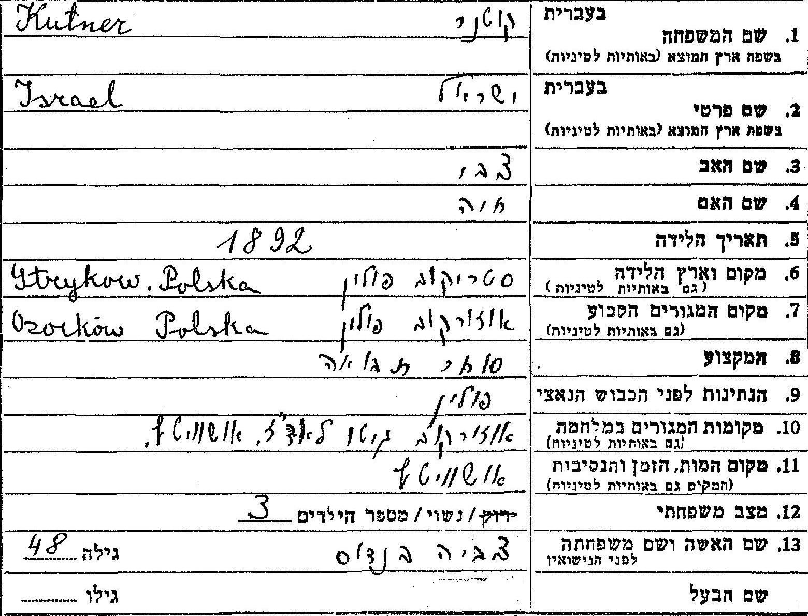
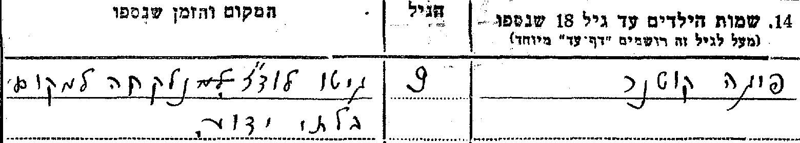
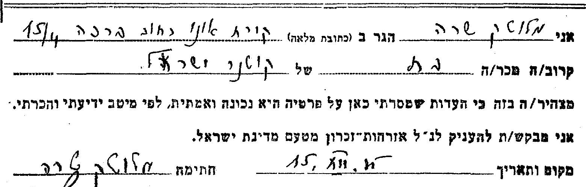
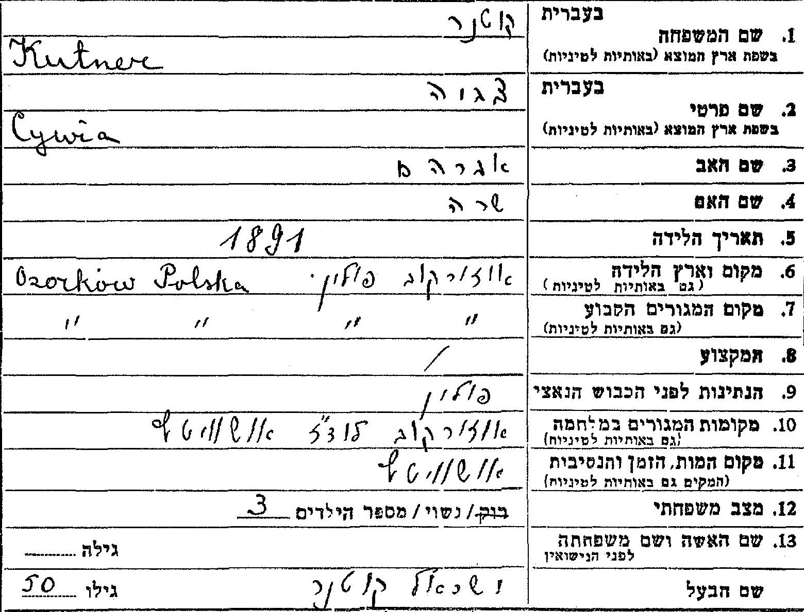
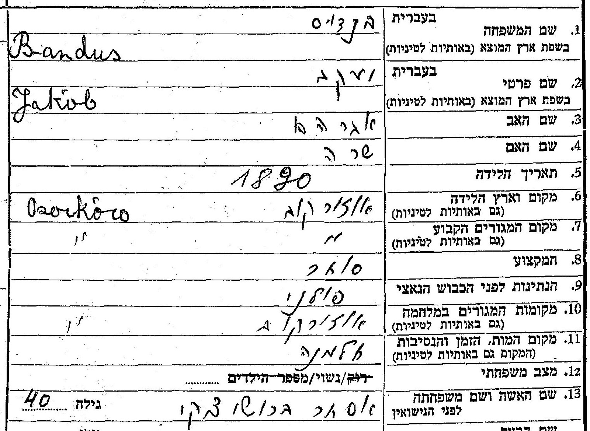
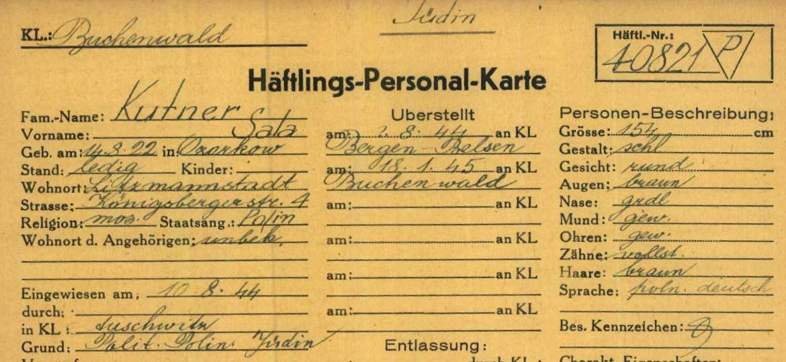
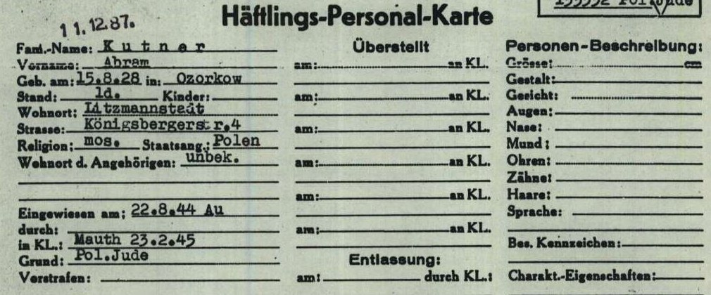
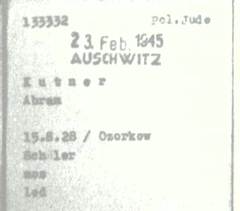
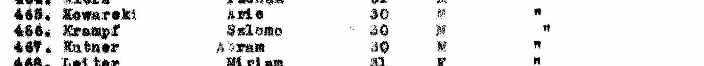

::: lede

**אברהם ("אברמק") קוטנר** — Abram Kutner במסמכי המלחמה — נולד ב-**15 באוגוסט 1928 באוזורקוב** שבפולין, בנם של **ישראל קוטנר**, סוחר תבואה, ו**צביה לבית בנדוס**. הוא עבר את **גטו לודז'** — בסוף הקיץ של 1942 נרשמו הוא, הוריו ושרה באותה דירה, ברחוב קניגסברג 4 — הובא ממנו ל**אושוויץ**, ובפברואר 1945 נרשם במחנה **מאוטהאוזן** כאסיר 133332 — "תלמיד", רווק, "קרובים: לא ידוע". הוריו ואחותו הצעירה **פייגה**, בת תשע, נספו; אחותו הבכורה **שרה** שרדה את אושוויץ, ברגן-בלזן ובוכנוולד, ובשנות החמישים מילאה עליהם דפי עד ביד ושם.

אחרי המלחמה — לפי אתר הזיכרון של הבית — היה מ**ילדי סלווינו**, בית הילדים היהודי בהרי ברגמו שבאיטליה; ב-1947 "Kutner Abram" — ככל הנראה הוא — ברשימת **ילדים יתומים** שהועברו ממחנות המעצר בקפריסין; ובשנת 1952 הוא בפנקס הבוחרים של **קיבוץ צאלים**, ובשורה שאחריו **צפורה קוטנר**, אשתו ([המחקר עליה](../index.html#research-tzipora-kutner)). לפי "רשימה קצרה" באותו אתר, היה המזכיר הראשון של צאלים ועבד בכור הגרעיני בדימונה. נפטר ב-19 במרץ 1986 (ח' באדר ב' תשמ"ו), ונקבר עם צפורה בבית העלמין הישן של באר שבע, תחת מצבה "לזכר הוריהם ובני משפחתם שנספו בשואה".

כל מסמך שנקרא מופיע פעמיים — קישור אל הרשומה בארכיון וקישור אל עותק שמור; גם ממצא שלילי נרשם ([9.4](#s9-4)).

:::

**מאיפה להתחיל**

- [אוזורקוב — ההורים והאחיות](#s3) — שני דפי העד שמילאה אחותו שרה.
- [המלחמה — לודז', אושוויץ, מאוטהאוזן](#s4) — כרטיס האסיר.
- [סלווינו](#s4-3) — בית הילדים באיטליה.
- [קפריסין וצאלים](#s5) — העלייה, והמסמך הישראלי הראשון.
- [שנת הלידה — שלוש גרסאות](#s6) — 1927, 1928, 1930.
- [הפעולות הפתוחות](#s8) — מה עוד חסר.

---

## 1. תמצית

אברהם קוטנר נולד באוזורקוב, עיירה כ-25 ק"מ צפונית-מערבית ללודז', ב-15.8.1928 — כך בכרטיס האסיר שלו ממאוטהאוזן.[[1]] הוריו — **ישראל קוטנר** (נולד 1892 בסטריקוב, בן צבי וחיה, סוחר תבואה) ו**צביה (Cywia) לבית בנדוס** (ילידת אוזורקוב, בת אברהם ושרה) — ידועים משני דפי עד שמילאה בתם **שרה מלוטק** בשנות החמישים;[[2]][[3]] שניהם נספו, לפי דפי העד, באושוויץ. בדפים — "נשוי, 3 ילדים"; בשמה מופיעה רק **פייגה**, שנלקחה בת תשע מגטו לודז' "למקום בלתי ידוע";[[2]] שרה היא הממלאת ("בת"); שאברהם הוא הילד השלישי — **כמעט ודאי** ([4.1](#s4-1), [4.2](#s4-2)).

אברהם, הוריו ואחותו שרה רשומים באותה דירה בגטו לודז' — Königsberger Straße 4, דירה 35: ההורים ושרה "מאוזורקוב" מ-26.8.1942, ואברהם, שהיה בגטו כבר קודם בכתובות אחרות, מ-15.9.1942, "שוליה של חייט";[[4]][[14]] אותה כתובת נושאים כרטיס האסיר שלו וכרטיס האסירה של שרה. הכרטיס רושם "הוכנס 22.8.44 Au" — אושוויץ — ו"מאוטהאוזן 23.2.45", אסיר **133332**, "יהודי פולני", מקצוע "תלמיד".[[1]] אחרי המלחמה — בבית הילדים של **סלווינו** באיטליה: "Kutner Avraham (Abram)", 1930, ברשימת ילדי סלווינו של אתר הזיכרון לבית, ובאותו אתר, ב"רשימה קצרה" של עיסוקי הילדים בבגרותם, שלפי האתר מבוססת על ספרו של אהרן מגד: אברהם גורש לאושוויץ ועבר "צעדת מוות" עד זקסנהאוזן ([4.3](#s4-3)).[[8]] מסמך בן-זמנו על 1945–1947 — לא נמצא.

ב-1947 "Kutner Abram" — יליד 1930 לפי הרשימה, וככל הנראה הוא — נמנה, לפי תיאור המאגר, עם "המכסה השנייה של ילדים יתומים" שהועברו ממחנות המעצר בקפריסין, ובעמודה שאחרי שמו — האונייה "Ch. Arlozorof".[[5]] בשנת 1952 **אברהם קוטנר, יליד 1930**, בפנקס הבוחרים של קיבוץ צאלים, ובשורה שאחריו **צפורה קוטנר, ילידת 1932**.[[6]] באותו עמוד של רשימת קפריסין, בשורה 452 — "Balem Cypora", ילידת 1931, באותה אונייה ([5.1](#s5-1)).

## 2. מה ידוע מהמשפחה

נקודת המוצא היא עץ המשפחה שהמשפחה בנתה ב-MyHeritage — זיכרון משפחתי שנרשם, לא רשומה:[[7]]

- אברהם קוטנר, "סביבות 15 באוגוסט 1928", אוזורקוב, פולין. בפי המשפחה — **אברמק**.
- נפטר בין 18 ל-19 במרץ 1986; נקבר בבית הקברות הראשון (הישן) של באר שבע.
- הוריו: ישראל קוטנר וצביה (שם המשפחה שלה בעץ — בנדוס); סבו וסבתו מצד האב — הרש וחיה; מצד האם — אברהם ושרה בנדוס.
- אחיותיו: **שרה** (14.8.1923 – 29.8.2009), נשואה ל**מרדכי מלוטק** (1919–2010); ו**פלה/פייגה**, "נספתה בשואה".
- דודים: רבקה, פייגה ופישל קוטנר; יעקב (נ' 1890) ושימק בנדוס.
- נשוי לצפורה לבית בלם (1932–2006); שני ילדיהם נולדו בצאלים ב-1957 וב-1959 (חיים — פרטיהם אינם מתפרסמים, [9.6](#s9-6)).

כל אחד מהפריטים האלה נבדק מול הרשומות שלהלן; מה שאושר — מסומן, ומה שלא — נשאר **טעון אימות**.

ומפי בתו (20.10.2026):[[16]] אביה לא סיפר על עברו ולא דיבר עליו; הוא נפטר ב-19 במרץ 1986; הוא וצפורה נישאו ברבנות בבאר שבע — באו מקיבוץ צאלים, וחזרו לקיבוץ באותו ערב. שם המשפחה באנגלית — **Kutner**. זו עדות משפחתית — **מאומת** כעדותה; תאריך הנישואין — לא ידוע.

## 3. אוזורקוב — ההורים והאחיות

### 3.1 דף העד של ישראל קוטנר

שרה מלוטק, "בת", מקריית אונו, מילאה דף עד על אביה.[[2]] התאריך בכתב ידה — «15.XII.» ושנה שאינה קריאה; "תשי"ג 1953" המודפס בטופס הוא שנת חוק יד ושם, לא שנת המילוי. מספרי הדפים (329533, 379532) מתיישבים עם אמצע שנות החמישים או סופן — **ככל הנראה**.

*דף עד מס' 329533, יד ושם: «קוטנר / Kutner · ישראל / Israel · שם האב: צבי · שם האם: חיה · 1892 · סטריקוב, פולין / Strykow, Polska · מקום המגורים הקבוע: אוזורקוב · סוחר תבואה · פולין · אוזורקוב, גיטו לודז', אושוויץ · אושוויץ · נשוי, 3 ילדים · צביה בנדוס, גילה 48». המקור: [דף העד](#src-2).*

| שדה | קריאה | דירוג |
|---|---|---|
| שם האב | צבי | **מאומת** (בדף העד); "הרש" בעץ — אותו שם: הרש/הירש הוא הכינוי היידי של צבי |
| שם האם | חיה | **מאומת** (בדף העד); תואם את העץ |
| הלידה | 1892, **סטריקוב** | **מאומת** (בדף העד) — לא אוזורקוב כבעץ |
| המגורים | אוזורקוב | **מאומת** |
| המקצוע | סוחר תבואה | **מאומת** |
| המקומות במלחמה | אוזורקוב, גטו לודז', אושוויץ | **מאומת** (בדף העד); עדות הבת, לא רשומה |
| האישה | צביה בנדוס, בת 48 | **מאומת** |
| הילדים | שלושה | **מאומת** |

בשדה "ילדים עד גיל 18 שנספו" — ילדה אחת:

*«פייגה קוטנר · 9 · גיטו לודז' — נלקחה למקום בלתי ידוע». המקור: [דף העד](#src-2).*

הדף אינו מציין את סדר הלידה; אבל ילדה שהייתה בת תשע כשנלקחה מהגטו (1940–1944) נולדה בין 1931 ל-1935 — אחרי אברהם, בכל אחת משנות הלידה שלו. **פייגה** היא, אם כן, הצעירה — **כמעט ודאי** — ולא אחות בוגרת. ברקע — ולא כממצא: בספטמבר 1942 גורשו מגטו לודז' הילדים שמתחת לגיל עשר; אם כך נלקחה, גם "אושוויץ" שבמפתח של יד ושם אינו סביר. "פלה/פייגה" שבעץ היא ככל הנראה היא. ברשומה המאונדקסת של יד ושם (8760277) מקום מותה "אושוויץ" — כך במפתח, לא בכתב היד; הדף עצמו אומר "למקום בלתי ידוע". באיזו שנה הייתה בת תשע — הדף אינו אומר.

*«אני מלוטק שרה הגר בקרית אונו … בת של קוטנר ישראל». המקור: [דף העד](#src-2).*

### 3.2 דף העד של צביה קוטנר

*דף עד מס' 379532, יד ושם: «קוטנר / Kutner · צביה / Cywia · שם האב: אברהם · שם האם: שרה · 1891 · אוזורקוב, פולין · אוזורקוב, לודז', אושוויץ · אושוויץ · נשואה, 3 ילדים · שם הבעל: ישראל קוטנר, גילו 50». ממלאת: מלוטק שרה, בת. המקור: [דף העד](#src-3).*

- שמות הוריה של צביה — **אברהם ושרה** — **מאומת** בדף העד, ותואם את "אברהם ושרה בנדוס" שבעץ. שם המשפחה בנדוס/Bandus — מדף העד של ישראל ומרשימת הגטו ([4.1](#s4-1)).
- שנת הלידה: **1891** בדף העד; **10.12.1895** ברשימת הגטו. אבל הגילים שבשני הדפים — צביה "בת 48", ישראל (יליד 1892) "בן 50" — מצביעים על כ-1894–1896, קרוב יותר לרשימת הגטו. אף גרסה אינה מוכרעת — **טעון אימות**.
- "יעקב בנדוס, נ' 1890" שבעץ — דף העד עליו נקרא:[[13]]

*דף עד, יד ושם (720638), «15.II.56»: «בנדוס / Bandus · יעקב / Jakob · שם האב: אברהם · שם האם: שרה · 1890 · אוזורקוב / Ozorkow · סוחר · פולני · אוזורקוב · חלמנו · שם האישה: אסתר לבית ברושצקי, גילה 40». לפי מפתח יד ושם הממלא הוא Mordekhai Mlotek מקריית אונו; בכתב היד השם והקרבה קריאים רק בחלקם. המקור: [דף העד](#src-13).*

  יעקב בנדוס, בן **אברהם ושרה**, יליד אוזורקוב — אותם הורים ואותה עיירה של צביה: אחיה — **כמעט ודאי**. הוא ואשתו אסתר נספו, לפי הדף, בחלמנו. הממלא, מרדכי מלוטק מקריית אונו, הוא ככל הנראה בעלה של שרה — **ככל הנראה**: אותו שם כבעץ, ואותה עיר שבה גרה שרה כשמילאה את דפיה.

### 3.3 שרה מלוטק

בארכיון ארולסן, בתיקים האישיים של אסירות מחנה בוכנוולד — **Sala Kutner**:[[9]]

*Häftlings-Personal-Karte, בוכנוולד: «Kutner · Sala · geb. am 14.8.22 in Ozorkow · ledig · Litzmannstadt, Königsbergerstr. 4 · mos. · Polin · Wohnort d. Angehörigen: unbek. · Eingewiesen am 10.8.44 · in KL Auschwitz · Grund: Polit. Polin Jüdin · überstellt am ?.8.44 an KL Bergen-Belsen · am 18.1.45 an KL Buchenwald · Häftl.-Nr. 40821 · Grösse 154 · Sprache: poln. deutsch». בתרגום: קוטנר סלה, נולדה 14.8.22 באוזורקוב, רווקה, לודז' — רחוב קניגסברג 4; דת משה; פולנייה; מגורי הקרובים — לא ידוע; הוכנסה ב-10.8.44 באושוויץ; סיבה: "פוליטית, פולנייה, יהודייה"; הועברה באוגוסט 1944 לברגן-בלזן, וב-18.1.45 לבוכנוולד; אסירה 40821; גובה 154 ס"מ; שפות: פולנית, גרמנית. המקור: [התיק בארולסן](#src-9).*

- הכרטיס — **מאומת**. שזו שרה, אחותו — **כמעט ודאי**: אותה כתובת בגטו של אברהם ושל הוריהם, עיר הלידה, ויום הלידה **14 באוגוסט** — כבעץ (שם 1923; כאן 1922). Sala הוא הכינוי הפולני של שרה.
- וברשימת תושבי הגטו — «KUTNER, Sala · 14/08/1922 · Origin: Ozorkow · Konigsberger Strasse 4 Flat 35 · 26/08/1942 · Schneiderin» — קוטנר, סלה · 14.8.1922 · מוצא: אוזורקוב · רחוב קניגסברג 4, דירה 35 · 26.8.1942 · תופרת. אותו תאריך לידה בדיוק שבכרטיס בוכנוולד, אותה דירה של הוריה ושל אברהם, "תופרת" ([4.1](#s4-1)).[[14]] הרשומה — **מאומת** כאינדקס; שזו שרה — **כמעט ודאי**.
- היא הגיעה לאושוויץ ב-10.8.1944, אברהם — ב-22.8.1944; משם נפרדו דרכיהם.

ביד ושם רשומה גם **שרה מלוטק (קוטנר)** כמי ש"בחיים אחרי המלחמה", בת ישראל וצביה לבית בנדוס (17547601) — רשומת אינדקס שלא נקראה בסריקה.[[4]] היא ממלאת שני דפי העד, מקריית אונו — **מאומת**. תאריך הפטירה שבעץ (29.8.2009) ובעלה מרדכי מלוטק — **טעון אימות**. ברשימת הגטו של לודז' יש גם "Sura Bajla Kutner", ילידת 15.7.1923, מאוזורקוב, ברחוב פיש 10 (4552609) — לא בדירת המשפחה; אחרי שנמצאה שורתה של Sala, היא ככל הנראה אישה אחרת — לא זוהתה.

## 4. המלחמה — לודז', אושוויץ, מאוטהאוזן

### 4.1 גטו לודז'

רשימות תושבי גטו לודז' מופיעות בשני אינדקסים: במאגר השמות של יד ושם,[[4]] וב-"Lodz Ghetto List" של JewishGen — שם נקראו, ב-20.10.2026, כל 303 השורות של שם המשפחה Kutner וכתיביו.[[14]] בדירה 35 ברחוב קניגסברג 4 — ארבע שורות, ואחריהן — שורה מוקדמת יותר של אברהם:

| שם | לידה | מוצא / כתובת קודמת | כתובת בגטו | תאריך רישום | מקצוע |
|---|---|---|---|---|---|
| Kutner, Izrael | 18.9.1897 | "Origin: Ozorkow" | Königsberger Str. 4, דירה 35 | 26.8.1942 | Arbeiter — פועל |
| Kutner, Cywia, לבית **Bandus** | 10.12.1895 | "Origin: Ozorkow" | Königsberger Str. 4, דירה 35 | 26.8.1942 | Schneiderin — תופרת |
| Kutner, Sala | 14.8.1922 | "Origin: Ozorkow" | Königsberger Str. 4, דירה 35 | 26.8.1942 | Schneiderin — תופרת |
| Kutner, Abram | 15.8.**1927** | לודז' · Fisch Str. 9 | Königsberger Str. 4, דירה 35 | 15.9.1942 | Schneiderlehrl. — שוליה של חייט |
| Kutner, Abraham | 15.8.1927 | לודז' | Hamburger Str. 5, דירה 3 → Fisch Str. 9 | 23.7.1942 "WYM" | Schüler — תלמיד |

- השורות — **מאומת** כאינדקס (הרשימה המודפסת לא נקראה; [פרק 8](#s8)).
- שהם המשפחה — **כמעט ודאי**: אברם — יום הלידה וכתובת הגטו של כרטיס מאוטהאוזן; צביה — שמה ושם נעוריה מדף העד; Sala — תאריך הלידה וכתובת הגטו של כרטיס בוכנוולד ([3.3](#s3-3)); וישראל — באותה דירה, מאותה עיירה, באותו יום עם אשתו ובתו.
- **ישראל** — נמצא בסבב הזה לראשונה. ברשימה הוא יליד 18.9.1897; בדף העד — 1892, "בן 50". הפער אינו מוכרע — **טעון אימות**; אותו פער יש גם לצביה ([3.2](#s3-2)). ברשימה — "פועל", לא סוחר התבואה של דף העד: המקצוע בגטו, לא לפני המלחמה.
- **הסדר בזמן:** שלושת בני המשפחה "מאוזורקוב" נרשמו בדירה ב-26.8.1942. אברהם — שבשתי שורותיו המגורים "לודז'", ולא "מאוזורקוב" — היה בגטו כבר קודם: ברחוב המבורג 5, ומ-23.7.1942 ברחוב פיש 9 ("WYM" — ככל הנראה סימון של יציאה מהכתובת); ב-15.9.1942 הצטרף אל הוריו ואחותו, ו"התלמיד" נרשם עכשיו "שוליה של חייט". מתי ואיך הגיע ללודז' לפני משפחתו — לא ידוע.
- **פייגה** — אינה ברשימה בכתובות המשפחה. אף אחת מחמש השורות של "Fajga Kutner" שבאינדקס אינה מאוזורקוב או בכתובות המשפחה. היחידה בגיל ילדה — ילידת 25.2.1935, Rauch Gasse 21, דירה 36, "AUSG" (הוצאה מהגטו) 15.3.1942 — לא זוהתה; ואברהם מראה שילד יכול היה להיות בגטו לפני שמשפחתו הגיעה. **טעון אימות** ([9.4](#s9-4), N-9).

### 4.2 כרטיס האסיר ממאוטהאוזן

בארכיון ארולסן, בתיקים האישיים של אסירי מאוטהאוזן — תיק בן ארבעה מסמכים על שמו:[[1]]

*Häftlings-Personal-Karte — כרטיס האסיר האישי: «Kutner · Abram · geb. am 15.8.28 in Ozorkow · Stand: ld. · Wohnort: Litzmannstadt · Strasse: Königsbergerstr. 4 · Religion: mos. · Staatsang.: Polen · Wohnort d. Angehörigen: unbek. · Eingewiesen am: 22.8.44 Au · im KL.: Mauth 23.2.45 · Grund: Pol. Jude · 133332». בתרגום: קוטנר אברם, נולד 15.8.28 באוזורקוב; רווק; מקום מגורים: ליצמנשטט (לודז'), רחוב קניגסברג 4; דת: משה; אזרחות: פולנית; מקום מגורי הקרובים: לא ידוע; הוכנס ב-22.8.44 — אושוויץ; במחנה: מאוטהאוזן 23.2.45; סיבה: יהודי פולני. המקור: [התיק בארולסן](#src-1).*

*כרטיס המספר: «133332 · Pol. Jude · 23. Feb. 1945 · AUSCHWITZ · Kutner Abram · 15.8.28 / Ozorkow · Schüler · mos · led». בתרגום: יהודי פולני; 23 בפברואר 1945; [הגיע מ]אושוויץ; תלמיד; דת משה; רווק. המקור: [התיק בארולסן](#src-1).*

| שדה | קריאה | דירוג |
|---|---|---|
| השם | Kutner Abram | **מאומת** |
| הלידה | 15.8.1928, Ozorkow | **מאומת** (בכרטיס) |
| מקום המגורים | Litzmannstadt (לודז'), Königsbergerstr. 4 | **מאומת** — אותה כתובת של הוריו ושל שרה ברשימת הגטו |
| "Eingewiesen am" | 22.8.44 Au | **מאומת** כקריאה; הפירוש — נכנס למערכת המחנות באושוויץ ב-22.8.1944 — **ככל הנראה** |
| מאוטהאוזן | 23.2.1945, אסיר 133332 | **מאומת** |
| מקצוע | Schüler — תלמיד | **מאומת** |
| הקרובים | unbek. — לא ידוע | **מאומת** |
| שהאסיר הוא אברהם שלנו | — | **כמעט ודאי**: שם, יום הלידה, עיר הלידה, וכתובת האם בגטו |

על עטיפת התיק: «KUTNER, Abram · 15.8.1928 · Ozorkow · 133332 · T/D Nr. 360426» — מספר תיק איתור (T/D) בשירות האיתור הבין-לאומי בארולסן. בקטלוג של ארולסן התיק הזה רשום: «KUTNER, ABRAM, born 15.08.1930 or 15.08.1928» — אחד-עשר מסמכים מהשנים 1954–1995, שאינם סרוקים.[[1]] **שתי שנות הלידה של המסמכים — 1928 של המחנה ו-1930 של קפריסין וצאלים — באותו תיק איתור**: מי שפתח אותו חיבר בין אסיר מאוטהאוזן לבין האיש שחי בישראל. זה מחזק את הזיהוי — **כמעט ודאי**. מי ביקש, ומה נשלח לו — רק קריאת התיק תגיד ([פרק 8](#s8)). על הכרטיס האישי חותמת תאריך «11.12.87» — אחרי מותו; ככל הנראה קשורה בטיפול בתיק האיתור — **טעון אימות**. במסמך השלישי (Häftlingskarte) רוב השדות ריקים, וחותמת בעמודת ההעברה אינה קריאה.

מה **אין** בתיק: העברה ממאוטהאוזן למחנה-בת, שחרור, או מוות. ארולסן לא החזיר עליו כרטיס עקורים (DP) או טופס IRO ([9.4](#s9-4)). כיצד שרד את 1945 — **לא ידוע**.

### 4.3 סלווינו

**Sciesopoli** — בית ההבראה בסלווינו, בהרי ברגמו, ששימש מסוף 1945 בית ליתומים יהודים ניצולי השואה — מקיים אתר זיכרון ובו שתי רשימות:[[8]]

- **"רשימת ילדי סלווינו (בעבודה)"** — רשימה מצטברת שהאתר מתקן לפי פניות: «347. Kutner Avraham (Abram) (1930 – PL)». וברשימה, מס' 36: «Balem (Balam) poi Kutner Zipora (1931 – Lubomjl, PL)» — "בלם (בלאם), לימים קוטנר, צפורה".
- **"רשימה קצרה של ילדי סלווינו"** — לפי האתר, מבוססת על ספרו של **אהרן מגד** על בית סלווינו, ומתארת את עיסוקם של הילדים "בשנת 1984 בקירוב". על אברהם קוטנר, בתמצית: גורש לאושוויץ, ועבר את «the "death march" up to Saxenhausen» ("צעדת המוות" עד זקסנהאוזן); מילא תפקיד אחראי בכור הגרעיני בדימונה; נולד ב-15 באוגוסט 1930 ונפטר במרץ 1986 (התאריכים — ככל הנראה תוספת של עורכי האתר: הספר קדם למותו); היה המזכיר הראשון של קיבוץ צאלים, ושם נשא את צפורה בלם, גם היא מילדי סלווינו.

הדירוג: **ככל הנראה** — מקור משני (אתר, המצטט ספר שלא נקרא), שאינו מציין מאין המידע. שזה אברהם שלנו — **כמעט ודאי**: 15 באוגוסט, צאלים, צפורה בלם, ומרץ 1986 — כולם תואמים את העץ ואת המסמכים. מה שהוא מוסיף: **סלווינו**, **דימונה**, **מזכיר צאלים**, ו**זקסנהאוזן**.

::: note
"צעדת מוות עד זקסנהאוזן" וכרטיס האסיר ("מאוטהאוזן 23.2.45, מאושוויץ") אינם בהכרח סותרים — ייתכן שעבר בדרכו יותר ממחנה אחד — אבל אף מסמך שנקרא אינו מראה אותו בזקסנהאוזן. נשאר **טעון אימות**.
:::

## 5. קפריסין וצאלים

### 5.1 רשימת קפריסין, 1947

ב-IGRA, מתוך תיק הארכיון הציוני המרכזי 56/4315 (עמ' 3275), רשימה של עצורי מחנות קפריסין שהועברו לארץ — לפי תיאור המאגר, "המכסה השנייה של ילדים יתומים", 1947:[[5]]

*«467. Kutner · Abram · 30 · M · "» — הסימן " חוזר על הערך שמעליו בעמודה האחרונה: «Ch. Arlozorof». המקור: [רשימת קפריסין](#src-5).*

- העמודה השלישית היא **שנת לידה** (בשורות אחרות "11.29", "10.29") — כלומר "Abram Kutner, יליד 1930" — **כמעט ודאי**. בעמוד אין כותרת, תאריך או שם אונייה בראש: "המכסה השנייה של ילדים יתומים" ו-1947 — מתיאור המאגר ב-IGRA.
- העמודה האחרונה מחליפה ערכים לאורך העמוד: "Mordey Hagetaoth", "Ch. Arlozorof", "Hamaapil Haalmoni" — שמות אוניות מעפילים. "Ch. Arlozorof" היא ככל הנראה אוניית המעפילים **"חיים ארלוזורוב"** — **ככל הנראה** (הכותרת של הרשימה אינה בעמוד). לפי אתר תיעוד ההעפלה של משפחת ורטהיימר, המסתמך על ספרו של פול סילברסטון על אוניות המעפילים, האונייה העלתה מעפילים בטרלבורג שבשוודיה ובמטפונטו שבאיטליה, נתפסה ב-27.2.1947, עלתה על שרטון מול בת גלים בחיפה ב-28.2.1947, ומעפיליה הועברו לקפריסין.[[10]] איפה עלה אליה אברהם — לא ידוע; ילדי סלווינו, שבאיטליה, עלו, ככל הנראה, במטפונטו — **טעון אימות**.
- מתי יצאה "המכסה השנייה של ילדים יתומים" מקפריסין — לא נמצא; **טעון אימות**.
- לצפורה, הזיהוי באותה רשימה **כמעט ודאי** — שם משפחה נדיר, ושנת הלידה כמו בכרטיס שלה מאיטליה; לאברהם — **ככל הנראה** בלבד: שמו נפוץ יותר, ואין עליו מסמך בן-זמנו מאיטליה.
- שזה אברהם — **ככל הנראה**: שם ושם משפחה, ושנת לידה מוקטנת בשנתיים — ראו [פרק 6](#s6). החיזוק: אותה שנה, 1930, בפנקס צאלים ([5.2](#s5-2)).

באותו עמוד, **שורה 452: "Balem · Cypora · 31 · F"** — באותה עמודת אונייה. צפורה בלם, אשתו לעתיד, ילידת 1932 לפי העץ ולפי פנקס צאלים; האם היא "Cypora Balem" זו — נבחן [במחקר עליה](../index.html#research-tzipora-kutner).

*שורות 445–468 באותו עמוד: «452. Balem · Cypora · 31 · F» ו-«467. Kutner · Abram · 30 · M». המקור: [רשימת קפריסין](#src-5).*

### 5.2 פנקס הבוחרים של צאלים, 1952

המועצה האזורית "חבל מעון", הנגב המערבי — "פנקס הבוחרים — קיבוץ צאלים", עמ' 19:[[6]]

*«928 · קוטנר · אברהם · 1930» ו-«929 · קוטנר · צפורה · 1932». עמודת מספרי הזהות מושחרת בסריקה. המקור: [פנקס הבוחרים](#src-6).*

- אברהם קוטנר, יליד 1930, חבר קיבוץ צאלים ב-1952 — **מאומת** (ברשומה); שזה אברהם שלנו — **כמעט ודאי**: אשתו בשמה ובשנת לידתה בשורה הבאה, והמקום — צאלים, שבו נולדו ילדיהם לפי העץ.
- השנה (1952) וסוג הבחירות — מתיאור המאגר ב-IGRA; אינם כתובים בעמוד.
- צפורה כבר נושאת את השם **קוטנר** ב-1952 — כלומר נישאו (או נרשמו כזוג) לפני כן — **ככל הנראה**. לפי בתם, נישאו ברבנות בבאר שבע ([פרק 2](#s2)); המועד — לא נמצא.

### 5.3 הקבורה, באר שבע

בבית העלמין הישן של באר שבע — מצבה משותפת לאברהם ולצפורה, שצילם מתנדב של BillionGraves ותעתק.[[12]] אותם שני קברים, באותם תאריכים עבריים ובאותם גילים, רשומים גם במרשם הקבורה של JewishGen (JOWBR) — "Be'er Sheva Old Cemetery".[[15]] בתעתיק:

| שדה | אברהם | צפורה |
|---|---|---|
| נפטר/ה | 19.3.1986 · ח' באדר ב' תשמ"ו | 28.1.2006 · כ"ח בטבת תשס"ו |
| גיל | 57 | 73 |
| ההורים | ישראל וציביה | מנדל בלם וזלדה-סוניה |

ובמצבה, הקדשה: «לזכר הוריהם ובני משפחתם שנספו בשואה».

- התעתיק — **כמעט ודאי**: תעתיק של מתנדב, והתצלום המלא אינו פתוח לעיון חינם. שזו מצבתם — **כמעט ודאי**: שני השמות, ארבעת ההורים בשמותיהם מדפי העד, באר שבע; את התצלום עצמו לא ראינו. ששתי הרשומות הן מצבה אחת משותפת — **כמעט ודאי**: אותם ארבעה הורים, אותה הקדשה, אותן רשומות סמוכות.
- תאריך הפטירה: ח' באדר ב' תשמ"ו התחיל בערב 18.3.1986 ונמשך עד ערב 19.3. בתו מוסרת: **19 במרץ 1986** ([פרק 2](#s2)) — ששעות היום שלו חלו בח' באדר ב'. התאריך — **כמעט ודאי**: עדות המשפחה ותאריך המצבה מתיישבים; ה-19.3 שבתעתיק וב-JOWBR הוא המרה של המתעתקים, לא מקור נוסף.
- הגיל, 57 במרץ 1986, מתאים ללידה ב-**1928** — **ככל הנראה** (גיל על מצבה הוא מה שהמשפחה מסרה) ([פרק 6](#s6)).

## 6. שנת הלידה — שלוש גרסאות

| המקור | שנה | יום וחודש |
|---|---|---|
| רשימת תושבי גטו לודז' ([4.1](#s4-1)) | 1927 | 15.8 |
| כרטיס האסיר, מאוטהאוזן 1945 ([4.2](#s4-2)) | **1928** | 15.8 |
| עץ המשפחה ([פרק 2](#s2)) | 1928 ("סביבות") | 15.8 |
| רשימת קפריסין 1947 ([5.1](#s5-1)) | 1930 | — |
| פנקס צאלים 1952 ([5.2](#s5-2)) | 1930 | — |
| רשימות סלווינו באתר הזיכרון ([4.3](#s4-3)) | 1930 | 15.8 (עורכי האתר) |
| המצבה, באר שבע 1986 ([5.3](#s5-3)) | בן 57 ← **1928** | — |

יום הלידה, **15 באוגוסט**, עקבי בכל מקום שבו הוא נרשם. השנה זזה: **1927** בגטו — שם נער מבוגר יותר נחשב כשיר לעבודה; **1928** בכרטיס המחנה ובזיכרון המשפחה; **1930** מקפריסין והלאה — שם "מכסת ילדים יתומים" הייתה פתוחה לצעירים. ההסבר הזה — שינוי מכוון של הגיל בכל פעם לכיוון שהיטיב עם הנער — השערה, **טעון אימות**; אינה נשענת על מסמך. המצבה — "בן 57" במרץ 1986 — חוזרת ל-**1928**: ככל הנראה המשפחה ידעה את השנה האמיתית, גם כשהרישום הישראלי נשא 1930. שנת הלידה בתעודת הזהות — לא נבדקה ([פרק 8](#s8)).

## 7. עץ המשפחה

העץ מוצג בתרשים ב[מקטע העץ](#tree). בטקסט:

- **צבי (הרש) וחיה קוטנר** — הוריו של ישראל (דף העד) — **מאומת** בדף העד; לא ידוע עליהם יותר.
- **אברהם ושרה בנדוס** — הוריה של צביה (דף העד) — **מאומת** בדף העד.
- **ישראל קוטנר** — 1892 (דף העד) / 18.9.1897 (רשימת הגטו), סטריקוב; סוחר תבואה באוזורקוב; גטו לודז', קניגסברג 4, מ-26.8.1942; נספה באושוויץ (דף העד).
- **צביה (Cywia) קוטנר לבית בנדוס** — 1891 (דף העד) / 10.12.1895 (רשימת הגטו), אוזורקוב; גטו לודז', קניגסברג 4, מ-26.8.1942; נספתה באושוויץ (דף העד).
  - **שרה (Sala) מלוטק לבית קוטנר** — 14.8.1922 (1923 בעץ), אוזורקוב; גטו לודז', קניגסברג 4, מ-26.8.1942; אושוויץ 10.8.1944, ברגן-בלזן, בוכנוולד 18.1.1945, אסירה 40821; שרדה; קריית אונו (דפי העד). נפטרה 2009, נשואה למרדכי מלוטק — לפי העץ, **טעון אימות**.
  - **אברהם (אברמק) קוטנר** — 15.8.1928 (1927 בגטו, 1930 בישראל), אוזורקוב — 19.3.1986 (ח' באדר ב' תשמ"ו), באר שבע. גטו לודז', קניגסברג 4, מ-15.9.1942; סלווינו; צאלים; דימונה.
  - **פייגה קוטנר** — בת 9, נלקחה מגטו לודז' "למקום בלתי ידוע" (דף העד).
- אשתו: **צפורה לבית בלם** — 1932 (1931 ברשימות שאחרי המלחמה), לובומל — 2006 — [מחקר נפרד](../index.html#research-tzipora-kutner).

## 8. פעולות פתוחות

| # | פעולה | מה זה ישנה | מי |
|---|---|---|---|
| 1 | **שנת הלידה בתעודת הזהות** — פרטי הקבורה ידועים ([5.3](#s5-3)) | 1928 או 1930, כפי שנרשמה בישראל | משפחה |
| 2 | **1945–1947: מאוטהאוזן → סלווינו → קפריסין** | רשימות המשוחררים של מאוטהאוזן; כרטיס הילד בסלווינו (OSE / ג'וינט / IRO איטליה); רישום עליית ב' של "חיים ארלוזורוב" | ארולסן ([3](#s8)) והארכיון הציוני — **נשלחה בקשה, 20.10.2026** |
| 2א | **ספרו של אהרן מגד על ילדי סלווינו** | הקטע על אברהם במקור — ומאין לקח מגד את פרטיו | ספרייה |
| 2ב | **כור דימונה; מזכירות צאלים** | תאריכים; תצלומים; ארכיון הקיבוץ | משפחה / ארכיון צאלים |
| 3 | **תיק T/D 360426 בארולסן** — 11 מסמכים, 1954–1995, לא סרוקים | מי פתח את האיתור ולמה; ייתכן גם כרטיסי עקורים, ויישוב שנת הלידה | ארולסן — **נשלחה בקשה, 20.10.2026** (זמן מענה: עד 13 חודשים) |
| 3ב | **תיק T/D 392622 של שרה (Sala) בארולסן** | איפה ומתי שוחררה, תקופת העקורים והדרך לארץ ([3.3](#s3-3)) | ארולסן — **נשלחה בקשה, 20.10.2026** (זמן מענה: עד 13 חודשים) |
| 3א | **JewishGen — מאגרי הפירוט** | **נקראו, 20.10.2026**: רשימת גטו לודז' — ישראל ושרה בדירת המשפחה ([4.1](#s4-1)); JOWBR — הקבר בבאר שבע ([5.3](#s5-3)); טראונשטיין — אדם אחר (N-10) | — |
| 4 | **תצלומים ומסמכים במשפחה** | תצלום של אברהם; תעודות מצאלים | משפחה |
| 5 | **רשימת הגטו של לודז' — הספר המודפס** | קריאת השורות עצמן — גם של ישראל ושל שרה ([4.1](#s4-1)) | יד ושם — **נשלחה בקשה, 20.10.2026** |
| 6 | **הנישואין לצפורה** | נישאו ברבנות בבאר שבע (לפי בתם); המועד — לא ידוע | רבנות באר שבע / ארכיון צאלים |
| 7 | **יעקב בנדוס (720638)** — אחיה של צביה | **נקרא** ([3.2](#s3-2)) | — |

## 9. שיטה ומגבלות

### 9.1 בסיס הראיות

אתר הזיכרון של בית סלווינו (מקור משני); כרטיסי המחנה ממאוטהאוזן בארכיון ארולסן (מקור ראשוני בן-זמנו, סריקות שנקראו); שני דפי עד שמילאה אחותו בשנות החמישים (מקור ראשוני מאוחר — עדות בכתב יד); רשימת עצורי קפריסין ופנקס בוחרים מ-1952 (מקורות ראשוניים, סריקות IGRA שנקראו); ומאגר השמות של יד ושם ומאגר הגטו של JewishGen (שני אינדקסים של רשימות הגטו, לא נקראו בסריקה); ומה שמסרה בתו (עדות משפחתית). עץ MyHeritage של המשפחה הוא נקודת המוצא בלבד.

### 9.2 סולם הוודאות

**מאומת** — נקרא ישירות מהמסמך; **כמעט ודאי** — מסמכים מתכנסים ללא סתירה; **ככל הנראה** — פרשנות סבירה או זיהוי נסיבתי; **טעון אימות** — לא פוענח או לא נבדק. המסמך מדורג בנפרד מן הזיהוי שנשען עליו: דף עד הוא **מאומת** כעדות, ומה שבו — עדות של בת על אביה.

### 9.3 מוסכמות הכתיב

קוטנר · Kutner · Kotner — אותו שם; במסמכי המלחמה ובקפריסין Kutner, בישראל קוטנר; ובאנגלית, כפי שהמשפחה כותבת אותו — **Kutner**. אברם · Abram · Abraham · אברהם · אברמק. צביה · Cywia · Tzvia. בנדוס · Bandus. אוזורקוב · Ozorków · Ozorkow; לודז' · Litzmannstadt (השם הגרמני בזמן הכיבוש).

### 9.4 ממצאים שליליים

| # | שאלה | מקור וכיסוי | תוצאה | דירוג |
|---|---|---|---|---|
| N-1 | כרטיס עקורים, CM/1 או IRO לאברם קוטנר | ארולסן, 20.10.2026: Kotner / Kottner / Kotnar / Kotnier / Cutner — אפס; Kutner — כל 2,194 הרשומות; וריאנטים Kuttner, Awram, Avram, Abramek | רק תיק מאוטהאוזן (ותיק האיתור T/D 360426, לא סרוק) | **ככל הנראה** — אינדקס שמות בלבד |
| N-2 | אברם קוטנר באושוויץ | מאגר מוזיאון אושוויץ, Kutner Abram / Avraham, Kotner Avraham | אפס — רוב יהודי לודז' שהגיעו באוגוסט 1944 לא נרשמו במספר | אינו שלילה |
| N-3 | ג'וינט — עקורים, הגירה | JDC Names, Kutner (התאמה מדויקת) — 47; Kotner / Kocner / Kutner + Ozorkow — אפס | אין אברם 1928/1930 | **ככל הנראה** |
| N-4 | נישואי ישראל וצביה, לידת אברם | JRI-Poland, אוזורקוב, Kotner/Kutner | אין | **ככל הנראה** — כיסוי האינדקס לשנות ה-20 חלקי |
| N-5 | מודעת אבל, מרץ 1986 | JPress, "קוטנר" | אפס | אינו שלילה — כיסוי 1986 דל |
| N-6 | רשימות העולים, Pinpoint | "Kutner Abram", "קוטנר אברם/אברהם"; שני תיקי "מעפילים — Haim Arlosoroff 1947" (טפסי משטרה) נקראו רק בחלקם — חלק מהעמודים לא נפתחו | רעש OCR בלבד | לא הוכרע — כיסוי חלקי |
| N-7 | דפי עד שמילא אברהם עצמו | יד ושם, ממלא Kutner/Kotner + Avraham/Abraham — 19 דפים | כולם של משפחת קוטנר מוורשה | **ככל הנראה** — לא הוא |
| N-8 | דפי עד של שרה על דודיה רבקה, פייגה ופישל קוטנר | יד ושם, ממלאת Mlotek + Sara / Sura / Mlotek-Kutner | אין — רק דפי ההורים, פייגה, ודף אחד נוסף (737334) שלא זוהה | **ככל הנראה** (לפי המפתח) |
| N-9 | פייגה ברשימת גטו לודז' | JewishGen, Lodz Ghetto List — כל 303 השורות של Kutner (וכתיביו); חמש שורות "Fajga" (ילידות 1884, 1897, 1899, 1924, 1935) | אף אחת אינה מאוזורקוב או בכתובות המשפחה; היחידה בגיל ילדה — ילידת 25.2.1935, Rauch Gasse 21/36, "AUSG" 15.3.1942 — לא זוהתה | **טעון אימות** — ייתכן שנרשמה בשם אחר, שלא נרשמה, או שהיא השורה מ-1935 |
| N-10 | אברם קוטנר במחנה העקורים טראונשטיין | JewishGen, Traunstein Displaced Persons — 9 שורות של Kutner | "Abram Kutner" שם הוא תינוק, יליד 5.8.1946 בשצ'צ'ין, עם יעקב ובלה קוטנר | **נשלל** |
| N-11 | מאגרים נוספים של JewishGen | בית החולים של גטו לודז' (12 שורות), כרך 5 של רשימות הגטו (22), משלוחי לודז' לחלמנו (17) | אין ישראל, צביה, שרה, אברם 1927/28 או פייגה | **ככל הנראה** |
| N-12 | עדות של אברהם או של שרה ביד ושם | קטלוג העדויות: "קוטנר אברהם" — 19 תוצאות, אף אחת אינה שלו; "Mlotek Sara Ozorkow", "מלוטק שרה" — אפס | אין | **ככל הנראה** — חיפוש בקטלוג בלבד |

### 9.5 חסמים

קבורה: הרשומה ב-BillionGraves נמצאה בדפדפן (20.10.2026); התצלום המלא — בתשלום. FamilySearch — אין אסימון גישה; לא נבדק. JewishGen — עמודי הפירוט החזירו בכלי האוטומטי "0 רשומות" גם במאגרים שבהם הסקירה מנתה התאמות — תקלה, לא שלילה; ב-20.10.2026 נקראו בדפדפן, בחשבון מחובר: רשימת הגטו, JOWBR, טראונשטיין, בית החולים, כרך 5 ומשלוחי חלמנו ([4.1](#s4-1), [5.3](#s5-3), N-9 עד N-11); פנקס הניצולים — לא נקרא. כרטיסי "הקו האדום" של ארולסן באינדקס של JewishGen (476 שורות לשם המשפחה) — לא נקראו אחד-אחד.

### 9.6 מה הדף אינו עושה

אינו מפרסם את שמות ילדיו של אברהם או פרטים על צאצאיו החיים. אינו מסתמך על עץ MyHeritage כראיה — רק כנקודת מוצא. אינו משלים את 1945–1947 מתוך ספרות כללית: מה שלא נמצא במסמך, נאמר שלא נמצא.

