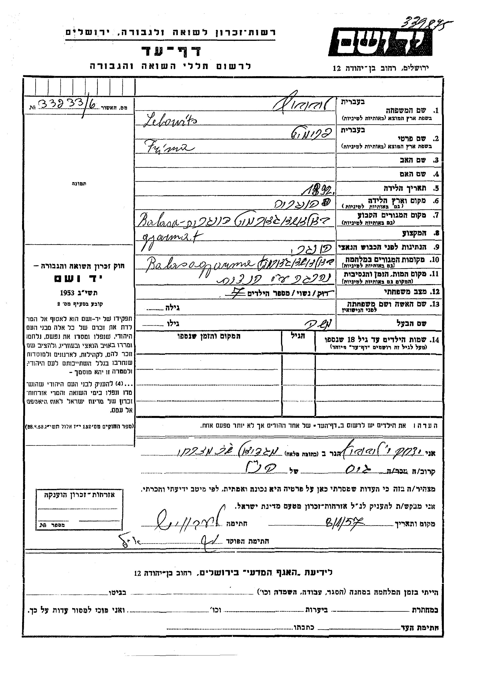

::: lede

**מרים (מגדה) בלומנטל** — **מרים ליבוביץ** מלידה — נישאה ל**יעקב בלומנטל** ב-**27 באוקטובר 1948** ברבנות פתח תקווה. בתעודת הנישואין היא "פועלת" בת 22, גרה בפתח תקווה ברחוב **חובבי ציון 12**, ושמות הוריה — **משה הלוי ליבוביץ** ו**פרימט** — מסומנים כמתים.[[1]] ברשימת בעלי זכות הבחירה לכנסת, תש"ט (1949), באותה כתובת: "ליבוביץ מרים", בת משה, ילידת **1925**.[[2]] לפי המשפחה — באה **מהונגריה**;[[6]] ולפי עץ של ענף אחר במשפחה — "מרים מגדה", ילידת 1925, הונגריה, נפטרה ב-**2003**.[[7]]

בנה **מאיר** נולד בפתח תקווה ב-1952; כדורגלן של הפועל פתח תקווה וחייל בחיל האוויר, "בן מרים ויעקב", צנח ומת באימון ב-1974, בן 22, ו"השאיר אחריו הורים, שני אחים ואחות".[[3]][[4]] על שמו נקראו אחיו **אחימאיר**; אם גם מרים ויעקב שינו את שמם — לא נמצא מסמך.[[6]] מאיזו עיר בהונגריה באה מרים, מתי עלתה ומה עבר עליה — **לא נמצא**. הדף מספר מה שהמסמכים מראים, ומה הם עוד לא מראים.

כל מסמך שנקרא מופיע פעמיים — קישור אל הרשומה בארכיון וקישור אל עותק שמור; גם ממצא שלילי נרשם ([9.4](#s9-4)).

:::

**מאיפה להתחיל**

- [תעודת הנישואין, 1948](#s3) — הוריה, וכתובתה.
- [רשימת הבוחרים, 1949](#s3-3) — שנת הלידה.
- [המועמדות שנשללו](#s4) — "מרים ליבוביץ" אחרות.
- [מאיר, 1952–1974](#s5) — הבן שעל שמו נקראו אחיו.
- [הפעולות הפתוחות](#s8) — מה עוד חסר, ואת מי לשאול.

---

## 1. תמצית

**המסמך הראשון:** תעודת נישואין H 99915, רבנות פתח תקווה, מחוז תל אביב, 27.10.1948 — כ"ד בתשרי תש"ט. הכלה: "מרים ליבוביץ", 22, "פועלת", "ישראלית", "פתח תקוה, חובבי ציון 12"; אביה "משה הלוי ליבוביץ", אמה "פרימט" — שניהם מתים. החתן: "יעקב בלומנטל", 30, "חייל", "אי שם...", בן משה בן ציון וחוה — גם הם מתים.[[1]] — **מאומת**.

**שנת הלידה:** ברשימת בעלי זכות הבחירה לכנסת, תש"ט (1949), פתח תקווה (ארכיון המדינה, גל-45496/2), מסמך 394: "ליבוביץ · מרים · משה · 1925 · חובבי ציון 12".[[2]] הגיל בתעודה (22 ב-27.10.1948) מתיישב עם 1925 או 1926. — **כמעט ודאי** שזו היא: אותו שם, אותו שם אב, אותה כתובת.

**המוצא:** לפי המשפחה — הונגריה; העיר — לא נמסרה.[[6]] בעץ משפחה שמנהל קרוב, "מ. בלומנטל" — "מרים מגדה בלומנטל (לבית ליבוביץ)", "1925 — הונגריה".[[7]] **מגדה** — לפי עץ המשפחה בלבד; אם זה שמה ההונגרי — **טעון אימות**.

**הילדים:** מאיר (11.4.1952 – 21.11.1974), "בן מרים ויעקב";[[3]] ושמשון (26.1.1954), משה ונאוה — מכרטיס ההתאמה ב-MyHeritage.[[5]] מאתר יזכור ומודעות האבל: **מרים ויעקב היו בחיים בנובמבר 1974** ([5.2](#s5-2)).

**הפטירה:** "2003" — לפי עץ המשפחה של "מ. בלומנטל" בלבד; **טעון אימות**.[[7]]

**מה לא נמצא:** עיר הולדתה; הוריה — מי היו ואיפה מתו; דרכה ארצה; תאריך פטירתה ומקום קבורתה ([פרק 8](#s8)).

## 2. מה ידוע מהמשפחה

כרטיס ההתאמה ב-MyHeritage לשמשון ("Achimeir Family Tree"): "הורים: יעקב בלומנטל ו**מרים ליבוביץ'**"; "אחים/אחיות: משה, נאוה ומאיר" — ככל הנראה מתוך רשומה ב-Geni.[[5]] ומפי המשפחה (אוהד צדוק, 26.10.2026): "השם משפחה שלהם הוא בלומנטל, אחימאיר זה על שם האח מאיר שנפטר בגיל צעיר"; ו"**שני ההורים מהונגריה**, אני לא בטוח מאיזו עיר, נוכל לשאול את שמשון".[[6]] — **מאומת** כעדות המשפחה.

צאצאיה: **שמשון אחימאיר** (נ' 26.1.1954), נשוי מ-7.9.1981 ל**אילנה לבית קוטנר** — בתם של אברהם וצפורה קוטנר ([המחקר על אברהם](../index.html#research-avraham-kutner), [המחקר על צפורה](../index.html#research-tzipora-kutner)). ילדיהם: **טל** (14.3.1987, שיקגו), נשואה מ-11.6.2017 ל**אוהד צדוק**; **איל** (23.7.1989, שיקגו); ו**שירי** (4.1.1998).[[5]] בנותיהם של טל ואוהד, **יסמין** ו**יערה** — במחקרים על משפחת קוטנר. — מן העץ המשפחתי; **טעון אימות** מול רשומה.

ומעץ משפחה ב-MyHeritage שמנהל קרוב, "מ. בלומנטל מישראל", שהגיע למשפחה כ"התאמה חכמה":[[7]] "**מרים מגדה בלומנטל (לבית ליבוביץ)** — לידה: 1925 — הונגריה; פטירה: 2003; בעל: יעקב בלומנטל; ילדים: מאיר" ועוד שלושה (פרטיים); חמיה וחמותה — משה בן ציון בלומנטל וחוה (לבית Deutsch); ובין 40 האנשים — גם "יוסף יונגר" ו"פסיה יונגר", "אבא של כלתה" ו"אמא של כלתה" — הורי אשתו של אחד מבניה; כלומר, ככל הנראה, עץ שבנה אחד מצאצאיה של מרים. הוריה של מרים — "פרטי". עץ משתמשים שמקורותיו לא ידועים — **כיוון, לא רשומה**.

## 3. פתח תקווה, 1948–1949

### 3.1 תעודת הנישואין

*תעודת נישואין H 99915, רבנות פתח תקווה, 27.10.1948 — שורת הכלה. המקור: [ערך 1](#src-1).*

| שדה | קריאה | דירוג |
|---|---|---|
| שם הכלה | מרים ליבוביץ | מאומת |
| גיל | 22 — נולדה ב-1925 או ב-1926 | מאומת כרישום |
| משלח יד | "פועלת" | מאומת |
| מקום מגורים | פתח תקווה, חובבי ציון 12 | מאומת |
| אביה | "משה הלוי ליבוביץ" — מת (גרשיים, מתחת ל"מת" שבשורת החתן) | מאומת |
| אמה | "פרימט" — מתה (גרשיים) | מאומת |

### 3.2 מה התעודה אומרת על מרים

שהייתה עובדת בגיל 22, עם כתובת בפתח תקווה; שאביה **לוי** (משה **הלוי**); ושהוריה כבר אינם בחיים. שם המשפחה של אמה, פרימט — אינו בתעודה. כל השאר — היכן נולדה, מתי עלתה — אינו בתעודה.

### 3.3 רשימת הבוחרים, 1949

*רשימת בעלי זכות הבחירה לכנסת, תש"ט (1949), פתח תקווה (ארכיון המדינה, גל-45496/2), מסמך 394. המקור: [ערך 2](#src-2).*

ברשימה מ-1949 — עדיין בשם נעוריה; מדוע — לא ידוע. השורה מוסיפה את **שנת הלידה — 1925**. יעקב אינו באותה רשימה ([המחקר עליו](../index.html#research-yaakov-blumenthal)).

## 4. "מרים ליבוביץ" אחרות — ומועמד אחד

השם נפוץ. כל אחת מן הרשומות האלה נבדקה ונשללה — 11 רשומות, בשמונה שורות:

| מועמדת | מקור | למה נשללה |
|---|---|---|
| כלה בפרדס חנה, 8.5.1947, בת 20 | [IGRA-17903-05-Marriages-1936](https://genealogy.org.il/AID/index.php?recordID=SUdSQS0xNzkwMy0wNS1NYXJyaWFnZXMtMTkzNg==) | הוריה אריה לייב ורוזה |
| כלה בתל אביב, 1.12.1946, בת 19 | [IGRA-17900-Marriages-3377](https://genealogy.org.il/AID/index.php?recordID=SUdSQS0xNzkwMC1NYXJyaWFnZXMtMzM3Nw==) | שמות ההורים אחרים |
| כלה בתל אביב, 1949, בת 50 | [IGRA-17899-Marriages-796](https://genealogy.org.il/AID/index.php?recordID=SUdSQS0xNzg5OS1NYXJyaWFnZXMtNzk2) | הגיל |
| מרים בלומנטל, נתניה ותל אביב, 1949 | [IGRA-1949-National-Elections-9401](https://genealogy.org.il/AID/index.php?recordID=SUdSQS0xOTQ5LU5hdGlvbmFsLUVsZWN0aW9ucy05NDAx), [IGRA-1949-National-Elections-261056](https://genealogy.org.il/AID/index.php?recordID=SUdSQS0xOTQ5LU5hdGlvbmFsLUVsZWN0aW9ucy0yNjEwNTY=) | ילידות 1901 ו-1912 |
| פרימט ליבוביץ, סלטווינה, נ' 1896 | [יד ושם 1649391](https://collections.yadvashem.org/he/names/1649391) | בעלה דוד, והממלא — בנה אנשל |
| פרימט קרמר לבית ליבוביץ, שיליצה, נ' 1907 | [יד ושם 970411](https://collections.yadvashem.org/he/names/970411) | נשואה לקרמר — ילדיה נשאו את השם קרמר |
| פרומה ליבוביץ; פרימט לייבוביץ, חוסט | [יד ושם 8790607](https://collections.yadvashem.org/he/names/8790607), [יד ושם 8767285](https://collections.yadvashem.org/he/names/8767285) | ילדות |
| Marie Levkovic, Miriam Lewkowicz, ילידות 1926 | ג'וינט, כרטיסי עקורים | שם משפחה אחר; יעדן — ארצות הברית |

ועוד שתי רשומות שלא הוכרעו, במאגר עולי עתלית (1932–1949): "Marajka Lajbowicz" ([IGRA-Atlit-Imigrants-Index-35971](https://genealogy.org.il/AID/index.php?recordID=SUdSQS1BdGxpdC1JbWlncmFudHMtSW5kZXgtMzU5NzE=), מסמך עתלית 33813), ו"Marajka Bercovici", שם נוסף Lajbowicz ([IGRA-Atlit-Imigrants-Index-16632](https://genealogy.org.il/AID/index.php?recordID=SUdSQS1BdGxpdC1JbWlncmFudHMtSW5kZXgtMTY2MzI=), מסמך 36959) — בלי גיל, בלי ארץ מוצא ובלי שמות הורים. **טעון אימות** ([פרק 8](#s8)).

### 4.1 מועמד: משה ופרימט ליבוביץ מבאלאשאג'רמאט

אחרי שהמשפחה מסרה שמרים באה מהונגריה, נסרקו מחדש דפי העד ההונגריים. שני דפים, שמילא ב-1957 **יצחק ליבוביץ**, אחיו של הבעל:[[8]]

- **משה ליבוביץ (Lebowits)**, יליד 1890, הונגריה, סוחר, בן אברהם ופייגה-טויבה, גר בבאלאשאג'רמאט (מחוז נוגראד); אשתו "פרימיט" (יד ושם 800983).
- **פרימה (Frima) ליבוביץ**, ילידת 1892, הונגריה, באלאשאג'רמאט, ובזמן המלחמה — בגטו שם; נשואה למשה; "מספר הילדים: 7" (יד ושם 569649).

*דף עד 569649, מאת יצחק ליבוביץ, 8.1.1957. המקור: [ערך 8](#src-8).*

בעד: הצירוף **משה ופרימט** — כמו בתעודת הנישואין; הונגריה; ובאלאשאג'רמאט — עיר במחוז נוגראד, שבו גם נוגראדברצל; ואם "גיארמת (גטו)" שבדף שמילא יהודה בלומנטל הוא באלאשאג'רמאט, היו בה בזמן המלחמה גם הוריו של יעקב, ככל הנראה. קרבה גאוגרפית — אפשרות להיכרות, לא ראיה לזיהוי. נגד / חסר: בדפים אין "הלוי"; שמות שבעת הילדים אינם רשומים; אין מסמך שמונה בת בשם מרים או מגדה. — **טעון אימות**: מועמד, לא זיהוי.

## 5. פתח תקווה — הילדים

### 5.1 מאיר בלומנטל, 1952–1974

*מאיר בלומנטל — מתוך דף ההנצחה באתר יזכור. המקור: [ערך 3](#src-3).*

מאיר בלומנטל, חיל האוויר, "בן יעקב ומרים", נולד ב-11.4.1952 בפתח תקווה; למד בבית הספר היסודי "השומר" בבני ברק, ובבתי ספר מקצועיים בתל אביב ובפתח תקווה; כדורגלן בקבוצות הנערים והנוער של הפועל פתח תקווה ובנבחרת גוש דן; נהג רכב כבד בחיל האוויר, בצבא הקבע בדרגת סמל; לחם במלחמת יום הכיפורים בסיני וברמת הגולן. ב-21.11.1974 צנח באימון קבוצתו ומת — לפי "מעריב", "הועבר לבית החולים 'בילינסון' — שם נקבע מותו"; לפי "על המשמר", מת במגרש, "בטרם חשו אליו"; נקבר בבית העלמין הצבאי בקריית שאול; "אחרי מותו הועלה לדרגת סמ"ר". "השאיר אחריו הורים, שני אחים ואחות".[[3]][[4]] — הדף **מאומת**; שזהו בנה של מרים — **כמעט ודאי** (שמות ההורים, העיר, שנת הלידה ומספר האחים מתיישבים).

### 5.2 הבית, 1974–1977

לפי מודעות האבל והאזכרה ב"מעריב":[[4]] ב-24.11.1974 — מודעת תנחומים אל "יעקב בלומנטל" על מות "יקירכם, מאיר" (בחתימת "משפחות בייזר-גרובר"), ומודעה "למשפחת בלומנטל" מ"דיירי הבית, **רחוב יהוד 2**, פתח תקוה"; ב-1975 — "אוטובוס יצא מביתנו ברח' **רוטשילד 160א'**, פתח תקוה"; ומודעות אזכרה ב-1975–1977, חתומות "המשפחה". ובגביע לזכרו של מאיר — ב-28.9.1975 הגיש אותו "אביו של מאיר בלומנטל ז"ל", וב-1980 — "בני משפחתו" ([המחקר על יעקב](../index.html#research-yaakov-blumenthal)).

### 5.3 שמשון, משה ונאוה

**שמשון** — 26.1.1954; **משה** ו**נאוה** — מכרטיס ההתאמה בלבד.[[5]] "שני אחים ואחות" — ביזכור.[[3]]

## 6. השם אחימאיר

"אחי-מאיר" — "אחיו של מאיר". לפי המשפחה: "השם משפחה שלהם הוא בלומנטל, אחימאיר זה על שם האח מאיר".[[6]] השם — של האחים; אם גם מרים ויעקב שינו את שמם, ומתי — לא נמצא מסמך; מודעות האזכרה 1975–1977 חתומות "המשפחה", ואינן מלמדות על מועד השינוי.[[4]] ההודעה הרשמית — לא נמצאה ([המחקר על יעקב, פרק 6](../index.html#research-yaakov-blumenthal)).

## 7. עץ המשפחה

הוריה של מרים — מתעודת הנישואין בלבד; ילדיה — מכרטיס ההתאמה ומאתר יזכור. ראו את [העץ](#tree).

## 8. פעולות פתוחות

| # | פעולה | למה | איפה |
|---|---|---|---|
| 1 | **לשאול את שמשון**: מאיזו עיר בהונגריה באה אמו? מתי עלתה ואיך? מה שם המשפחה של אמה, פרימט? מתי נפטרה (2003?) ואיפה נקברה? | עיר הולדתה ודרכה ארצה — לא נמצאו בשום מאגר | המשפחה |
| 2 | תיק עולה / תעודת זהות של מרים ליבוביץ (1925) | ארץ ומקום לידה, תאריך עלייה | ארכיון המדינה (משרד הפנים) |
| 3 | מסמכי עתלית 33813 ו-36959 | האם "Marajka Lajbowicz" שם היא מרים — Marajka, צורה הונגרית של מריה | ארכיון "מחנה המעפילים עתלית" |
| 4 | ילדיהם של משה ופרימט ליבוביץ מבאלאשאג'רמאט, וצאצאי יצחק ליבוביץ שמילא את דפיהם | האם מרים (מגדה), ילידת 1925, היא אחת משבעת הילדים ([4.1](#s4-1)) | המשפחה; יד ושם; מרשם הלידות של באלאשאג'רמאט |
| 5 | שכני חובבי ציון 12 ברשימת 1949 | מי גר איתה — קרובים? | רשימת הבוחרים, אותו עמוד |
| 6 | פטירה וקבורה תחת **בלומנטל**, 2003 | אימות שנת הפטירה שבעץ | בתי העלמין בפתח תקווה; BillionGraves |
| 7 | מנהל העץ "מ. בלומנטל מישראל" ב-MyHeritage | הוריה של מרים מסומנים שם "פרטי" — אולי ידועים לו | MyHeritage — פנייה דרך האתר |

## 9. שיטה ומגבלות

### 9.1 בסיס הראיות

שני מסמכים ראשוניים על מרים עצמה — תעודת הנישואין ורשימת הבוחרים;[[1]][[2]] על בנה מאיר — דף ההנצחה הממלכתי ועיתונות בת-זמנה;[[3]][[4]] והמוצא ההונגרי — מפי המשפחה.[[6]] לא נמצאו: רשומת עלייה, תעודת לידה, רשומת פטירה או קבורה.

### 9.2 סולם הוודאות

**מאומת** — המסמך אומר זאת במפורש; **כמעט ודאי** — כמה מסמכים מתיישבים ואין סתירה; **ככל הנראה** — ההתאמה טובה אבל חסר מסמך מקשר; **טעון אימות** — רמז בלבד; **נשלל** — נבדק ואינו היא.

### 9.3 מוסכמות הכתיב

מגדה · Magda. ליבוביץ · לייבוביץ · Leibovitz · Leibowitz · Lejbowicz · Lajbowicz · Leibovici · Lebovits · Lebovics. פרימט · פרומעט · Frimet · Frymeta · Fruma. מרים · Miriam · Mirjam · Mária · Marajka · Marika. בלומנטל · Blumenthal. אחימאיר · אחי-מאיר · Achimeir.

### 9.4 ממצאים שליליים

| # | שאלה | מקור וכיסוי | תוצאה | דירוג |
|---|---|---|---|---|
| N-1 | מרים בעלייה — רשימות ומחנות | IGRA: ליבוביץ (63), לייבוביץ (17), ליבוביטש / לייבוביטש (0), Leibovitz (77 — 40 נקראו), Lajbowicz + Miriam (77 — 40 נקראו); ג'וינט — 22 אנשים בכל הכתיבים; ארולסן — 23 שורות; Pinpoint — "ליבוביץ מרים" | אין אישה ילידת 1925/26 עם אב משה | **ככל הנראה** — כיסוי חלקי |
| N-2 | דפי עד על הוריה | יד ושם: פרימט / Frimet / Frime + ליבוביץ וכתיביו; משה ליבוביץ — 529 רשומות, 80 נקראו; ואחר כך — דפי עד הונגריים בשם Lebowits / Lebovits | זוג אחד בלבד: משה ו"פרימיט" (פרימה) ליבוביץ מבאלאשאג'רמאט — מועמד ([4.1](#s4-1)); אין דף שמילאה מרים | **טעון אימות** — בלי עיר, אין הכרעה |
| N-3 | דף עד שמילאה מרים | יד ושם, ממלאת אחימאיר / Achimeir / Ahimeir / בלומנטל + מרים | אין | **ככל הנראה** — לא מילאה |
| N-4 | פטירה וקבורה | JPress, מודעות מדצמבר 1974: "מרים בלומנטל" — אחת, של אחרת (אלמנת מאיר בלומנטל, ירושלים, 1977); "מרים אחימאיר" — אפס; JOWBR: Achimeir / Ahimeir — אפס | לא נמצאו | אינו שלילה — JOWBR ובתי העלמין לא נבדקו בשם בלומנטל |
| N-5 | מרים בלומנטל, 1949–1963 | IGRA: בוחרים 1949 (נתניה 1901, תל אביב 1912), מורות 1951–1955, ספר הטלפונים 1963 (חיפה) | אף אחת אינה היא | **נשלל** |

### 9.5 חסמים

הספרייה הלאומית (JPress) — תמונות העמודים חסומות באתגר Cloudflare; לא נעקף. מאגר עתלית ב-IGRA — מסנן המאגר החזיר אפס אף שבתצוגה יש רשומות; החיפוש נעשה לפי שם בלבד.

### 9.6 מה הדף אינו עושה

אינו מניח שמרים הייתה ניצולת שואה — הוריה מתו לפני 1948, אבל מתי ואיפה — לא ידוע; ייתכן שעלתה לפני המלחמה. אינו קובע שמרים שינתה את שמה לאחימאיר. אינו מסתמך על עץ MyHeritage כראיה. לבקשת המשפחה, הדף כולל גם את בני המשפחה החיים.

