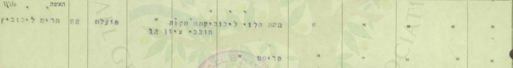
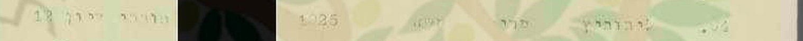
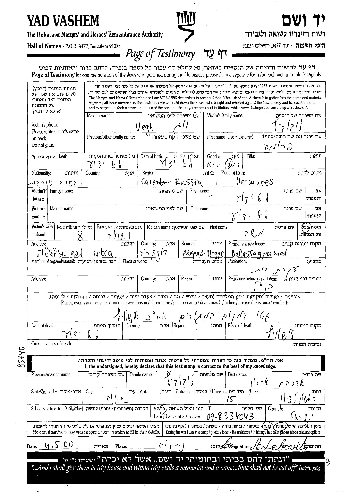
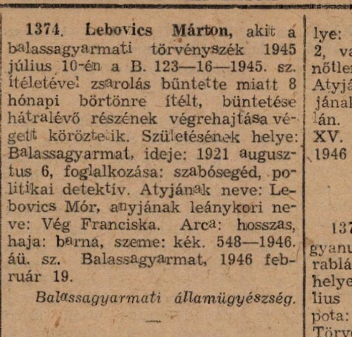
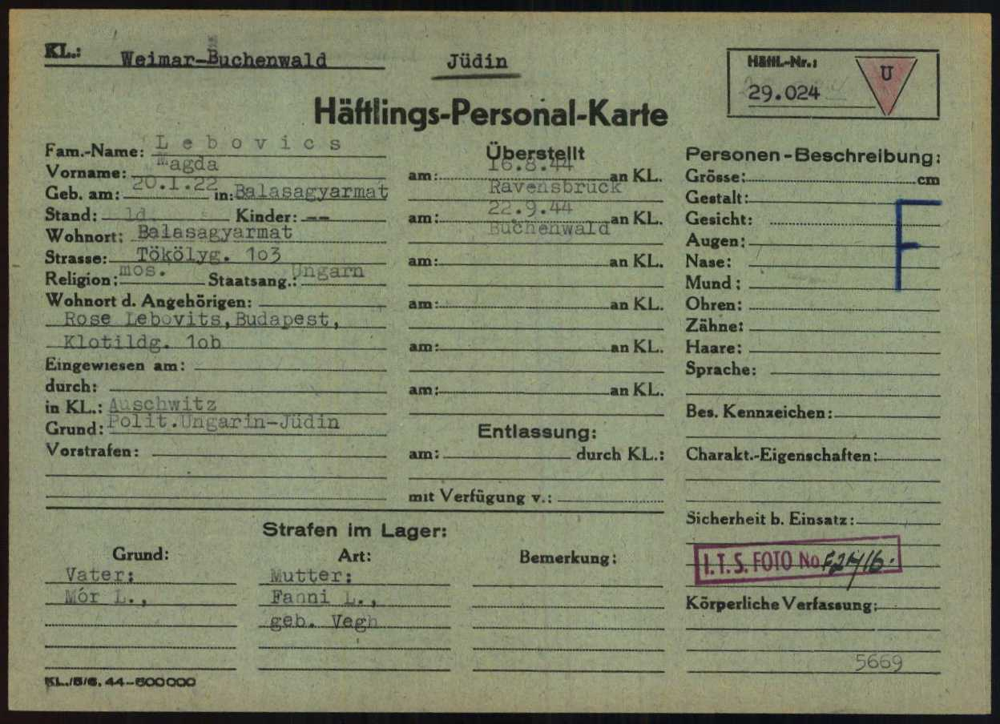
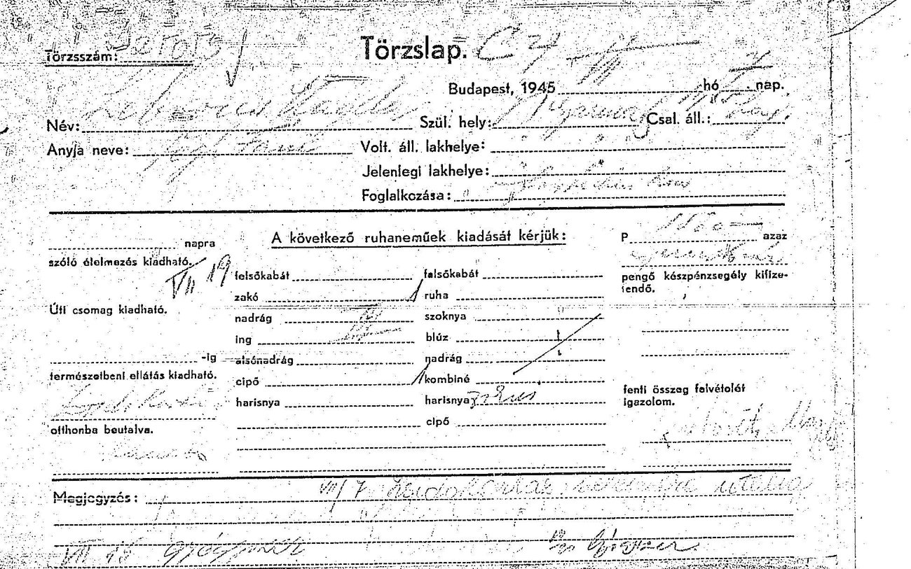
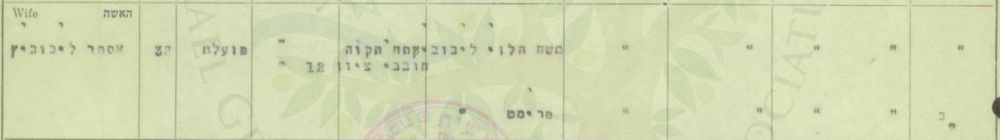
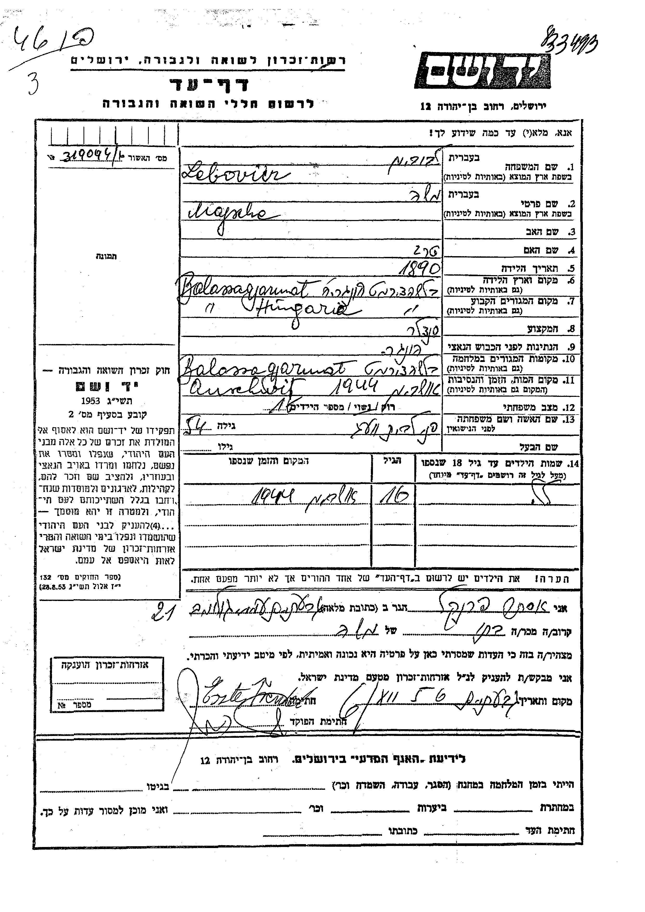
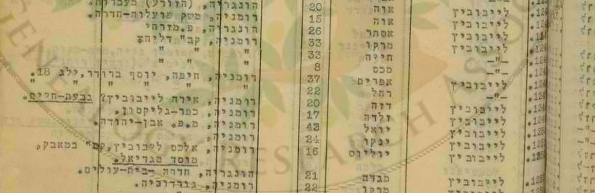
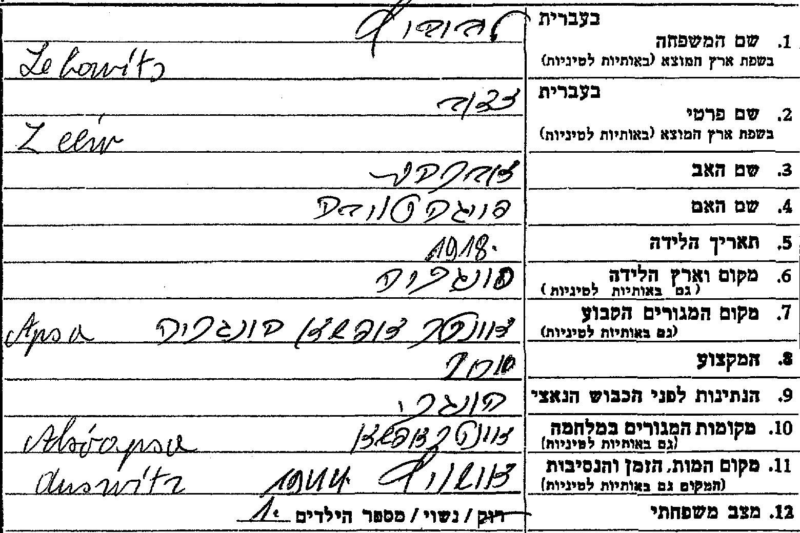

::: lede

**מרים בלומנטל** — **מרים ליבוביץ** מלידה, "מגדה" לפי עץ המשפחה[[7]] — נישאה ל**יעקב בלומנטל** ב-**27 באוקטובר 1948** ברבנות פתח תקווה: "פועלת" בת 22, מרחוב **חובבי ציון 12**, בת **משה הלוי ליבוביץ** ו**פרימט** — שניהם מתים.[[1]] ברשימת הבוחרים של 1949 — ילידת **1925**;[[2]] ולפי המשפחה — באה **מהונגריה**.[[6]]

יום קודם נישאה באותה רבנות **אסתר ליבוביץ**, בת 32 — מאותה כתובת, ושמות הוריה זהים: אחותה, **כמעט ודאי**.[[15]] וכ"אסתר פרנקל" מילאה אסתר ב-1956 וב-1999 דפי עד על אביה **משה**, סנדלר ב**באלאשאג'רמאט** שבהונגריה, על אמה **פני**, על אחיה **שמשון** ו**שאנדור** ועל אחותה **לילה** — שנספו ב-1944;[[16]] ואחיהם **דוד** מילא דפים ב-1957, בכפר סבא.[[18]] מכאן: הוריה של מרים הם, **כמעט ודאי**, משה ופרומה (פני) ליבוביץ מבאלאשאג'רמאט ([4.3](#s4-3)). אסתר הגיעה, ככל הנראה, באניית המעפילים **"הגנה"**, ביולי 1946 — ובאותה רשימה גם "מגדה ליבוביץ", 21, מהונגריה.[[20]] ואם מרים היא בתם מגדה, שעברה ב-1944 את אושוויץ ורוונסבריק ושרדה, ככל הנראה — **טעון אימות** ([4.2](#s4-2), [4.4](#s4-4)).

בנה **מאיר** נולד בפתח תקווה ב-1952; חייל בחיל האוויר, מת באימון ב-1974, בן 22,[[3]][[4]] ועל שמו נקראו אחיו **אחימאיר**.[[6]]

כל מסמך שנקרא מופיע פעמיים — קישור אל הרשומה בארכיון וקישור אל עותק שמור; גם ממצא שלילי נרשם ([9.4](#s9-4)).

:::

**מאיפה להתחיל**

- [תעודת הנישואין, 1948](#s3) — הוריה, וכתובתה.
- [רשימת הבוחרים, 1949](#s3-3) — שנת הלידה.
- [אסתר, האחות](#s4-3) — שתי תעודות נישואין, ודפי העד שמילאה.
- [האנייה "הגנה", 1946](#s4-4) — אסתר, ו"מגדה" בת 21.
- [המועמדות שנשללו](#s4) — "מרים ליבוביץ" אחרות.
- [מאיר, 1952–1974](#s5) — הבן שעל שמו נקראו אחיו.
- [הפעולות הפתוחות](#s8) — מה עוד חסר, ואת מי לשאול.

---

## 1. תמצית

**המסמך הראשון:** תעודת נישואין H 99915, רבנות פתח תקווה, מחוז תל אביב, 27.10.1948 — כ"ד בתשרי תש"ט. הכלה: "מרים ליבוביץ", 22, "פועלת", "ישראלית", "פתח תקוה, חובבי ציון 12"; אביה "משה הלוי ליבוביץ", אמה "פרימט" — שניהם מתים. החתן: "יעקב בלומנטל", 30, "חייל", "אי שם...", בן משה בן ציון וחוה — גם הם מתים.[[1]] — **מאומת**.

**שנת הלידה:** ברשימת בעלי זכות הבחירה לכנסת, תש"ט (1949), פתח תקווה (ארכיון המדינה, גל-45496/2), מסמך 394: "ליבוביץ · מרים · משה · 1925 · חובבי ציון 12".[[2]] הגיל בתעודה (22 ב-27.10.1948) מתיישב עם 1925 או 1926. — **כמעט ודאי** שזו היא: אותו שם, אותו שם אב, אותה כתובת.

**המוצא:** לפי המשפחה — הונגריה; העיר — לא נמסרה.[[6]] מן המסמכים — **באלאשאג'רמאט**: **אסתר ליבוביץ** נישאה ב-26.10.1948, יום לפני מרים, באותה רבנות, מאותה כתובת, ושמות הוריה — "משה הלוי ליבוביץ" ו"פרימט" — זהים: אחותה, **כמעט ודאי** ([4.3](#s4-3)).[[15]] וכ"אסתר פרנקל" — ובדפים מ-1999 גם בשם נעוריה, "לייבוביץ" — מילאה אסתר ב-1956 וב-1999 דפי עד על אביה, **משה ליבוביץ**, יליד 1890, סנדלר; על אמה, **פני לבית וג**, ילידת בודפשט; על אחיה **שמשון** (1914) ו**שאנדור** (כ-1924); ועל אחותה **לילה** (כ-1927) — כולם מבאלאשאג'רמאט, וכולם נספו ב-1944.[[16]] וגם **דוד**, אחיהם, מילא ב-1957 בכפר סבא דפי עד: על שמשון — לפי דוד, יליד **דולני אפשה** (Dolní Apša, נפת רחוב), שמת מטיפוס בשופרון — ועל לילה, "פייגה טובה", ילידת 1930, שמתה מטיפוס בברגן-בלזן.[[18]] הזוג הזה — משה ופרומה (פרימט, פני) ליבוביץ לבית וג, מרחוב טקלי — מתועד גם בדפי עד של יצחק, אחיו של משה (1957), ושל אברהם אהרן ליבוביץ (2000), ובספר ארכיון מחוז נוגראד; ובכרוז של המשטרה ההונגרית מ-1946 — בנם **מרטון**, יליד באלאשאג'רמאט, 6.8.1921, "Atyjának neve: Lebovics Mór, anyjának leánykori neve: Vég Franciska" ("שם אביו: מור לבוביץ'; שם הנעורים של אמו: פרנציסקה וג") — "מנו" של רשימות נספי פלוגות העבודה, ששרד ([4.1](#s4-1)).[[21]] שהם הוריה של מרים — **כמעט ודאי**. בעץ משפחה שמנהל קרוב, "מ. בלומנטל" — "מרים מגדה בלומנטל (לבית ליבוביץ)", "1925 — הונגריה";[[7]] ולזוג הייתה בת בשם מגדה — "20.1.1922" בכרטיסי המחנות, תאריך שככל הנראה שגוי, משום שמרטון נולד ב-6.8.1921 — שעברה ב-1944 את אושוויץ, רוונסבריק ואלטנבורג, וביולי 1945 — ככל הנראה — נרשמה בבודפשט כניצולה ([4.2](#s4-2)).[[19]] שמרים היא מגדה הזאת — **אפשר ש… (טעון אימות)**: השם "מגדה" — מעץ המשפחה בלבד; אבל שנת הלידה שבכרטיסי המחנות, שנראתה סותרת (1922 מול 1925/26), אינה עוד ראיה נגד. וברשימת מעפילי האנייה "הגנה", יולי 1946 — "לייבוביץ אסתר", 26, ו"לייבוביץ מגדה", 21, מהונגריה;[[20]] וברשימת "מעפילי 'החייל העברי' ו'הגנה' שהועברו למחנה עתלית" — "לייבוביץ אסתר", 28, ו"לייבוביץ נחמה", 21, בנות משה ו"פרימאם" מהונגריה.[[17]] אסתר — ככל הנראה האחות; "מגדה" ו"נחמה" — ככל הנראה אישה אחת; ושהיא מרים עצמה — **אפשר ש…** ([4.4](#s4-4)).

**הדור הקודם:** משפחת אביה — מ**אלשואפשה** (Alsóapsa) שבמרמרוש: שם חיו אחיו של משה, זאב ופרידה, עד שנרצחו ב-1944, ושם נולד ב-1914 בנו שמשון — **כמעט ודאי**; וסבה וסבתה — **ככל הנראה** **אברהם ופייגה טובה ליבוביץ לבית הוך**, שארבעה מבניהם נולדו שם ב-1887–1894 ([4.5](#s4-5)).[[8]][[22]]

**הילדים:** מאיר (11.4.1952 – 21.11.1974), "בן מרים ויעקב";[[3]] ושמשון (26.1.1954), משה ונאוה — מכרטיס ההתאמה ב-MyHeritage.[[5]] מאתר יזכור ומודעות האבל: **מרים ויעקב היו בחיים בנובמבר 1974** ([5.2](#s5-2)).

**הפטירה:** "2003" — לפי עץ המשפחה של "מ. בלומנטל" בלבד; **טעון אימות**.[[7]]

**מה לא נמצא:** מסמך שנוקב בעיר הולדתה של מרים עצמה, או שמונה אותה בין ילדי משה ופרומה; מסמך שנוקב בשמה בדרכה ארצה — אם באה באותה אנייה כמו אסתר, היא נרשמה שם בשם אחר ([4.4](#s4-4)); תאריך פטירתה ומקום קבורתה ([פרק 8](#s8)).

## 2. מה ידוע מהמשפחה

כרטיס ההתאמה ב-MyHeritage לשמשון ("Achimeir Family Tree"): "הורים: יעקב בלומנטל ו**מרים ליבוביץ'**"; "אחים/אחיות: משה, נאוה ומאיר" — ככל הנראה מתוך רשומה ב-Geni.[[5]] ומפי המשפחה (אוהד צדוק, 26.10.2026): "השם משפחה שלהם הוא בלומנטל, אחימאיר זה על שם האח מאיר שנפטר בגיל צעיר"; ו"**שני ההורים מהונגריה**, אני לא בטוח מאיזו עיר, נוכל לשאול את שמשון".[[6]] — **מאומת** כעדות המשפחה.

צאצאיה: **שמשון אחימאיר** (נ' 26.1.1954), נשוי מ-7.9.1981 ל**אילנה לבית קוטנר** — בתם של אברהם וצפורה קוטנר ([המחקר על אברהם](../index.html#research-avraham-kutner), [המחקר על צפורה](../index.html#research-tzipora-kutner)). ילדיהם: **טל** (14.3.1987, שיקגו), נשואה מ-11.6.2017 ל**אוהד צדוק**; **איל** (23.7.1989, שיקגו); ו**שירי** (4.1.1998).[[5]] בנותיהם של טל ואוהד, **יסמין** ו**יערה** — במחקרים על משפחת קוטנר. — מן העץ המשפחתי; **טעון אימות** מול רשומה.

ומעץ משפחה ב-MyHeritage שמנהל קרוב, "מ. בלומנטל מישראל", שהגיע למשפחה כ"התאמה חכמה":[[7]] "**מרים מגדה בלומנטל (לבית ליבוביץ)** — לידה: 1925 — הונגריה; פטירה: 2003; בעל: יעקב בלומנטל; ילדים: מאיר" ועוד שלושה (פרטיים); חמיה וחמותה — משה בן ציון בלומנטל וחוה (לבית Deutsch); ובין 40 האנשים — גם "יוסף יונגר" ו"פסיה יונגר", "אבא של כלתה" ו"אמא של כלתה" — הורי אשתו של אחד מבניה; כלומר, ככל הנראה, עץ שבנה אחד מצאצאיה של מרים. הוריה של מרים — "פרטי". עץ משתמשים שמקורותיו לא ידועים — **כיוון, לא רשומה**.

## 3. פתח תקווה, 1948–1949

### 3.1 תעודת הנישואין

*תעודת נישואין H 99915, רבנות פתח תקווה, 27.10.1948 — שורת הכלה. המקור: [ערך 1](#src-1).*

| שדה | קריאה | דירוג |
|---|---|---|
| שם הכלה | מרים ליבוביץ | מאומת |
| גיל | 22 — נולדה ב-1925 או ב-1926 | מאומת כרישום |
| משלח יד | "פועלת" | מאומת |
| מקום מגורים | פתח תקווה, חובבי ציון 12 | מאומת |
| אביה | "משה הלוי ליבוביץ" — מת (גרשיים, מתחת ל"מת" שבשורת החתן) | מאומת |
| אמה | "פרימט" — מתה (גרשיים) | מאומת |

### 3.2 מה התעודה אומרת על מרים

שהייתה עובדת בגיל 22, עם כתובת בפתח תקווה; שאביה **לוי** (משה **הלוי**); ושהוריה כבר אינם בחיים. שם המשפחה של אמה, פרימט — אינו בתעודה. כל השאר — היכן נולדה, מתי עלתה — אינו בתעודה.

### 3.3 רשימת הבוחרים, 1949

*רשימת בעלי זכות הבחירה לכנסת, תש"ט (1949), פתח תקווה (ארכיון המדינה, גל-45496/2), מסמך 394. המקור: [ערך 2](#src-2).*

ברשימה מ-1949 — עדיין בשם נעוריה; מדוע — לא ידוע. השורה מוסיפה את **שנת הלידה — 1925**. יעקב אינו באותה רשימה ([המחקר עליו](../index.html#research-yaakov-blumenthal)).

## 4. המשפחה מבאלאשאג'רמאט — ו"מרים ליבוביץ" אחרות

השם נפוץ. כל אחת מן הרשומות האלה נבדקה ונשללה — 11 רשומות, בשמונה שורות:

| מועמדת | מקור | למה נשללה |
|---|---|---|
| כלה בפרדס חנה, 8.5.1947, בת 20 | [IGRA-17903-05-Marriages-1936](https://genealogy.org.il/AID/index.php?recordID=SUdSQS0xNzkwMy0wNS1NYXJyaWFnZXMtMTkzNg==) | הוריה אריה לייב ורוזה |
| כלה בתל אביב, 1.12.1946, בת 19 | [IGRA-17900-Marriages-3377](https://genealogy.org.il/AID/index.php?recordID=SUdSQS0xNzkwMC1NYXJyaWFnZXMtMzM3Nw==) | שמות ההורים אחרים |
| כלה בתל אביב, 1949, בת 50 | [IGRA-17899-Marriages-796](https://genealogy.org.il/AID/index.php?recordID=SUdSQS0xNzg5OS1NYXJyaWFnZXMtNzk2) | הגיל |
| מרים בלומנטל, נתניה ותל אביב, 1949 | [IGRA-1949-National-Elections-9401](https://genealogy.org.il/AID/index.php?recordID=SUdSQS0xOTQ5LU5hdGlvbmFsLUVsZWN0aW9ucy05NDAx), [IGRA-1949-National-Elections-261056](https://genealogy.org.il/AID/index.php?recordID=SUdSQS0xOTQ5LU5hdGlvbmFsLUVsZWN0aW9ucy0yNjEwNTY=) | ילידות 1901 ו-1912 |
| פרימט ליבוביץ, סלטווינה, נ' 1896 | [יד ושם 1649391](https://collections.yadvashem.org/he/names/1649391) | בעלה דוד, והממלא — בנה אנשל |
| פרימט קרמר לבית ליבוביץ, שיליצה, נ' 1907 | [יד ושם 970411](https://collections.yadvashem.org/he/names/970411) | נשואה לקרמר — ילדיה נשאו את השם קרמר |
| פרומה ליבוביץ; פרימט לייבוביץ, חוסט | [יד ושם 8790607](https://collections.yadvashem.org/he/names/8790607), [יד ושם 8767285](https://collections.yadvashem.org/he/names/8767285) | ילדות |
| Marie Levkovic, Miriam Lewkowicz, ילידות 1926 | ג'וינט, כרטיסי עקורים | שם משפחה אחר; יעדן — ארצות הברית |

ועוד שתי רשומות שלא הוכרעו, במאגר עולי עתלית (1932–1949): "Marajka Lajbowicz" ([IGRA-Atlit-Imigrants-Index-35971](https://genealogy.org.il/AID/index.php?recordID=SUdSQS1BdGxpdC1JbWlncmFudHMtSW5kZXgtMzU5NzE=), מסמך עתלית 33813), ו"Marajka Bercovici", שם נוסף Lajbowicz ([IGRA-Atlit-Imigrants-Index-16632](https://genealogy.org.il/AID/index.php?recordID=SUdSQS1BdGxpdC1JbWlncmFudHMtSW5kZXgtMTY2MzI=), מסמך 36959) — בלי גיל, בלי ארץ מוצא ובלי שמות הורים. **טעון אימות** ([פרק 8](#s8)).

### 4.1 המשפחה מבאלאשאג'רמאט: משה ופרומה (פרימט) ליבוביץ לבית וג, וילדיהם

בתעודת הנישואין — הוריה של מרים: **משה הלוי ליבוביץ** ו**פרימט** ([3.1](#s3-1)); ואותם שמות בדיוק — בתעודת הנישואין של אחותה אסתר ([4.3](#s4-3)). ביד ושם, בספר של ארכיון מחוז נוגראד ובעיתונות ההונגרית מתועד זוג בשמות האלה, בבאלאשאג'רמאט:

- **דפי העד מ-1956 ומ-1999**, שמילאה **אסתר פרנקל**, בתם — ובדפים מ-1999 גם בשם נעוריה, "לייבוביץ" ([4.3](#s4-3)):[[16]] על **משה ליבוביץ** — יליד 1890 בבאלאשאג'רמאט, "סנדלר", אשתו "פני לבית וועג", נרצח באושוויץ ב-1944 ([1646775](https://collections.yadvashem.org/he/names/1646775), [3623074](https://collections.yadvashem.org/he/names/3623074)); על **פני** — ילידת 1890 בבודפשט, בת אברהם ואולגה, "עקרת בית", נרצחה באושוויץ ([569646](https://collections.yadvashem.org/he/names/569646), [3622857](https://collections.yadvashem.org/he/names/3622857)); על **שמשון**, בנם — יליד 1914 בבאלאשאג'רמאט, סוחר, רווק, מת ב-1944 "במחנה עבודה" ([333843](https://collections.yadvashem.org/he/names/333843)); ועל **שאנדור** ("JANDOR"), בן 20, ו**לילה** ("LILA"), "17 בערך" — שניהם נרצחו באושוויץ ב-1944 ([3630105](https://collections.yadvashem.org/he/names/3630105), [3575671](https://collections.yadvashem.org/he/names/3575671)). ובדפים מ-1999 — "TOKAI Str 4" (ככל הנראה רחוב טקלי) ו"גטו" — "NIRIEGE" (ככל הנראה ניריֶש).
- **דפי העד של יצחק, 1957**, שמילא **יצחק ליבוביץ** ממגדיאל, אחיו של הבעל:[[8]] "משה ליבוביץ (Lebowits)", יליד 1890, סוחר, בן אברהם ופייגה-טויבה ([800983](https://collections.yadvashem.org/he/names/800983)); ו**"פרימט"** (בכתב לטיני — "Fri'ma") ליבוביץ, ילידת 1892, נשואה למשה, "מספר הילדים: 7", ובזמן המלחמה — בגטו בבאלאשאג'רמאט ([569649](https://collections.yadvashem.org/he/names/569649)); וגם בדף של משה, בשדה "שם האשה" — "פרימט".
- **דפי העד מ-5.3.1957**, שמילא בכפר סבא **דוד ליבוביץ**, אחיהם:[[18]] על **שמשון** ("Simson") — יליד 1914 ב"דוני אפשה, צ'כיה" (Dolní Apša, נפת רחוב — עד 1918 בהונגריה, לפי יד ושם), "סוחר ברזל", מבאלאשאג'רמאט, מת "במחלת טיפוס בשפרון, הונגריה, 1944" (בשופרון) ([1120875](https://collections.yadvashem.org/he/names/1120875)); ועל **פייגה טובה** ("Feige Taube") — ילידת 1930 בבאלאשאג'רמאט, "תלמידה", בזמן המלחמה — בבודפשט, מתה "במחלת טיפוס בברגן בלזן, 1944" ([1649411](https://collections.yadvashem.org/he/names/1649411)). בשני הדפים — האב "משה" והאם "פרומט".
- **דפי העד מ-2000** — ארבעה דפים שמילא ב-11.5.2000 בנתניה **אברהם אהרן ליבוביץ**, ניצול גטו ומחנה:[[12]] על **משה ליבוביץ** — יליד מרמרוש, "סנדלר", "Tököly-gal utca" (רחוב טקלי), באלאשאג'רמאט, "אשה: פרומה", "שם לפני הנישואין: Vegh" (וג), "מס' ילדים: 8" ([3979003](https://collections.yadvashem.org/he/names/3979003)); על **פרומה** — ילידת מרמרוש, עקרת בית, נרצחה באושוויץ ([3978995](https://collections.yadvashem.org/he/names/3978995)); על **שמעון**, בנם — יליד מרמרוש, רווק, "מחנה עבודה באוקראינה", ושם מת ([3978985](https://collections.yadvashem.org/he/names/3978985)); ועל **"פייגה טויבה – לילי"**, בתם — ילידת באלאשאג'רמאט, תלמידה, "גטו בעיר המגורים, אח"כ ברגן-בלזן", ושם מתה ([3978975](https://collections.yadvashem.org/he/names/3978975)).
- **ספר ארכיון מחוז נוגראד** (Senkiföldjén, 2006), ברשימת נספי באלאשאג'רמאט, לפי יד ושם:[[13]] "Lebovics Moshe · Máramaros · 54" (יליד 1890 בערך); "Lebovics Moshené \*Végh Frumet · Máramaros · 1944 · dep." (אשת משה, לבית וג — גורשה ב-1944); "Lebovics Manó · an: Végh Franciska · Balassagyarmat · 23" (בנם — אמו פרנציסקה לבית וג; בשירות עבודה); ו"Lebovics Lilla · 17 · 1944 · dep." (לילי — בת 17; גורשה ב-1944).
- **ארכיון ארולסן** — מגדה ליבוביץ, ילידת 1922 בבאלאשאג'רמאט, "Tökölyg. 103" / "Tököli u 103" (רחוב טקלי 103), בת "Mór L." / "Mor Lebovits", "schuster" (סנדלר), ו"Fanni L., geb. Vegh" / "Fani geb Vegh" (פאני לבית וג) ([4.2](#s4-2)).
- **"Bűnügyi Körözések Lapja"** ("עיתון הכרוזים הפליליים" של המשטרה ההונגרית), 9.3.1946, רשומה 1374:[[21]] "Lebovics Márton ... Születésének helye: Balassagyarmat, ideje: 1921 augusztus 6, foglalkozása: szabósegéd, politikai detektív. Atyjának neve: Lebovics Mór, anyjának leánykori neve: Vég Franciska" ("מרטון לבוביץ' ... מקום לידתו: באלאשאג'רמאט; תאריך: 6 באוגוסט 1921; משלח ידו: שוליית חייט, בלש פוליטי. שם אביו: מור לבוביץ'; שם הנעורים של אמו: פרנציסקה וג") — שבית המשפט המחוזי בבאלאשאג'רמאט גזר עליו ב-10.7.1945 שמונה חודשי מאסר על סחיטה, ובפברואר 1946 היה מבוקש לריצוי יתרת העונש.

*דף עד 3978995, מאת אברהם אהרן ליבוביץ, נתניה, 11.5.2000. המקור: [ערך 12](#src-12).*

*"Bűnügyi Körözések Lapja", 9.3.1946, עמ' 145, רשומה 1374 — חיתוך הרשומה; העמוד השלם — באתר Arcanum. המקור: [ערך 21](#src-21).*

**מה זה מוכיח:** שברחוב טקלי בבאלאשאג'רמאט חיו **משה ליבוביץ**, סנדלר, ואשתו **פרומה** (פרימט, Frumet; בהונגרית — פרנציסקה, פאני) **לבית וג** — הורים לשמונה לפי הדף מ-2000 (בדף של יצחק, 1957 — לשבעה); ששניהם נרצחו באושוויץ; ושמילדיהם — שמשון מת ב-1944 (במחנה עבודה; לפי דוד — מטיפוס, בשופרון), שאנדור ולילה נספו ב-1944, ודוד חי בישראל ב-1957 — **מאומת** כעדות: דפי העד וספר הארכיון מתיישבים זה עם זה בשם האם, בשם נעוריה, במקצוע האב וברחוב. "סוחר" בדף של יצחק ו"סנדלר" בדפים מ-1956, מ-1999 ומ-2000 ובארולסן — ייתכן שסחר בנעליים שתיקן.

**ובמה הם חלוקים:** מקום הלידה של משה — מרמרוש (דפי 2000) או באלאשאג'רמאט (דפי אסתר), ושנתו — 1890 (1956; יצחק, 1957), או 1888 בערך ("56" במותו, 1999); מקום הלידה של האם — מרמרוש (דפי 2000; ספר הארכיון) או בודפשט (דף אסתר מ-1956), ושנתה — 1890 או 1892 (יצחק, 1957); שם אמו של משה — "פייגה-טויבה" (יצחק, 1957) או "טרג" (1956); מקום הלידה של שמשון — דולני אפשה שבמרמרוש (דוד, 1957) או באלאשאג'רמאט (אסתר, 1956), ומקום מותו — שופרון (דוד) או "מחנה עבודה" (אסתר); שנת הלידה של לילי — 1930 (דוד) או 1927 בערך (אסתר, 1999; ספר הארכיון); ומקום מותה — ברגן-בלזן (דוד; 2000) או אושוויץ (1999), ומקום הימצאה בזמן המלחמה — בודפשט (דוד) או "גטו בעיר המגורים" (2000); ושמעון של דפי 2000 מת "במחנה עבודה באוקראינה", ושמשון של דוד — בשופרון. מרמרוש — בדפי 2000 (משה, פרומה ושמעון) ובספר הארכיון; באלאשאג'רמאט ובודפשט — בדפי אסתר: שמשפחתו של משה באה ממרמרוש, מן הכפר אלשואפשה — **כמעט ודאי**, לפי דפי העד של אחיו יצחק ושל בנו דוד ([4.5](#s4-5)); ומרטון, ב-1921, כבר נולד בבאלאשאג'רמאט.

**מרטון ("מנו"):** בכרוז המשטרה מ-1946 — מרטון לבוביץ', יליד באלאשאג'רמאט, 6.8.1921, בן "Lebovics Mór" ו"Vég Franciska";[[21]] וביד ושם, באשכול [13900321](https://collections.yadvashem.org/he/names/13900321), שתי רשומות מרשימות נספי פלוגות העבודה על "Lebovics Mano" — אותו תאריך לידה, אותה עיר, אמו "Franciska Vegh": ברשימת חברי פלוגות העבודה שנספו, 1944–1945 — היה במחנה **בור** שביוגוסלביה ומת ב-25.10.1944 במונקאץ' ("murdered" — נרצח); וברשימת קלרספלד — "missing" (נעדר), פלוגה 101/7.[[14]] אותו אדם — **כמעט ודאי**: תאריך לידה מלא, עיר ושם אם, בשני מקורות שאינם תלויים זה בזה; השם — "מרטון" כאן, "מנו" שם. והוא בנם של משה ופרומה — **כמעט ודאי**: שם האב, "מור", כמו בכרטיסי המחנות של מגדה ("Vater: Mór L."), ושם האם ונעוריה — כמו בכל המקורות. ומכאן שתיים: הרשומות על מותו שגויות — **שרד**: ב-10.7.1945 נשפט בבאלאשאג'רמאט, ובפברואר 1946 היה מבוקש; ותאריך הלידה שבכרטיסי המחנות של מגדה, 20.1.1922 — חמישה חודשים וחצי אחריו, ובדיווחה שלה בלבד — **ככל הנראה שגוי** ([4.2](#s4-2)). אסתר, שמילאה דפים על שמשון ועל שאנדור, לא מילאה דף על מרטון — מתיישב עם מי ששרד.

**שהם הוריה של מרים — כמעט ודאי:** אחותה **אסתר** — כמעט ודאי אחותה, לפי שתי תעודות הנישואין — היא בתם, בעדותה שלה, ובדפים מ-1999 רשמה גם את שם נעוריה, "לייבוביץ" ([4.3](#s4-3)); שני השמות, משה ופרימט — כמו בתעודת הנישואין, ו"פרימט" אף באותו כתיב בדיוק, בשני הדפים של יצחק, 1957 ([800983](https://collections.yadvashem.org/he/names/800983), [569649](https://collections.yadvashem.org/he/names/569649)); הונגריה — כמו שמסרה המשפחה; וחיפוש ביד ושם מצא רק זוג אחד כזה ([N-2](#s9-4)). מה שעוד חסר: מסמך שמונה את מרים עצמה בין הילדים — אין; ו"הלוי" — אינו באף דף עד. "מגדה" — כך נקראת מרים בעץ המשפחה, וכך שמה של בתם ([4.2](#s4-2)) — אבל זה כיוון מעץ משתמשים, לא ראיה.

**האחים והאחיות:** **אסתר**, ילידת 1915/16 — כמעט ודאי ([4.3](#s4-3)); **שמשון** (Simson), יליד 1914, סוחר ("סוחר ברזל" — בדף של דוד), רווק, שמת ב-1944 — "במחנה עבודה" לפי אסתר, מטיפוס בשופרון לפי דוד; **שאנדור** (Sándor), בן 20 ב-1944 — מאומת כעדות אחותו אסתר;[[16]] **לילה** — "לילי"; "פייגה טויבה – לילי" בדפי 2000, "פייגה טובה" בדף של דוד — "17 בערך" לפי אסתר, ילידת 1930 לפי דוד; ו**דוד** עצמו, שחי בכפר סבא ב-1957: שמשון, לילה ודוד — מאומת כעדות אסתר ודוד.[[16]][[18]] **מרטון** ("מנו"), יליד 6.8.1921, ששרד — **כמעט ודאי** (לעיל).[[21]] לילה היא, ככל הנראה, גם הילדה בת ה-16 שבדף של משה מ-1956 ([8650894](https://collections.yadvashem.org/he/names/8650894)); לפי אסתר נרצחה באושוויץ, ולפי דוד ודפי 2000 — מתה בברגן-בלזן. **כמעט ודאי** גם: מגדה — ששרדה, ככל הנראה ([4.2](#s4-2)). **ככל הנראה**: אברהם אהרן — שמילא את הדפים ב-2000 ולא רשם את קרבתו; שמו כשם שני הסבים — אביו של משה (לפי הדף של יצחק) ואביה של פני (לפי דף אסתר) — ולכן, ככל הנראה, בנם; אבל אפשר גם שהוא בן דוד, בנו של יצחק, שנקרא על שם אותו סב. ושמעון, "יליד מרמרוש", שמת "במחנה עבודה באוקראינה" (דפי 2000) — ככל הנראה שמשון עצמו: שם קרוב, רווק, מחנה עבודה, ואין שמעון באף מקור אחר — אף שלפי דוד מת בשופרון ולא באוקראינה. ו**אפשר ש…** בלבד: "רוזה ליבוביץ" (Rose) מבודפשט, שרשומה בכרטיס של מגדה כקרובה הקרובה — אולי אחות; ו**נחמה**, בת 21, ברשימת מעפילים מ-1946 — ככל הנראה "מגדה" שבאותה אנייה ([4.4](#s4-4)).

**המניין:** שמשון, אסתר, מרטון, מגדה, שאנדור, מרים, לילה ודוד — שמונה שמות שקשרם למשפחה כמעט ודאי; ואם מרים היא מגדה — שבעה. ואברהם אהרן — ככל הנראה בנם, אבל אולי בן דוד. הדף מ-2000 מונה שמונה ילדים, ודף יצחק מ-1957 — שבעה. אם מרים היא מגדה — השמות מתיישבים עם אחד הדפים, עם אברהם אהרן (שמונה) ובלעדיו (שבעה); ואם מרים אינה מגדה — רק אם אברהם אהרן אינו בנם (שמונה), ואחרת — תשעה, יותר משני הדפים. המניין נוטה, אפוא, לקריאה שמרים היא מגדה; אבל מניין בדף עד אינו מסמך מדויק — ילד שמת בינקותו, למשל, אולי נמנה ואולי לא — ואינו מכריע.

### 4.2 מגדה ליבוביץ מבאלאשאג'רמאט, 1944 — מועמדת

בארכיון ארולסן — תיק אסירה של מחנה בוכנוולד (נשים), ובו שמונה מסמכים, על **מגדה ליבוביץ** (Magda Lebovits / Lebovics), ילידת **20.1.1922** בבאלאשאג'רמאט — כך בכרטיסים:[[9]]

*כרטיס האסירה (Häftlings-Personal-Karte) של מחנה בוכנוולד, מספר 29024. המקור: [ערך 9](#src-9).*

- **מגורים:** "Balasagyarmat, Tökölyg. 103" (רחוב טקלי 103); רווקה, "Kinder: —" (ילדים: אין).
- **הורים:** "Vater: Mór L." (האב: מור ל.), ובכרטיס האחר — "Beruf: schuster" (מקצועו: סנדלר); "Mutter: Fanni L., geb. Vegh" (האם: פאני ל., לבית וג).
- **קרובה:** "Rose Lebovits, Budapest, Klotildg. 10b" (רוזה ליבוביץ, בודפשט, רחוב קלוטילד 10ב).
- **הדרך:** "Eingew. am 10.6.1944 in KL Nyírjes" ("הוכנסה ב-10.6.1944 למחנה ניריֶש") — ניריֶשפוסטה, אתר הריכוז של גטו באלאשאג'רמאט, שממנו יצאה באותו יום הרכבת לאושוויץ; "in KL.: Auschwitz"; "16.8.44 ... Ravensbrück" (הועברה לרוונסבריק — שם היה מספרה 53608); ובכרטיס האישי — "Überstellt am 5.9.1944 an KL Bu. Arb. Ko. Altenburg" ("הועברה ב-5.9.1944 אל מחנה העבודה של בוכנוולד באלטנבורג"), ובהערות — "6.9.44 KL Ravensbrück"; ובכרטיס בוכנוולד — "22.9.44 ... Buchenwald", מספר 29024. בכרטיס האישי — חתימתה, "Magda Lebovits".

המסלול הזה מתועד גם בעדות שבע נשים מבאלאשאג'רמאט, מאותה רכבת: "Június 10-én vagoníroztak bennünket ... 14-én érkeztünk meg Auschwitzba ... Augusztus 13-án bevagoníroztak, ekkor kb. 2000-en mentünk el ... Megérkeztünk Ravensbrückbe" ("ב-10 ביוני הועמסנו לקרונות ... ב-14 הגענו לאושוויץ ... ב-13 באוגוסט הועמסנו שוב, כ-2,000 יצאנו ... הגענו לרוונסבריק").[[10]]

**ואחרי המלחמה — ככל הנראה שרדה:** בכרטסת הניצולים ששבו להונגריה, שהכין ב-1945–1946 DEGOB, "הוועד הארצי לטיפול במגורשים" — "Törzslap" ("דף אב") מבודפשט, 1945: "Lebovics Magda", ילידת באלאשאג'רמאט, אמה "Fani", רווקה, "Dental technician" ("טכנאית שיניים") — כך במפתח יד ושם ([8052495](https://collections.yadvashem.org/en/names/8052495)).[[19]] בסריקה הכתב דהוי: נקראים השם; החתימה ("Lebovits Magd…") על קבלת סיוע כספי; סימונים ברשימת הבגדים; ותאריכים מיולי — "VII 19" ליד שורת המזון, "VII/7" ו-"VII 18" בשדה ההערות. שם האם והמקצוע — לפי המפתח; הסכום ונוסח ההערות — לא נקראו. שזו מגדה של כרטיסי המחנות — **ככל הנראה** (שם, עיר, שם האם); ומכאן — שמגדה, ככל הנראה, שרדה, וביולי 1945 נרשמה וקיבלה סיוע בבודפשט (במפתח — מקום מגוריה אחרי המלחמה: באלאשאג'רמאט). ובבאלאשאג'רמאט הייתה משפחת לבוביץ' נוספת שבה האם "פאני" — לבית קופס; אבל אין בה מגדה, וכל בני הבית הוכרזו ב-1947 מתים ([N-10](#s9-4)).[[21]]

*"Törzslap" — כרטיס הרישום של DEGOB, בודפשט, יולי 1945 (הכרטיס העליון בעמוד המיקרופילם). המקור: [ערך 19](#src-19).*

**האם זו מרים?**
- **מגדה היא בתם של משה ופרומה מרחוב טקלי** — **כמעט ודאי**: שם האם (פאני לבית וג — Frumet, פרנציסקה, לבית וג), האב סנדלר בשם מור, אותו רחוב ואותה עיר ([4.1](#s4-1)). ואיש מאחיה לא מילא דף עד עליה — מתיישב עם כרטיס DEGOB.
- **בעד:** "מגדה" — כך נקראת מרים בעץ המשפחה ([פרק 2](#s2)) — עץ משתמשים: כיוון, לא ראיה; הוריה של מרים — משה ופרימט — הם, כמעט ודאי, אותו זוג ([4.3](#s4-3)); ושתי בנות בשם מגדה באותה משפחה — לא סביר (הנחה, לא מסמך). מגדה, ככל הנראה, שרדה — כרטיס DEGOB, יולי 1945 (לעיל); ובאותה אנייה כמו אסתר, "הגנה", ביולי 1946 — "מגדה ליבוביץ", 21, מהונגריה: ילידת 1925 בערך, כמו מרים ([4.4](#s4-4)). ותאריך הלידה בכרטיסי המחנות, 20.1.1922 — ככל הנראה שגוי: אחיה מרטון נולד ב-6.8.1921 ([4.1](#s4-1)); וכך נופל עיקר הטיעון נגד. והמניין — נוטה לקריאה הזאת, ואינו מכריע ([4.1](#s4-1)).
- **נגד:** "נחמה" — ברשימת עתלית, לצד אסתר, רשומה "נחמה" בת 21, ולא "מגדה" ולא "מרים"; ואם העיתון רשם שמות עבריים (כמו "חוה" במקום "אוה" — [4.4](#s4-4)), שמה העברי של הצעירה ההיא היה נחמה — ומרים נישאה כ"מרים". וגם 1925 שבפנקס הבוחרים אינה מאומתת: אם מרים היא מגדה, היא נתנה גם ב-1948 וב-1949 גיל נמוך מזה שבכרטיסיה — ואילו אסתר, שגילה נרשם ב-1946 נמוך (26, 28), נתנה בתעודת נישואיה את הגיל המבוגר (32) ([4.4](#s4-4)); שינוי גיל אחרי המלחמה אינו נדיר — גם אצל ניצולים אחרים בארכיון הזה ([אברהם קוטנר](../index.html#research-avraham-kutner)) — אבל כאן לא הוכח. ובעיתון ההונגרי בישראל "Új Kelet" ("מזרח חדש"), 29.12.1949, ברשימת מי שמוזמנים ללשכת העלייה בעניין קרוביהם בהונגריה — "Lebovics Joszéf Jenő ... (Lebovits Magda 292)" ("יוז'ף ינו לבוביץ' ... [בעניין] מגדה לבוביץ, תיק 292"): מגדה לבוביץ שעוד בהונגריה בסוף 1949; אם זו מגדה שלנו — היא אינה מרים, שנישאה בפתח תקווה ב-1948; אבל השם נפוץ — **לא הוכרע**.[[17]]
- **ומה אינו ראיה לעצמו:** שאיש מן האחים — אסתר ב-1956 וב-1999, דוד ב-1957, אברהם אהרן ב-2000 — לא מילא דף על מגדה: מתיישב עם מי ששרד, כמו מרטון ("מנו"), שגם עליו לא מילאו ([4.1](#s4-1)); אבל היעדר דף אינו מסמך.
- **הדירוג: אפשר ש… (טעון אימות)** — שמרים היא מגדה ליבוביץ, בתם של משה ופרומה, ששרדה, ככל הנראה, את אושוויץ, רוונסבריק ואלטנבורג. זו הקריאה המובילה: תאריך הלידה של מגדה בכרטיסי המחנות — ככל הנראה שגוי; מגדה, ככל הנראה, שרדה; ו"מגדה ליבוביץ", 21, מהונגריה, באה באותה אנייה כמו אסתר. מה שעוד עומד מולה — "נחמה" שברשימת עתלית; ומה שחסר — מסמך שקושר את מרים לשם "מגדה". מה שיכריע: מסמכי מחנה עתלית על שם "מגדה ליבוביץ", 56036 ו-79664 ([4.4](#s4-4)); יום ההולדת של מרים (20 בינואר?); תיק העלייה שלה; תיק החיפוש T/D 367444 בארכיון ארולסן; או עדות של שמשון ([פרק 8](#s8)).

### 4.3 אסתר — האחות, ודפי העד שמילאה

*תעודת נישואין H 99913, רבנות פתח תקווה, 26.10.1948 — שורת הכלה. המקור: [ערך 15](#src-15).*

ב-26 באוקטובר 1948 — כ"ג בתשרי תש"ט, יום לפני חתונתה של מרים — נישאה באותה רבנות **אסתר ליבוביץ** ל**יהודה הלוי פרנקל**, "חייל" בן 40, "אי שם...", בן אברהם הלוי ובילא:[[15]]

| שדה | אסתר — H 99913, 26.10.1948 | מרים — H 99915, 27.10.1948 |
|---|---|---|
| גיל | 32 | 22 |
| משלח יד | "פועלת" | "פועלת" |
| מקום מגורים | פתח תקוה, חובבי ציון 12 | פתח תקוה, חובבי ציון 12 |
| האב | "משה הלוי ליבוביץ" — מת | "משה הלוי ליבוביץ" — מת |
| האם | "פרימט" — מתה | "פרימט" — מתה |
| החתן | יהודה הלוי פרנקל, 40, חייל | יעקב בלומנטל, 30, חייל |
| העדים | זישא שלנגר; צבי יהושע גורדון, פקיד | אותם עדים |

ובעיתון "הצופה" מ-8.10.1948, תחת "נרשמו לנשואין אצל הרבנות הראשית בפתח תקווה" — שני הזוגות, זה אחר זה: "יעקב בן משה בלומנטאל — עין גנים פ"ת" ו"מרים בת משה ליבוביץ — פתח־תקווה"; "יהודה בן אברהם פרינקל — אי שם" ו"אסתר בת משה ליבוביץ — פתח־תקווה" (בפענוח: "עין _גגים", "צרים", "פתח־תקווד"; "בה משד, ליבובי", "פתדדתקווה").[[17]]

**שאסתר היא אחותה של מרים — כמעט ודאי:** אותה כתובת, אותם שמות הורים — גם "הלוי", גם הכתיב "פרימט" — ונישואין באותה רבנות, ביומיים רצופים. העדים זהים — אבל אותם שני עדים חתומים גם על תעודות של זוגות אחרים באותם יומיים, H 99912, 99914 ו-99916: עדים קבועים של הרבנות, ולא ראיה לקשר.

**ומי הייתה אסתר:** ב-6 בדצמבר 1956 מילאה "אסתר פרנקל", מגבעתיים, שלושה דפי עד ביד ושם — על אביה, על אמה ועל אחיה שמשון; וב-3.7.1999 — עוד ארבעה: על אביה ועל אמה שוב, על אחיה שאנדור ועל אחותה לילה. בדפים מ-1999 היא "אסתר לייבוביץ פרנקל", ובשלושה מהם סימנה "הנני ניצול השואה: כן" (ועל שמשון ועל לילה מילא דפים, ב-1957, גם אחיה דוד[[18]] — [4.1](#s4-1)):[[16]]

*דף עד 1646775, מאת אסתר פרנקל — "בת ... של משה" — 6.12.1956. המקור: [ערך 16](#src-16).*

- **משה ליבוביץ** ("Lebovicz", "Mojshe"; ב-1999 — "MOSHE") — יליד 1890 בבאלאשאג'רמאט (ב-1999: "56" במותו); "סנדלר"; אשתו "פני לבית וועג"; נרצח באושוויץ, 1944. שם אמו — "טרג", כך במפתח יד ושם; הכתב אינו חד.
- **פני ליבוביץ** ("Fani") — ילידת 1890 ב**בודפשט**, בת אברהם ואולגה; אשת משה; ב-1999 — בת 54, "עקרת בית"; נרצחה באושוויץ, 1944.
- **שמשון ליבוביץ** ("Simson") — יליד 1914 בבאלאשאג'רמאט; "סוחר"; רווק; מת ב-1944 "במחנה עבודה" — שם המקום שאחרי המילים האלה אינו קריא בוודאות (במפתח יד ושם: "הונגריה").
- **שאנדור ליבוביץ** ("JANDOR" — Sándor) — בן 20; נרצח באושוויץ, 1944 (1999).
- **לילה ליבוביץ** ("LILA") — "17 בערך"; נרצחה באושוויץ, 1944 (1999). ובדף של משה מ-1956, בשדה "שמות הילדים עד גיל 18 שנספו" — ילד/ה בן/בת **16**, אושוויץ, 1944, ושמו/ה — אות אחת: "נ" לפי מפתח יד ושם ([8650894](https://collections.yadvashem.org/he/names/8650894)), ואולי ל' — ככל הנראה לילה.
- ובארבעת הדפים מ-1999 — "TOKAI Str 4" (ככל הנראה רחוב טקלי, Tököly utca; בכרטיסי מגדה — מספר 103); "גטו" — "NIRIEGE": ככל הנראה ניריֶש, אתר הריכוז שבכרטיס של מגדה — "KL Nyírjes" ("מחנה הריכוז ניריֶש") ([4.2](#s4-2)); הכתיב מתאים גם ל-Nyíregy(háza), וכך פוענח במפתח יד ושם — עיר במחוז אחר, שאין לה קשר ידוע למשפחה; ואושוויץ, "1944 אביב".

**מה זה מוכיח:** שאסתר פרנקל היא בתם של משה ופני ליבוביץ מבאלאשאג'רמאט — **מאומת** כעדותה; ושהיא אסתר ליבוביץ של תעודת הנישואין — **כמעט ודאי**: שם פרטי; שם הנעורים, "לייבוביץ", בדפים מ-1999; שם המשפחה של בעלה; שם האב; ושם האם — "פני" בדפים, "פרימט" בתעודה — שני שמות של אותה אישה, שבמקורות האחרים היא "Fri'ma", "פרומה", "Fanni geb. Vegh" ("פאני לבית וג") ו-"Végh Frumet" ("פרומט לבית וג") ([4.1](#s4-1)). ומכאן — שגם מרים בתם: **כמעט ודאי**.

### 4.4 "הגנה", 1946: אסתר — ו"מגדה", או "נחמה", בת 21

ב-27 ביולי 1946 רשמה לשכת העלייה בחיפה את "המעפילים שבאו לא"י" באנייה "בל-בוא — הגנה" (בעמוד 54: "הגנה-בלבוא"), ברשימה לפי שם המשפחה.[[20]] בעמוד 26, בגוש ליבוביץ, ארבע שורות מהונגריה, ובהן:

*רשימת "מעפילים שבאו לא"י", לשכת העלייה בחיפה, האנייה "בל-בוא — הגנה", 27.7.1946, עמוד 26. המקור: [ערך 20](#src-20).*

- "לייבוביץ אסתר 26 — הונגריה, פ.מזרחי" — אסתר ליבוביץ, 26, הונגריה; בעמודה "הקרובים בא"י וכתבתם" — "פ.מזרחי" (בשורה אחרת באותו עמוד — "הפ.המזרחי") ([IGRA 12267](https://genealogy.org.il/AID/index.php?recordID=SUdSQS0xOTQ2LUltbWlncmF0aW9uTGlzdHMtSGFpZmEtMTIyNjc=));
- "לייבוביץ מגדה 21 — הונגריה, חדרה – בית-עולים" — מגדה ליבוביץ, 21, הונגריה; היעד — בית העולים בחדרה ([IGRA 12278](https://genealogy.org.il/AID/index.php?recordID=SUdSQS0xOTQ2LUltbWlncmF0aW9uTGlzdHMtSGFpZmEtMTIyNzg=); במפתח — "רומניה", טעות).

שתי השורות האחרות מהונגריה — "אברהם", 13, ו"אוה", 20; ושאר הגוש — מרומניה, ושתיים מצ'כיה. ובגליון "לקרוב ולרחוק" מ-22.8.1946, תחת "מעפילי 'החייל העברי' ו'הגנה' שהועברו למחנה עתלית" — "רשימת המילואים" של "הגנה", ורשימת "החייל העברי"; "שם המשפחה, השם הפרטי, הגיל, שמות ההורים ... וארץ המוצא" — שתי שורות רצופות:[[17]]

- "לייבוביץ נחמה 21 משה פרימאם ה" — נחמה ליבוביץ, 21, בת משה ו"פרימאם" (כך בפענוח), הונגריה;
- "לייבוביץ אסתר 28 משה פרימאם ה" — אסתר ליבוביץ, 28, בת משה ו"פרימאם", הונגריה.

**אסתר:** ברשימת "החייל העברי" של לשכת העלייה (31.7.1946) — אין ליבוביץ מהונגריה; ב"הגנה" — אסתר אחת.[[20]] אסתר של "לקרוב ולרחוק", בת משה ו"פרימאם", באה, אפוא, ככל הנראה, ב"הגנה"; ושהיא אסתר של תעודת הנישואין ושל דפי העד — **ככל הנראה**: אותו שם, אותם שמות הורים, הונגריה. גילה — 26 ברשימת האנייה, 28 ב"לקרוב ולרחוק", 32 בתעודת הנישואין, כשנתיים אחר כך: בשנת הלידה — פער של כארבע שנים; ובתעודת הנישואין — הגיל המבוגר.

**"מגדה" ו"נחמה":** בכל אחת משתי הרשימות — צעירה אחת בת 21, ליבוביץ, מהונגריה, לצד אסתר: ברשימת האנייה — "מגדה", ואין "נחמה"; ב"לקרוב ולרחוק" — "נחמה", ואין "מגדה" (גם לא בגליון הקודם, 6.8.1946, שנקרא כולו). והרשימות נבדלות בשמות, לא רק בכתיב: "אוה" בת ה-20 מהונגריה שברשימת האנייה היא, ככל הנראה, "חוה", 20, ב"לקרוב ולרחוק" מ-6.8 — שם עברי במקום השם האירופי; וכך "מינה", 40, אשת אהרן — "מושקה", 40; ו"קטרינה" לבקוביץ, 31, מהונגריה — "לאה", 31; וב"לקרוב ולרחוק" מ-22.8 — "ליבוביץ דויד 20" מרומניה, ובאנייה — "לייבוביץ דזה 20" מרומניה: אולי אותו אדם. ו"נחמה" — מן הפענוח האוטומטי, שמשבש באותה שורה גם את שם האם ("פרימאם"), ותמונת העמוד נעולה. שזו אישה אחת — **ככל הנראה**; אבל הרשימות אינן זהות — "אברהם", 13, מהונגריה, שברשימת האנייה, אינו ב"לקרוב ולרחוק" — ומסמך שקושר את השמות אין. ובמאגר מחנה עתלית — שתי רשומות על שם "מגדה ליבוביץ" (מסמכים 56036 ו-79664) ושתיים על שם "אסתר ליבוביץ" (56060 ו-79653), בלי פרטים; המסמכים עצמם לא נראו, והם — מה שעשוי להכריע ([פרק 8](#s8)).[[20]]

**ומרים?** מרים עצמה אינה באף אחת מן הרשימות האלה (אות ה-ל' שלמה בכולן). שלוש קריאות:

- **מרים היא "מגדה" שבאנייה** — "מגדה" הוא שמה בעץ המשפחה; 21 ביולי 1946 — כמו ילידת 1925 שבפנקס הבוחרים; וב-1948 גרה עם אסתר. ואם כך — היא, ככל הנראה, גם מגדה של המחנות, שתאריך הלידה שבכרטיסיה ככל הנראה שגוי ([4.1](#s4-1)). המחיר: "נחמה" — אם העיתון רשם שמות עבריים, זה שמה העברי, ולא "מרים" (או שיבוש); וגילה הנמוך היה צריך להישאר עמה ב-1948 וב-1949 — ואסתר, למשל, חזרה ב-1948 לגיל המבוגר.
- **"מגדה" היא אחות אחרת** — מגדה של המחנות, ש"נחמה" שמה העברי; ומרים באה בדרך אחרת — אולי "לייבו מרים 1925" של "מקס נורדאו" (להלן). מתיישבת עם "נחמה"; אבל אז "מגדה" שבעץ המשפחה — טעות, ולילדים — יותר שמות ממה שמונים הדפים, אלא אם אברהם אהרן אינו בנם ([4.1](#s4-1)); וב-IGRA, ברשימות הבוחרים לכנסת, 1949 — אין "מגדה ליבוביץ" ([N-8](#s9-4)).
- **"נחמה" היא אחות נוספת** — נפרדת מ"מגדה"; אבל אם באה ב"הגנה", הייתה צריכה להופיע ברשימת האנייה — ואין בה עוד צעירה בת 21, ליבוביץ, מהונגריה.

שלושתן — **אפשר ש… (טעון אימות)**. הראשונה מסבירה את "מגדה" שבעץ, את גילה של "מגדה" שבאנייה ואת המניין; השנייה — את "נחמה"; אף אחת לא הוכחה.

ועוד קצה חוט, חלש: ברשימת 1,754 המעפילים של האנייה "מקס נורדאו", שיצאה מקונסטנצה ב-7.5.1946 ונכנסה לנמל חיפה ב-14 במאי — "לייבו מרים 1925": מרים, ילידת 1925, ושם המשפחה קטוע.[[17]] בלי שמות הורים ובלי ארץ מוצא — **אפשר ש… (טעון אימות)**.

ועוד אחת, שלא הוכרעה: ב"הצופה", 3.12.1951, ברשימת הנרשמים לנישואין בפתח תקווה — "רבקה בת משה ליבוביץ", רווקה, "בצבא".[[17]] אחות צעירה? משה ליבוביץ — שם נפוץ, ואין בשורה מוצא או גיל — **לא הוכרע**.

### 4.5 הדור הקודם: אלשואפשה שבמרמרוש — אברהם ופייגה טובה ליבוביץ

בדף העד על משה ליבוביץ, 1957, כתב אחיו יצחק, ממגדיאל, ששמות הוריהם — **אברהם** ו**פייגה-טויבה** ([800983](https://collections.yadvashem.org/he/names/800983)). באותו יום, 8.1.1957, באותה חתימה ובאותה כתובת, מילא יצחק עוד שלושה דפים, במספרי אישור עוקבים (33933/8–10):[[8]]

- **זאב ליבוביץ** ("Zeev", "Lebowitz") — אביו "אברהם", אמו "פיגה טויבה"; סוחר; נשוי ל"אסתר"; מקום מגוריו — "Apsa", ובזמן המלחמה — "Alsóapsa"; נרצח באושוויץ, 1944; הממלא — "אח" ([1663378](https://collections.yadvashem.org/he/names/1663378)).
- **פרידה דוידוביץ** ("Frida", "Dawidowitz") — אביה "אברהם", אמה "פיגה טויבה"; אלשואפשה; נרצחה באושוויץ ([492547](https://collections.yadvashem.org/he/names/492547)).
- **אסתר ליבוביץ** ("Ester") — אשת זאב; אלשואפשה; נרצחה באושוויץ, 1944; הממלא — במאגר: "גיס" ([5249740](https://collections.yadvashem.org/he/names/5249740)).

*דף עד 1663378 — חיתוך השדות; לחיצה פותחת את הדף המלא. התמליל של שלושת הדפים: [כאן](docs/candidates/yitzhak_leibovitz_pages_1957_and_alsoapsa_births_1887-1894_transcription.md). המקור: [ערך 8](#src-8).*

שנות הלידה שבשלושת הדפים — 1918, 1919, 1918 — אינן יכולות להיות של אחיו של יצחק, יליד 1894 (להלן), ושל משה, יליד 1890 בערך: אולי שנתה של אסתר, אשת זאב, שהועתקה לשני הדפים האחרים. אין בהן שימוש כאן.

**מרשם הלידות של אלשואפשה.** במפתח של JewishGen למרשמי הלידות של מרמרוש — לפי ספר 281 של סניף באיה מארה בארכיון הלאומי של רומניה — ארבעה בנים ל-"LEBOVITS, Abraham" ול-"HOCH, Feige Tobe", שנולדו באלשואפשה ("Alsó-Apsa"), נפת סיגט:[[22]]

| הבן | תאריך הלידה | הסנדק | עמוד–שורה |
|---|---|---|---|
| Mozes Gedalya (משה גדליה) | 28.4.1887 | Gedalyovits Ancsel | 56-10 |
| Volf (וולף) | 31.5.1889 | Lebovits Jiczchak (יצחק) | 64-23 |
| Hers (הרש) | 18.3.1892 | Gedaljovits Motye | 75-14 |
| Iczik Jakob (יצחק יעקב) | 22.11.1894 | Lebovits Abraham | 128-21 |

עיר האם, בשלוש מן השורות — "Fejeregyhaza" (Fehéregyháza), ובאחת — "Also Apsa". ובמאגר העלייה של IGRA — "יצחק ליבוביץ, בן אברהם וטובה", יליד 1894, מהונגריה, ברשימת מבוטחי קופת חולים בשער העלייה, 26.5.1950.[[23]]

**מה זה מוכיח:**
- שזאב (Zeev) ופרידה, אחיו ואחותו של משה — בני אברהם ופייגה-טויבה — ואשת זאב, אסתר, חיו באלשואפשה ונרצחו באושוויץ ב-1944 — **מאומת** כעדות יצחק. שהם דודיה ודודתה של מרים — **כמעט ודאי**, כמו שמשה הוא אביה ([4.1](#s4-1)).
- שמשפחתו של משה באה מאלשואפשה — **כמעט ודאי**: שלושת הדפים של יצחק; דף העד של דוד, שלפיו נולד שמשון ב-1914 בדולני אפשה — הוא אלשואפשה בשמו הצ'כי ([4.1](#s4-1)); ו"מרמרוש" בדפי 2000 ובספר ארכיון נוגראד. ובין 1914 ל-1921, כשנולד מרטון, עברה המשפחה לבאלאשאג'רמאט.
- שאברהם ופייגה טובה לבית הוך שבמפתח הם הוריו של משה — **ככל הנראה**: אותם שמות ואותו כפר, ושניים מבניהם — כאחיו של משה: וולף — זאב (צמד שמות מקובל), ואיצ'יק יעקב, יליד 22.11.1894 — יצחק, יליד 1894, "בן אברהם וטובה". אבל אלה שורות מפתח, וסריקות הספר לא נראו. ומכאן גם שם הנעורים של סבתה של מרים — **הוך** (Hoch) — **ככל הנראה**.
- **ומשה עצמו?** אין במפתח בן שנולד ב-1890. "Mozes Gedalya", 28.4.1887 — השם תואם, והגיל — כמו בדפים מ-1999 ("56" ב-1944); אבל לא כמו 1890, בדפים מ-1956 ומ-1957. אפשר ש… הוא משה; ואפשר שמשה נולד בין מאי 1889 למרץ 1892 ואינו במפתח, ומוזס גדליה מת בינקותו. רק סריקת הספר תכריע. **הרש**, יליד 1892, אינו באף מקור אחר.
- ו"פייגה טובה" — שמה העברי של לילה, אחותה הצעירה של מרים ("פייגה טויבה – לילי", "פייגה טובה"; [4.1](#s4-1)) — כשם סבתה. אפשר ש… נקראה על שמה.

**הצד של האם, משפחת וג — לא נמצא.** במפתח יש באלשואפשה זוג "Végh Abraham", בן "Simsi", ו-"Lebovits Rifke Lea", עם ילדים מ-1890, 1892 ו-1899; אבל אמה של פני, לפי אסתר, היא "אולגה", ואין להם בת ב-1890–1892. רמז בלבד, בלי דירוג ([N-11](#s9-4)).

## 5. פתח תקווה — הילדים

### 5.1 מאיר בלומנטל, 1952–1974

*מאיר בלומנטל — מתוך דף ההנצחה באתר יזכור. המקור: [ערך 3](#src-3).*

מאיר בלומנטל, חיל האוויר, "בן יעקב ומרים", נולד ב-11.4.1952 בפתח תקווה; למד בבית הספר היסודי "השומר" בבני ברק, ובבתי ספר מקצועיים בתל אביב ובפתח תקווה; כדורגלן בקבוצות הנערים והנוער של הפועל פתח תקווה ובנבחרת גוש דן; נהג רכב כבד בחיל האוויר, בצבא הקבע בדרגת סמל; לחם במלחמת יום הכיפורים בסיני וברמת הגולן. ב-21.11.1974 צנח באימון קבוצתו ומת — לפי "מעריב", "הועבר לבית החולים 'בילינסון' — שם נקבע מותו"; לפי "על המשמר", מת במגרש, "בטרם חשו אליו"; נקבר בבית העלמין הצבאי בקריית שאול; "אחרי מותו הועלה לדרגת סמ"ר". "השאיר אחריו הורים, שני אחים ואחות".[[3]][[4]] — הדף **מאומת**; שזהו בנה של מרים — **כמעט ודאי** (שמות ההורים, העיר, שנת הלידה ומספר האחים מתיישבים).

### 5.2 הבית, 1974–1977

לפי מודעות האבל והאזכרה ב"מעריב":[[4]] ב-24.11.1974 — מודעת תנחומים אל "יעקב בלומנטל" על מות "יקירכם, מאיר" (בחתימת "משפחות בייזר-גרובר"), ומודעה "למשפחת בלומנטל" מ"דיירי הבית, **רחוב יהוד 2**, פתח תקוה"; ב-1975 — "אוטובוס יצא מביתנו ברח' **רוטשילד 160א'**, פתח תקוה"; ומודעות אזכרה ב-1975–1977, חתומות "המשפחה". ובגביע לזכרו של מאיר — ב-28.9.1975 הגיש אותו "אביו של מאיר בלומנטל ז"ל", וב-1980 — "בני משפחתו" ([המחקר על יעקב](../index.html#research-yaakov-blumenthal)).

### 5.3 שמשון, משה ונאוה

**שמשון** — 26.1.1954; **משה** ו**נאוה** — מכרטיס ההתאמה בלבד.[[5]] "שני אחים ואחות" — ביזכור.[[3]] שמו של שמשון — כשם אחיה של מרים, שמשון, שמת ב-1944 — לפי אחיו דוד, מטיפוס, בשופרון; ושמו של משה — כשם אביה, וגם כשם אביו של יעקב ([4.3](#s4-3)). שנקראו על שמם — אפשרות בלבד; **טעון אימות**.

## 6. השם אחימאיר

"אחי-מאיר" — "אחיו של מאיר". לפי המשפחה: "השם משפחה שלהם הוא בלומנטל, אחימאיר זה על שם האח מאיר".[[6]] השם — של האחים; אם גם מרים ויעקב שינו את שמם, ומתי — לא נמצא מסמך; מודעות האזכרה 1975–1977 חתומות "המשפחה", ואינן מלמדות על מועד השינוי.[[4]] ההודעה הרשמית — לא נמצאה ([המחקר על יעקב, פרק 6](../index.html#research-yaakov-blumenthal)).

## 7. עץ המשפחה

שמות הוריה של מרים — מתעודת הנישואין; שהם משה ופרומה (פני) ליבוביץ מבאלאשאג'רמאט — **כמעט ודאי** ([4.1](#s4-1), [4.3](#s4-3)); אסתר, שמשון, שאנדור, לילה, דוד ומרטון — במסגרת מלאה; מי שהקשר שלהם למשפחה פחות ודאי — במסגרת מקווקווה; מגדה — ככל הנראה מרים עצמה, ולכן בתיבה שלה; ילדיה — מכרטיס ההתאמה ומאתר יזכור. ראו את [העץ](#tree).

## 8. פעולות פתוחות

| # | פעולה | למה | איפה |
|---|---|---|---|
| 1 | **לשאול את שמשון**: האם אמו באה מבאלאשאג'רמאט? מתי עלתה ואיך — עם אחותה אסתר, באניית המעפילים "הגנה", ביולי 1946? האם הכיר את **דודתו אסתר פרנקל**, את בעלה יהודה ואת ילדיהם — ואת **דודו דוד**, מכפר סבא? האם הייתה לאמו אחות בשם **נחמה**? האם הוא עצמו נקרא על שם **דודו שמשון**, שנספה ב-1944? האם שמע על אחים של אמו בשם שאנדור ומרטון ("מנו"), ועל אחות בשם לילה (לילי)? מתי נפטרה אמו (2003?) ואיפה נקברה? | עיר הולדתה, דרכה ארצה ושמותיה — לא נמצאו בשום מאגר | המשפחה |
| 2 | תיק עולה / תעודת זהות של מרים ליבוביץ (1925) | ארץ ומקום לידה, תאריך עלייה | ארכיון המדינה (משרד הפנים) |
| 3 | מסמכי עתלית 33813 ו-36959 | האם "Marajka Lajbowicz" שם היא מרים — Marajka, צורה הונגרית של מריה | ארכיון "מחנה המעפילים עתלית" |
| 4 | **משפחתו של אברהם אהרן ליבוביץ** (נתניה, 2000 — ככל הנראה אחיה), **של דוד ליבוביץ** (כפר סבא, 1957 — אחיה), וצאצאי יצחק ליבוביץ ממגדיאל (1957) | מי היו הילדים — שמונה לפי הדף מ-2000; האם אברהם אהרן בנם או בן דוד; האם מרים היא מגדה; והאם "אברהם", 13, מהונגריה, שהגיע ב"הגנה" ב-1946, הוא אברהם אהרן ([4.1](#s4-1), [4.2](#s4-2), [4.4](#s4-4)) | המשפחה |
| 4א | **רוזה ליבוביץ**, בודפשט, רחוב קלוטילד 10ב (1944); תיק פלוגת העבודה של **מרטון ("מנו") ליבוביץ** (101/7); ותיק בית המשפט המחוזי בבאלאשאג'רמאט, B. 123–16–1945 | אחותה? — מי מסר לרשימות שמרטון מת; ומה עלה בגורלו אחרי 1946 | ארכיון העיר בודפשט; ארכיון ההיסטוריה הצבאית בבודפשט (HL); ארכיון מחוז נוגראד — לבדוק |
| 4ב | **צאצאי אסתר ויהודה הלוי פרנקל** (נישאו בפתח תקווה, 26.10.1948; אסתר — בגבעתיים, 1956 ו-1999) | בני דודים של שמשון: מה ידוע להם על מרים, על נחמה, על מגדה ועל שאנדור ולילה ([4.3](#s4-3)) | המשפחה; מדריכי הטלפון ופנקסי הבוחרים |
| 5 | שכני חובבי ציון 12 ברשימת 1949 | מי גר איתה; אסתר, שגרה שם באוקטובר 1948, אינה ב-IGRA בפתח תקווה בשם פרנקל ([N-8](#s9-4)) | רשימת הבוחרים, אותו עמוד |
| 6 | פטירה וקבורה תחת **בלומנטל**, 2003 | אימות שנת הפטירה שבעץ | בתי העלמין בפתח תקווה; BillionGraves |
| 7 | מנהל העץ "מ. בלומנטל מישראל" ב-MyHeritage | הוריה של מרים מסומנים שם "פרטי" — אולי ידועים לו | MyHeritage — פנייה דרך האתר |
| 8 | **לשאול את שמשון**: האם אמו נקראה מגדה — או נחמה? באיזה יום נולדה — 20 בינואר? האם הייתה באושוויץ, ברוונסבריק ובמפעל באלטנבורג? האם הייתה לה קרובה, רוז'י (Rose), בבודפשט? | ההכרעה במועמדת מ-1944 ([4.2](#s4-2)) | המשפחה |
| 9 | תיק החיפוש T/D 367444 בארכיון ארולסן | מי חיפש אחרי מגדה ליבוביץ אחרי המלחמה, ומאיפה — אם מישראל, זו כנראה מרים | בקשה רשמית לארכיון ארולסן |
| 10 | מרשם הלידות של באלאשאג'רמאט, 1915–1932 (Lebovics / Lebovits) | לידות הילדים — אסתר (1915/16), מרטון (6.8.1921), מגדה ("20.1.1922" — ככל הנראה שגוי), שאנדור (כ-1924), מרים (1925), לילה (1927 או 1930), דוד ואברהם אהרן — ושמות ההורים המלאים; ושנת הלידה האמיתית של מגדה | MACSE (חשבון חינמי) — במפתח: 6 לידות Lebovics, לידה Lebovits אחת[[11]] |
| 11 | **מסמכי מחנה עתלית, קיץ 1946 — "מגדה ליבוביץ": 56036 ו-79664; "אסתר ליבוביץ": 56060 ו-79653**; ותיקי העולים של מעפילי "הגנה" — אסתר (26/28), ו"מגדה" או "נחמה" (21), בנות משה ו"פרימאם", הונגריה | שנת הלידה ושמות ההורים של "מגדה" — האם היא "נחמה", מגדה של המחנות, או מרים ([4.4](#s4-4)) | ארכיון "מחנה המעפילים עתלית"; ארכיון המדינה |
| 12 | תיקי הרבנות בפתח תקווה — הרישום לנישואין של אסתר ויהודה פרנקל ושל מרים ויעקב, אוקטובר 1948 | בקשות הרישום — אולי עם תאריכי לידה, מקום לידה ושם האם | ארכיון המדינה; הרבנות פתח תקווה |
| 13 | **מרשם הלידות של אלשואפשה** (Alsóapsa; Dolní Apša, נפת רחוב): ספר 281 — ארבע השורות של 1887–1894, ואם נולד שם משה ב-1889–1892; ו-1910–1916 — נישואי משה ופרומה, ולידת שמשון (1914) | שאברהם ופייגה טובה לבית הוך הם הוריו של משה; מתי נולד משה; ומתי עברה המשפחה לבאלאשאג'רמאט ([4.5](#s4-5)) | FamilySearch (סריקות הספר); הארכיון הלאומי של רומניה, באיה מארה; ארכיון מחוז זקרפטיה |
| 15 | הרשומה המלאה והסריקה של IGRA-1950-69-Immigration-16726 — יצחק ליבוביץ, 1894; וצאצאיו (מגדיאל, 1957) | הכתובת והפרטים המלאים — ומה ידעו במשפחתו על משה ועל ילדיו | IGRA (לחברים); המשפחה |
| 14 | כרטיס DEGOB של מגדה (8052495) — עותק ברור יותר, ותיק הרישום שמאחוריו | שם האם, המקצוע והכתובת, יולי 1945 — ולאן פנתה אחר כך ([4.2](#s4-2)) | יד ושם (המיקרופילם); המקור — לבדוק (במאגר: "Official Archives in Hungary") |

## 9. שיטה ומגבלות

### 9.1 בסיס הראיות

שני מסמכים ראשוניים על מרים עצמה — תעודת הנישואין ורשימת הבוחרים;[[1]][[2]] על אחותה אסתר — תעודת הנישואין שלה ודפי העד שמילאה ב-1956 וב-1999;[[15]][[16]] על בנה מאיר — דף ההנצחה הממלכתי ועיתונות בת-זמנה;[[3]][[4]] על הוריה ואחיה — דפי עד מ-1956, מ-1957, מ-1999 ומ-2000, ספר ארכיון מחוז נוגראד, רשומות יד ושם וכרוז המשטרה ההונגרית מ-1946;[[16]][[8]][[18]][[12]][[13]][[14]][[21]] על המועמדת מ-1944 — תיק המחנות בארכיון ארולסן, וכרטיס DEGOB מ-1945;[[9]][[19]] על המעפילים של 1946 — רשימת לשכת העלייה בחיפה, ועיתונות בת-זמנה;[[20]][[17]] על הרישום לנישואין — עיתונות בת-זמנה;[[17]] על הדור הקודם — דפי העד של יצחק, 1957, מפתח מרשם הלידות של מרמרוש, ורשומת IGRA;[[8]][[22]][[23]] והמוצא ההונגרי — מפי המשפחה.[[6]] לא נמצאו: רשומת עלייה, תעודת לידה, רשומת פטירה או קבורה.

### 9.2 סולם הוודאות

**מאומת** — המסמך אומר זאת במפורש; **כמעט ודאי** — כמה מסמכים מתיישבים ואין סתירה; **ככל הנראה** — ההתאמה טובה אבל חסר מסמך מקשר; **טעון אימות** — רמז בלבד; **נשלל** — נבדק ואינו היא.

### 9.3 מוסכמות הכתיב

מגדה · Magda. ליבוביץ · לייבוביץ · Leibovitz · Leibowitz · Lejbowicz · Lajbowicz · Leibovici · Lebovits · Lebovics. פרימט · פרומעט · פרומה · פני · Frimet · Frymeta · Fruma · Frumet · Fani · Fanni · Franciska. וג · וועג · Vegh · Végh. אסתר · Eszter · Ester. פרנקל · פרינקל · Frenkel. שמשון · Simson. שאנדור · Sándor · JANDOR. לילה · לילי · Lila · Lilla · פייגה טויבה · פייגה טובה · Feige Taube. דוד · David. מרטון · מנו · Márton · Manó · Mano. נחמה · Nechama. דולני אפשה · דוני אפשה · אלשואפשה · Dolní Apša · Dolny Apsa · Alsóapsa. שופרון · שפרון · Sopron. "הגנה" · Haganah · "בל-בוא" · בלבואה · Balboa. פרומט · Frumet. מרים · Miriam · Mirjam · Mária · Marajka · Marika. בלומנטל · Blumenthal. אחימאיר · אחי-מאיר · Achimeir. אלשואפשה · Alsó-Apsa · Also Apsa · Unter Apsa · Nyzhnya Apsha. הוך · Hoch. פייגה טויבה · פיגה טויבה · Feige Tobe · Feiga Tobe · טובה · Tova. זאב · Zeev · Volf · Wolf. פרידה · Frida. דוידוביץ · Dawidowitz · Davidovits. יצחק · Iczik Jakob. הרש · Hers. משה גדליה · Mozes Gedalya.

### 9.4 ממצאים שליליים

| # | שאלה | מקור וכיסוי | תוצאה | דירוג |
|---|---|---|---|---|
| N-1 | מרים בעלייה — רשימות ומחנות | IGRA: ליבוביץ (63), לייבוביץ (17), ליבוביטש / לייבוביטש (0), Leibovitz (77 — 40 נקראו), Lajbowicz + Miriam (77 — 40 נקראו); ג'וינט — 22 אנשים בכל הכתיבים; ארולסן — 23 שורות; Pinpoint — "ליבוביץ מרים" | אין אישה ילידת 1925/26 עם אב משה — מלבד "נחמה", 21, ברשימת עתלית מ-1946; ו"מגדה", 21, ברשימת האנייה "הגנה" — בלי שמות הורים ([4.4](#s4-4)) | **ככל הנראה** — כיסוי חלקי |
| N-2 | דפי עד על הוריה | יד ושם: פרימט / Frimet / Frime + ליבוביץ וכתיביו; משה ליבוביץ — 529 רשומות, 80 נקראו; ואחר כך — דפי עד הונגריים בשם Lebowits / Lebovits | זוג אחד בלבד: משה ו"פרימט" ("Fri'ma") ליבוביץ מבאלאשאג'רמאט ([4.1](#s4-1)); אין דף שמילאה מרים | אינו שלילה — כמעט ודאי הוריה ([4.3](#s4-3)) |
| N-3 | דף עד שמילאה מרים | יד ושם, ממלאת אחימאיר / Achimeir / Ahimeir / בלומנטל + מרים | אין | **ככל הנראה** — לא מילאה |
| N-4 | פטירה וקבורה | JPress, מודעות מדצמבר 1974: "מרים בלומנטל" — אחת, של אחרת (אלמנת מאיר בלומנטל, ירושלים, 1977); "מרים אחימאיר" — אפס; JOWBR: Achimeir / Ahimeir — אפס | לא נמצאו | אינו שלילה — JOWBR ובתי העלמין לא נבדקו בשם בלומנטל |
| N-5 | מרים בלומנטל, 1949–1963 | IGRA: בוחרים 1949 (נתניה 1901, תל אביב 1912), מורות 1951–1955, ספר הטלפונים 1963 (חיפה) | אף אחת אינה היא | **נשלל** |
| N-6 | מגדה / מרים ליבוביץ ברשומות המלחמה ואחריה | ארולסן — "Lebovits Magda", פונטי, 52 שורות; מוזיאון אושוויץ — 71 שמות מסוג Lebovits; ג'וינט — 13 צורות של מגדה / מרים, מדויק; DEGOB — Lebovits מבאלאשאג'רמאט; Pinpoint, עולים 1946–1948; ספר ארכיון מחוז נוגראד — "Lebovits / Lebovics" בכל הספר; 27.10.2026 | המועמדת מ-1944 ([4.2](#s4-2)); ונשללו: מגדה לבוביץ, ילידת 30.12.1924 ברומניה, בת ליאופולד ומריה לבית ברגן ([הכרטיס](docs/arolsen/lebowicz_magda_1924_postwar/arolsen_68005932_EXCLUDED_lebowicz_magda_1924_batarci.md)); "ליבוביץ מגדה", ילידת 1928, רומניה — חיפה, 4.2.1948 ([העמוד](docs/pinpoint/pinpoint_ac1fc850_p179_EXCLUDED_leibovitz_magda_1928_haifa_feb1948.md)); מגדה לבוביץ, ילידת 1927, אפאג'; ושתיים בג'וינט (1928, אוז'הורוד; לבית שלגו, קונסנטמיקלוש); ובספר ארכיון נוגראד — מגדה (Magdolna) בת Lebovits Mór מסצ'ני, שנספתה עם כל משפחתה ("חוזרים: אין"), "Lebovics Magda" מגטו שלגוטרייאן וברשימת נספי העיר, ו"Lebovics Mirjam Khana" מסיג (Szügy), בין הנרצחים. ו"LEBOVICZ Magda", ילידת 14.8.1925, "Beregsas" (ברגסאס) — כרטיס העקורים שלה בארולסן ([68005934](https://collections.arolsen-archives.org/en/document/68005934) · [הסריקה](docs/arolsen/arolsen_68005934_EXCLUDED_lebovicz_magda_1925_beregszasz_italy.jpg)): באיטליה מ-29.12.1945 (Cinecittà; הכשרה בגרוטאפרטה), בתה "Chana Riwka" נולדה ב-14.3.1948, ו"26.2.49 Jews Going to Palestine" ("26.2.1949 — יהודים היוצאים לפלשתינה") — באיטליה עד אחרי נישואי מרים | **נשלל** — לכל אחת מהן הורים, שנה, מקום או גורל אחרים; ברגסאס, 1925 — באיטליה עד פברואר 1949 |
| N-7 | מרים, מגדה, ההורים והאחים בעיתונות, 1944–1952 | JPress: 267 חיפושים, בעברית ובכתב לטיני, וכתיבי הפענוח שבערכים עצמם ("צרים", "לייבו", "טאגדו"); ב"לקרוב ולרחוק" (28.6.1945 – 17.9.1947) נקראו 84 מדורים — רשימות האניות, קפריסין ועתלית שזוהו בחיפושים, וחלקן קטועות (עתלית, 22.8.1946 — אחרי מ'; "תל-חי" — עד ו'); ורשימות הנרשמים לנישואין ב"הצופה" שזוהו בחיפושי השמות; 27.10.2026 ([היומן](docs/jpress/jpress_NEGATIVES_sweep_miriam-and-yaakov_1944-1952_2026-10-27.md)) | נמצאו: הרישום לנישואין, 8.10.1948; נחמה ואסתר, עתלית 1946; "לייבו מרים 1925" ([4.3](#s4-3), [4.4](#s4-4)). לא נמצאו: מרים או מגדה ליבוביץ ברשימות העיתון — מעפילי "הגנה" (6.8.1946), ו"החייל העברי" ו"הגנה" (22.8.1946); פריט שנוקב בבאלאשאג'רמאט ומשפחה זו. לא הוכרעו: "Lebovits Magda", עוד בהונגריה, "Új Kelet", 29.12.1949 ([4.2](#s4-2)); "רבקה בת משה ליבוביץ", פתח תקווה, 1951 ([4.4](#s4-4)) | **ככל הנראה** — כיסוי חלקי: לא נקראו 11 מדורים של "לקרוב ולרחוק" שעלו בחיפושים, עשרות פריטים בכתב לטיני ("Lebovits", "Lebovics") וארבע רשימות "נישואין" של "הצופה", 1948; ושמות שהפענוח קטע או שיבש, ופריטים שהמאגר מציג רק כעמוד שלם, אינם מכוסים |
| N-8 | אסתר פרנקל, נחמה ומגדה ליבוביץ במאגרי IGRA, וברשימות לשכת העלייה בחיפה, 1946 | "אסתר פרנקל" — 148 רשומות; "ליבוביץ / לייבוביץ נחמה" — 20; "מגדה" + ליבוביץ, פונטי — 5 (ובהן — רשימות הבוחרים לכנסת, 1949: אפס); רשימות לשכת העלייה, יולי 1946: "הגנה" — עמ' 25–27, ו-54–56 (תוספות); "החייל העברי" — עמ' 5–6, ו"רשימה נוספת" ([התמליל](docs/igra/haifa_aliyah_lists_1946_haganah_and_hahayal-haivri_leibovitz_transcription.md)); 27.10.2026 | אף "אסתר פרנקל" בפתח תקווה או בגבעתיים — שם גרה ב-1956 וב-1999 ([4.3](#s4-3)); אף נחמה שמתאימה (ילידות 1904–1914 או כ-1933; ילדה בת שלוש במפקד תל אביב, 1928 — ילידת 1925 בערך, אבל כבר אז בתל אביב, ולא בהונגריה; שינוי שם בחיפה, 1973, בלי שנת לידה); ברשימות לשכת העלייה — אין "נחמה ליבוביץ", וב"החייל העברי" — אין ליבוביץ מהונגריה; "מגדה ליבוביץ" — באנייה "הגנה", 1946, ובמאגר עתלית, ולא ברשימות הבוחרים של 1949 (ומגדות אחרות: ילידת 1927, חיפה, 1947 — אחרת; "מגדא ליבוביץ", בת 24, גירושין, ירושלים, 28.10.1947 — לא הוכרעה) | אינו שלילה — הנישואין שינו שמות, ולא כל המאגרים מפותחים |
| N-9 | דוד ליבוביץ, ממלא הדפים מ-1957 | יד ושם — חיפוש לפי הממלא; IGRA — "דוד ליבוביץ" בכפר סבא ובפנקסי הבוחרים, 1949; 27.10.2026 | ביד ושם — בשם המלא של הממלא: אפס; בשם הפרטי ובשם המשפחה לחוד ("David" + "Libovitz") עם באלאשאג'רמאט — שני הדפים בלבד: לא מילא דפים נוספים, גם לא על הוריו, על שאנדור או על מגדה; ב-IGRA — לא זוהה: "David (Doty) Leibovitz", כפר סבא, 1947, מבוקרשט — אחר; ברשימות 1949 — ילידי 1888, 1918 ו-1920, בלי פרט מקשר | אינו שלילה — כיסוי חלקי |
| N-10 | המשפחה בעיתונות ההונגרית; בקשות לתעודות עלייה, 1944 | Arcanum: "Lebovics Balassagyarmat", 1910–1950 — 123 עמודים; "Lebovits Balassagyarmat", 1914–1950 — 175; "Lebovics Mór" — 425; "Lebovics Márton", 1939–1960 — 35; "Lebovics / Lebovits Magda / Magdolna", 1938–1950 — 28; "Végh Fáni / Franciska / Fanni / Frumet", 1944–1950 — 6; עיתון מחוז נוגראד — "Lebovics", 5 ([התמליל](docs/arcanum/arcanum_lebovics_balassagyarmat_1946-1947_2026-10-27.md)); IGRA — בקשות לתעודות עלייה, הונגריה–ארץ ישראל, 1944: Lebovits / Lebovitz — 14; 27.10.2026 | נמצא: מרטון, 1946 ([4.1](#s4-1)). נשללה: משפחת איגנץ לבוביץ' ופאני לבית קופס, מסיג ומבאלאשאג'רמאט — שבעה ילדים, בלי מגדה; כולם הוכרזו מתים, "Magyar Közlöny", 29.1.1947 ([4.2](#s4-2)). לא נמצאו: משה הסנדלר, שמשון, אסתר, מגדה; ואף בקשה לתעודה מבאלאשאג'רמאט | אינו שלילה — חיפוש בפענוח אוטומטי רועש |
| N-11 | הדור הקודם — אברהם ופייגה טובה, נישואי משה ופרומה, משפחת וג | JewishGen, Lebovits + Apsa (פונטי): לידות מרמרוש — 111; נישואין ופטירות מרמרוש — 3 ו-2; מפקד קרפטו-רוס 1921 — 75; נישואין ולידות של "קרפטו-רוס והסביבה" — 75 ו-481; Végh + Frimet; יד ושם — Libovitz + Apsa (52), Lebovits + Alsoapsa (21), Lebowitz + Alsoapsa, Vegh + Olga; Hungaricana — Alsóapsa + Lebovics; 27.10.2026 ([יומן החיפוש](docs/census/miriam_ancestors_sweep_2026-10-27.md)) | נמצאו: ארבעת הבנים, 1887–1894, ודפי יצחק ([4.5](#s4-5)). לא נמצאו: נישואי אברהם ופייגה טובה; לידה של משה ב-1890; נישואי משה ופרומה; משק בית של אברהם במפקד 1921; פטירה של אברהם או של פייגה טובה; בת וג שמתאימה לפני. לנישואין ולידות באלשואפשה ב-1910–1916 — אין במאגרים כיסוי | אינו שלילה — כיסוי חלקי: המפתח אינו שלם, ושנות 1910–1916 אינן בו |

### 9.5 חסמים

הספרייה הלאומית (JPress) — תמונות העמודים נעולות באתר (זכויות יוצרים), והאתר עצמו מאחורי אתגר Cloudflare; לא נעקף. ארכיון ארולסן — תיק החיפוש T/D 367444 אינו מקוון. MACSE — הרשומות עצמן פתוחות רק לחברים. מאגר עתלית ב-IGRA — מסנן המאגר החזיר אפס אף שבתצוגה יש רשומות; החיפוש נעשה לפי שם בלבד. Arcanum — עמודי הסריקה מוגנים בתנאי המנוי; נשמרו חיתוך הרשומה ותמליל. FamilySearch — אין גישה: סריקות ספר 281 של אלשואפשה לא נראו, ולכן שורות המפתח — "ככל הנראה" לכל היותר. IGRA — הרשומה המלאה 16726 וסריקתה — לחברים בלבד. JewishGen — דפי הפירוט בממשק האוטומטי מחזירים אפס; הרשימות נקראו בדפדפן.

### 9.6 מה הדף אינו עושה

אינו קובע שמרים הייתה ניצולת שואה: הוריה — כמעט ודאי משה ופרומה (פני) מבאלאשאג'רמאט, ששניהם נרצחו באושוויץ ב-1944, לפי דפי העד של אחותה אסתר ([4.1](#s4-1), [4.3](#s4-3)); אבל דרכה של מרים עצמה בשנות המלחמה — לא ידועה. אינו קובע שמרים היא מגדה ליבוביץ שבתיק בוכנוולד ([4.2](#s4-2)), או "מגדה" שבאנייה "הגנה" ו"נחמה" שברשימת עתלית ([4.4](#s4-4)) — אלה אפשרויות בלבד, טעונות אימות. אינו קובע שמרים שינתה את שמה לאחימאיר. אינו מסתמך על עץ MyHeritage כראיה. לבקשת המשפחה, הדף כולל גם את בני המשפחה החיים.

