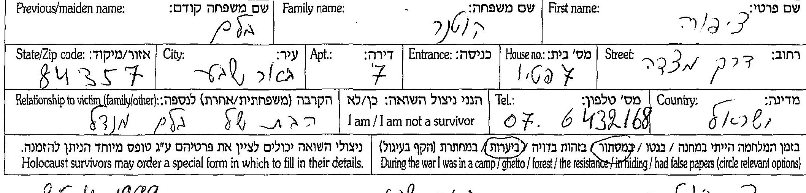
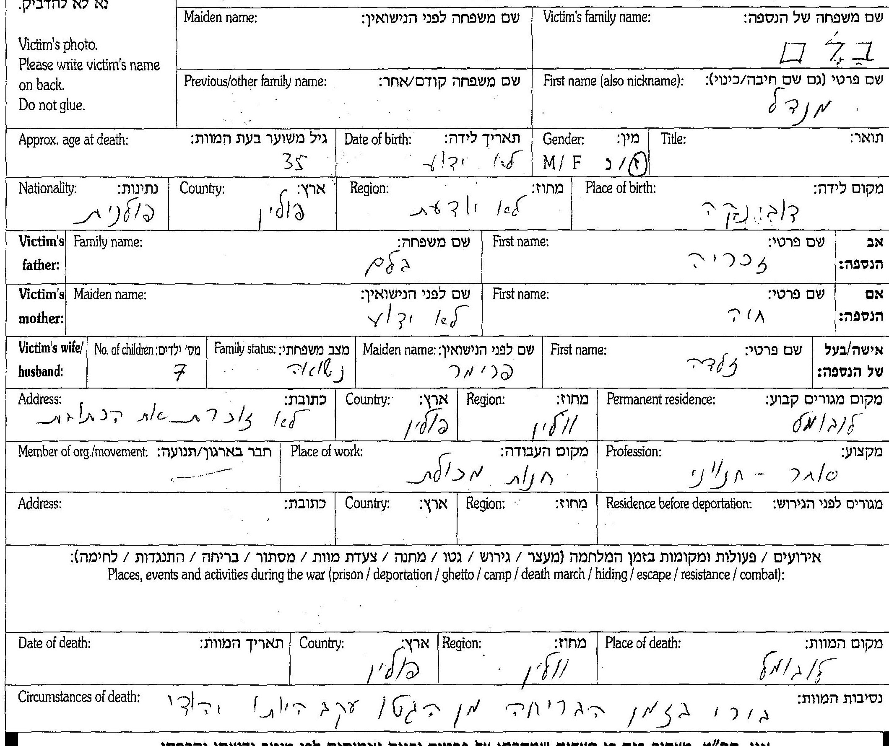
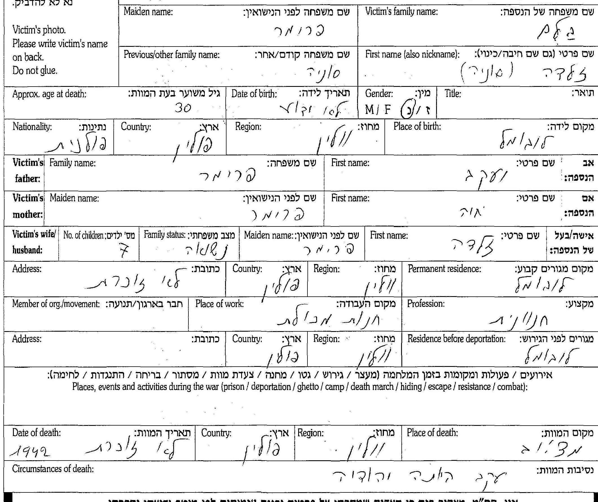
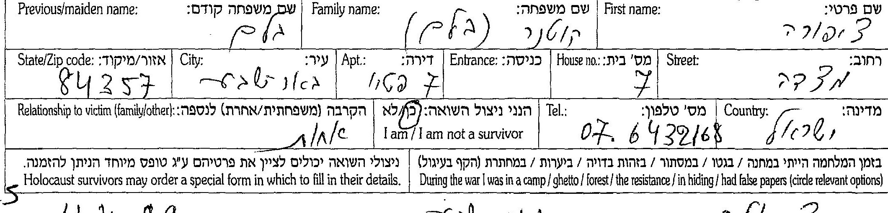
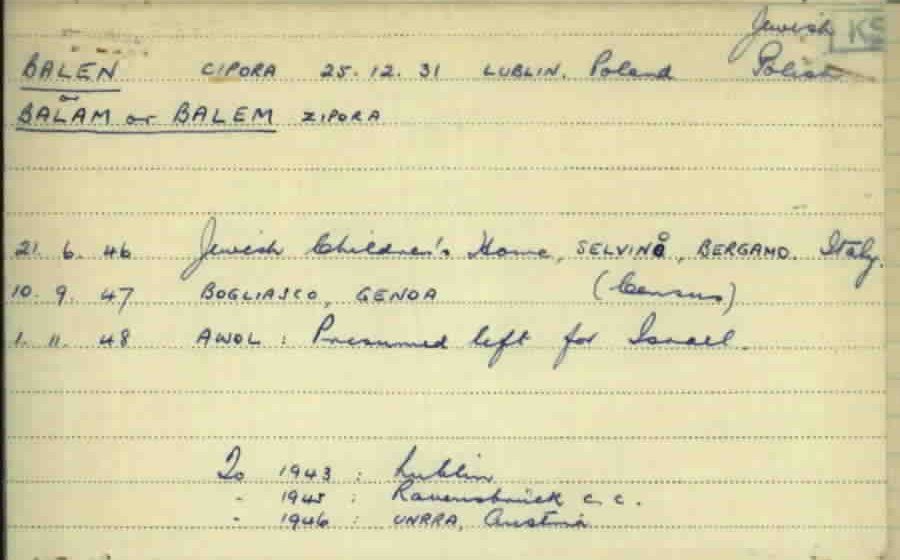
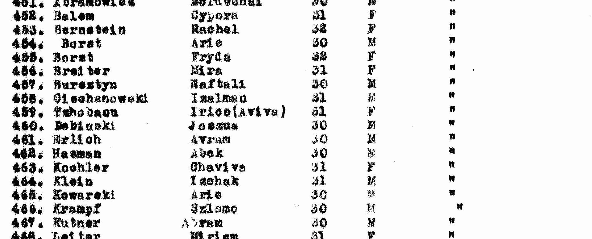

::: lede

**צפורה קוטנר לבית בלם** נולדה ב-**25 בדצמבר 1931** (1932 לפי המשפחה ולפי הרישום הישראלי) ב**לובומל** שבווהלין, השנייה מבין שבעת ילדיהם של **מנדל בלם** ו**זלדה (סוניה) לבית פרימר**, חנוונים. הוריה וששת אחיה נרצחו — כמעט בוודאות ב-1942; אחיה הבכור משה היה בן 14, הקטן, חיים, בן שנה. היא שרדה; בדפי העד שמילאה ב-1999 סימנה בעצמה את המילים "**ביערות**" ו"**במסתור**".

אחרי המלחמה היא ב**בית הילדים בסלווינו** שבהרי ברגמו באיטליה; ב-1947 היא — כמעט בוודאות — ברשימת **ילדים יתומים** שהועברו ממחנות המעצר בקפריסין, באותו עמוד ובאותה אונייה עם **אברם קוטנר**, לימים בעלה ([המחקר עליו](../index.html#research-avraham-kotner)); ב-1952 שניהם בפנקס הבוחרים של **קיבוץ צאלים**. נפטרה בינואר 2006, ונקברה עם אברהם בבית העלמין הישן של באר שבע, תחת מצבה "לזכר הוריהם ובני משפחתם שנספו בשואה".

כל מסמך שנקרא מופיע פעמיים — קישור אל הרשומה בארכיון וקישור אל עותק שמור; גם ממצא שלילי נרשם ([9.4](#s9-4)).

:::

**מאיפה להתחיל**

- [המשפחה בלובומל ובדוביינקה](#s3) — שלושה-עשר דפי עד שמילאה צפורה עצמה.
- [המלחמה — מה שהיא סימנה, ומה שכרטיס אחד אומר אחרת](#s4).
- [סלווינו, קפריסין, צאלים](#s5) — הדרך לארץ.
- [שנת הלידה](#s6) — 1931 או 1932.
- [הפעולות הפתוחות](#s8) — מה עוד חסר.

---

## 1. תמצית

צפורה בלם נולדה בלובומל (Luboml, בפולנית Luboml; ביידיש ובעברית לובומל), עיירה בווהלין סמוך לנהר הבוג, ב-25.12.1931 — כך בכרטיס של שירות האיתור הבין-לאומי בארולסן, שנערך על פי רשימה של ארגון הפליטים (IRO) באיטליה, ושבו העיר "Lublin";[[3]] 1932 בעץ המשפחה ובפנקס הבוחרים של 1952.[[7]][[5]] אביה **מנדל בלם**, יליד **דוביינקה** שעל הבוג, בן זכריה וחיה, "סוחר — חנווני"; אמה **זלדה (סוניה) לבית פרימר**, ילידת לובומל, בת יעקב וחיה פרימר; שניהם בעלי חנות מכולת. לזוג שבעה ילדים.[[1]]

ב-1999, בבאר שבע, מילאה צפורה — "צ. קוטנר", "שם משפחה קודם: בלם" — שלושה-עשר דפי עד: על אביה ("הבת של מנדל בלם"), על אמה, על ששת אחיה — **משה** (14), **רייזל** (7), **שמואל** (כ-5), **אשר** (4), **ישראל** (3½) ו**חיים** (שנה) — ועל ארבעת סביה.[[1]] על עצמה סימנה בכמה מהטפסים "ביערות" ו"במסתור" ([4.1](#s4-1)).

אחרי המלחמה: ב-21.6.1946 בבית הילדים היהודי בסלווינו, ב-10.9.1947 בבוליאסקו שליד גנואה, וב-1.11.1948 "AWOL — יש להניח שעזבה לישראל" (כרטיס שירות האיתור);[[3]] ברשימה הראשונה של ילדי סלווינו, מסוף 1945, היא מס' 1: "Balam Zipora", אב "Mandai", אם "Salda", "Lubomul", 1931.[[6]] ב-1947 "Balem Cypora", ילידת 1931, ברשימת "המכסה השנייה של ילדים יתומים" שהועברו ממחנות קפריסין — אונייה "Ch. Arlozorof"; ובאותו עמוד "Kutner Abram".[[4]] ב-1952 — **צפורה קוטנר**, ילידת 1932, בפנקס הבוחרים של קיבוץ צאלים, בשורה שאחרי **אברהם קוטנר**.[[5]]

## 2. מה ידוע מהמשפחה

נקודת המוצא היא עץ המשפחה שהמשפחה בנתה ב-MyHeritage — זיכרון משפחתי שנרשם, לא רשומה:[[7]]

- צפורה קוטנר, 25 בדצמבר 1932, "Lubomel, Poland"; נפטרה 27 בינואר 2006; נקברה בבית הקברות הראשון (הישן) של באר שבע.
- הוריה: מנדל בלם וזלדה-סוניה בלם; סבה וסבתה מצד האב — זכריה בלם (1882–1942) וחיה (1887–1942); מצד האם — יעקב פרימר (1882–1942) וחיה (1888–1942); דודתה **פרידה פרימר** (1913–1943).
- אחיה, כולם "נספו בשואה" ב-1942: משה (1928), רייזל (1935), שמואל (1937), אשר (1938), ישראל (1939), חיים (1941).
- נשואה לאברהם קוטנר (1928–1986); שני ילדיהם נולדו בצאלים ב-1957 וב-1959 (חיים — פרטיהם אינם מתפרסמים, [9.6](#s9-6)).

כמעט כל הפרטים האלה נמצאו בדפי העד שמילאה צפורה עצמה — כלומר העץ והדפים הם, ככל הנראה, אותו זיכרון בשני גלגולים, ולא שני מקורות בלתי תלויים.

## 3. המשפחה בלובומל ובדוביינקה

### 3.1 דפי העד של צפורה, 1999

במאגר השמות של יד ושם שם המשפחה נכתב **Blam** — לא Blum; משום כך חיפוש "Blum" בלובומל מחזיר אפס. חיפוש לפי הממלאת ("Tzipora Blam Kutner") מחזיר שנים-עשר דפים, ודף שלושה-עשר — על סבתה חיה — נמצא בחיפוש לפי מקום.[[1]]

*דף העד של מנדל בלם, חלק הממלאת: «צפורה · קוטנר · שם משפחה קודם: בלם · עיר: באר שבע · הקרבה: הבת של מנדל בלם · ביערות · במסתור (מוקפים) · 25.4.1999 · צ. קוטנר». המקור: [דפי העד](#src-1).*

| רשומה | הנספה | גיל | מה כתוב (קריאה) | הקרבה |
|---|---|---|---|---|
| 975385 | מנדל בלם | 35 | נולד דוביינקה; בן זכריה וחיה; אשתו זלדה לבית פרימר; 7 ילדים; לובומל; "סוחר — חנווני", חנות מכולת; מקום המוות לובומל; תאריך המוות — ריק; נסיבות: "נורו בזמן הבריחה מן הגטו עקב היותם יהודים" | "הבת של מנדל בלם" |
| 6544552 | מנדל בלם (דף שני) | 35 | נולד דוביינקה ("עיר נהר בוג"); מכולת; לובומל, "וולין (לוצק)"; תאריך המוות — "לא ידוע"; מקום המוות: "האם + האחים — [ב]מצ'יוב"; נסיבות: "הגרמנים אספו את האם עם הילדים הקטנים והרגו אותם ע"י העיירה מצ'יוב" | "אני הבת של הנספה" |
| 976303 | זלדה (סוניה) בלם לבית פרימר | 30 | נולדה לובומל; בת יעקב וחיה פרימר; 7 ילדים; חנוונית, חנות מכולת; מגורים לפני הגירוש — לובומל; תאריך המוות — "1942 לא זוכרת" (השנה, בלי יום וחודש); מקום המוות — "מצ'יוב"; "עקב היותה יהודיה" | "הבת של זלדה" |
| 6406843 | משה בלם | 14 | תלמיד; נולד לובומל; מגורים לפני הגירוש — "מצ'יוב"; תאריך המוות — "לא יודעת"; מקום המוות — "כפר בשם צ'מיקוס" (קריאה לא ודאית) | אחות |
| 960928 | רייזל בלם | 7 | — | אחות |
| 883376 | שמואל בלם | כ-5 | — | אחות |
| 960255 | אשר בלם | 4 | — | אחות |
| 960922 | ישראל בלם | 3½ | — | אחות |
| 962173 | חיים בלם | 1 | — | אחות |
| 5627800 | זכריה בלם | 60 | חייט, עבד בבית; נולד, גר ונרצח בדוביינקה; "2 ילדים"; "עקב היותו יהודי" | נכדה |
| 5627799 | חיה בלם | 55 | נולדה וגרה בדוביינקה; אשת זכריה | נכדה |
| 976309 | יעקב פרימר (Frimer) | 65 | סוחר, לובומל | נכדה |
| 956871 | חיה (פרימר) | 65 | עקרת בית, לובומל | נכדה |

הדפים — **מאומת** (נקראו בסריקה). שהממלאת היא צפורה שלנו — **מאומת**: שמה, שם נעוריה, באר שבע, והקרבה שכתבה בידה לכל אחד מהנספים, תואמים את העץ ואת כל המסמכים שלהלן. הגילים — משוערים, כפי שהטופס מבקש ("גיל משוער בעת המוות"); הגילים של הילדים מתיישבים עם שנות הלידה שבעץ. הגיל שנרשם לזלדה, 30, אינו מתיישב עם בן בכור בן 14 — ככל הנראה הערכה נמוכה; גם 35 של מנדל — הערכה. **שנת המוות** כתובה רק בדף של זלדה (1942); בדפים של מנדל ושל משה — "לא ידוע" / "לא יודעת". ש-1942 היא שנת מותם של כולם — **כמעט ודאי**. בדף של זכריה "2 ילדים" — אם אינו טעות מילוי (באותו דף נכתב "זכריה" גם בשדה האישה), לאביה של צפורה היו אח או אחות שאינם ידועים — **ככל הנראה** ([פרק 8](#s8)). בדף השני על מנדל (6544552) מולאו שדות "אב" ו"אם" בשמות הלא-נכונים (מנדל; זלדה) — טעות מילוי; בדף הראשון הם נכונים (זכריה; חיה).

*«בלם · מנדל · 35 · מקום לידה: דוביינקה · אב: זכריה בלם · אם: חיה · אשה: זלדה, לבית פרימר · 7 ילדים · נשוי · מקום מגורים קבוע: לובומל · מקום העבודה: חנות מכולת · מקצוע: סוחר — חנווני · מקום המוות: לובומל · נסיבות המוות: נורו בזמן הבריחה מן הגטו עקב היותם יהודים». המקור: [דפי העד](#src-1).*

*«בלם · זלדה (סוניה) · שם לפני הנישואין: פרימר · 30 · לובומל · אב: יעקב פרימר · אם: חיה פרימר · 7 ילדים · חנוונית, חנות מכולת · מגורים לפני הגירוש: לובומל · תאריך המוות: 1942». מקום המוות — "מצ'יוב" ([3.2](#s3-2)). המקור: [דפי העד](#src-1).*

### 3.2 המקום שבו נרצחו

שני תיאורים בכתב ידה של צפורה, שאינם אותו תיאור:

- בדף הראשון על אביה: "**נורו בזמן הבריחה מן הגטו**", ומקום המוות — לובומל.
- בדף השני על אביה: "הגרמנים **אספו את האם עם הילדים הקטנים והרגו אותם ע"י העיירה מצ'יוב**"; מקום המוות — "האם + האחים — [ב]מצ'יוב". אותה מילה — כמקום מותה של זלדה, וכמקום המגורים של משה לפני הגירוש; בדף של משה, מקום המוות "כפר בשם צ'מיקוס".

"העיירה מצ'יוב" היא ככל הנראה **מאצ'יוב** (Maciejów), עיירה כ-25 ק"מ דרומית-מזרחית ללובומל — **ככל הנראה**, כקריאה. "צ'מיקוס" — **טעון אימות**. המשמעות האפשרית — שהאם והילדים נרצחו ליד מאצ'יוב, והאב נורה בבריחה מגטו לובומל — היא צירוף של שני דפים שאינם מתיישבים לגמרי זה עם זה; **טעון אימות**.

*«בלם משה ילד · 14 · תלמיד · נולד לובומל ("עיר על נהר בוג") · מגורים לפני הגירוש: מצ'יוב · תאריך המוות: לא יודעת · מקום המוות: כפר בשם צ'מיקוס(?)». המקור: [דפי העד](#src-1).*

### 3.3 משפחת פרימר — דפים נוספים

שלושה דפי עד נוספים על **יעקב** ו**חיה פרימר** ועל **פרידה שלוקר לבית פרימר** מילא ב-14.4.1999 בן משפחה, שכתב על פרידה "בן" — כלומר בן דודה של צפורה.[[2]] בדף של פרידה: «SHLUKER · FRIDA · maiden PRIMER · 30 · LUBOMIL · father IACOV PRIMER · mother HAIA · 4 children · 1943 · LUBOMIL» — בת יעקב וחיה פרימר, ילידת לובומל, אם לארבעה, נספתה בלובומל ב-1943 — **מאומת** כעדות. שהיא אחותה של זלדה — **כמעט ודאי**: אותם הורים ואותה עיירה. "פרידה פרימר, 1913–1943" שבעץ היא היא.
בשני הדפים האחרים מאותו יום הוא רושם את **יעקב** (כבן 60) ואת **חיה** (כבת 57 או 54) **פרימר** — ילידי לובומל, נשואים זה לזה, נספו בלובומל ב-1942.[[2]] זה רישום **שני ובלתי תלוי** של סביה של צפורה, שגם היא רשמה אותם ב-1999 (בני 65); הגילים — הערכות. שהזוג הזה הוא הוריה של זלדה — **כמעט ודאי**.

## 4. המלחמה

### 4.1 מה שצפורה סימנה

בתחתית טופס דף העד שורה: "בזמן המלחמה הייתי במחנה / בגטו / ביערות / במסתור / בזהות בדויה / במחתרת (הקף בעיגול)". בחמישה מהטפסים (מנדל, זלדה, זכריה, חיה בלם, יעקב פרימר) הקיפה צפורה **"ביערות"** ו**"במסתור"**; בדף של משה הקיפה "כן" בשאלה "הנני ניצול השואה".[[1]] העדות — **מאומת** כעדותה; פרטים — היכן, מתי, עם מי, כמה זמן — אינם בדפים.

*«צפורה · קוטנר (בלם) · שם קודם: בלם · באר שבע · הקרבה: אחות · הנני ניצול השואה: כן (מוקף)». המקור: [דפי העד](#src-1).*

### 4.2 מה שכרטיס שירות האיתור מוסיף

על כרטיס הכרטסת המרכזית של שירות האיתור ([5.2](#s5-2)), בגוש נפרד בתחתיתו, נרשמה תולדה קצרה של המלחמה: «To 1943: Lublin · 1945: Ravensbrück c.c. · 1946: UNRRA, Austria» — "עד 1943: לובלין; 1945: מחנה הריכוז רוונסבריק; 1946: אונר"א, אוסטריה".[[3]] שלוש השורות אינן מתיישבות כולן עם עדותה:

- "עד 1943: לובלין" — לא בהכרח העיר: משפחת אביה ישבה ב**דוביינקה**, שבמחוז לובלין, מעבר לבוג; ייתכן שהכוונה למחוז, ואז זה מתיישב עם יער ומסתור.
- "1946: אונר"א, אוסטריה" — מתיישב עם הדרך הרגילה של הבריחה, מאוסטריה לאיטליה, לפני סלווינו ביוני 1946.
- "1945: רוונסבריק" — אינו מתיישב עם "ביערות / במסתור", ואין לו הסבר.

ייתכן שהגוש הועתק ממסמך אחר או נרשם מפי אחר. **טעון אימות** — ואין להעדיף אותו על פני עדותה.

## 5. סלווינו, קפריסין, צאלים

### 5.1 סלווינו

**Sciesopoli** — בית ההבראה בסלווינו, בהרי ברגמו, ששימש מסוף 1945 בית ליתומים יהודים — מקיים אתר זיכרון ובו שתי רשימות:[[6]]

- **"רשימה קצרה של ילדי סלווינו"** (בעמוד הזה — הרשימה של שמונים הילדים הראשונים) — לפי האתר, תמלול רשימה השמורה ביד ושם, שנשלחה מהקהילה היהודית במילאנו לארגון OSE בז'נבה, ככל הנראה באוקטובר–נובמבר 1945: שמונים הילדים הראשונים בבית. מס' 1: «Balam · Zipora · Mandai · Salda · Lubomul · Polonia · 1931» — שם האב "מנדאי", שם האם "סלדה": **מנדל וזלדה**, בכתיב איטלקי.
- **"רשימת ילדי סלווינו (בעבודה)"** — מס' 36: «Balem (Balam) poi Kutner Zipora (1931 – Lubomjl, PL)» — "בלם (בלאם), לימים קוטנר"; ומס' 347: «Kutner Avraham (Abram) (1930 – PL)».

הדירוג: הרשימות — **ככל הנראה** (תמלול של אתר; הרשימה המקורית לא נקראה). שזו צפורה שלנו — **כמעט ודאי**: שמות שני ההורים, העיירה והשנה. באותו אתר, ברשימה אחרת שלפי האתר מבוססת על ספרו של אהרן מגד על בית סלווינו: אברהם קוטנר היה המזכיר הראשון של קיבוץ צאלים, ושם נשא את צפורה בלם, גם היא מילדי סלווינו — **ככל הנראה** ([המחקר עליו](../index.html#research-avraham-kotner)).

### 5.2 כרטיס שירות האיתור — איטליה

בארכיון ארולסן, בכרטסת המרכזית של שירות האיתור — כרטיס שהוכן ב-7 במאי 1950, על פי רשימה של IRO איטליה:[[3]]

*«BALEN · CIPORA · 25.12.31 · LUBLIN, Poland · Jewish, Polish · BALAM or BALEM ZIPORA · 21.6.46 Jewish Children's Home, SELVINO, BERGAMO, Italy · 10.9.47 BOGLIASCO, GENOA (Census) · 1.11.48 AWOL: Presumed left for Israel». בתרגום: בלן צפורה, 25.12.31, לובלין, פולין; יהודייה, פולנייה; בלאם או בלם צפורה; 21.6.46 בית הילדים היהודי, סלווינו, ברגמו, איטליה; 10.9.47 בוליאסקו, גנואה (מפקד); 1.11.48 נעדרת ללא רשות — יש להניח שעזבה לישראל. בשוליים: «9/E/575 — Aufstellung v. KK d. IRO Italien, ausgest. v. IRO Rom» — "רשימה … של IRO איטליה, הונפקה על ידי IRO רומא". המקור: [הכרטיס בארולסן](#src-3).*

- הכרטיס — **מאומת**. שזו צפורה — **כמעט ודאי**: שלושת כתיבי שם המשפחה, יום הלידה **25.12** כבעץ, סלווינו ושנת הלידה כברשימת סלווינו.
- "Lublin" כמקום לידה — שיבוש של לובומל, או מחוז לובלין שבו שכנה דוביינקה ([4.2](#s4-2)); **טעון אימות**.
- השורות "10.9.47 בוליאסקו" ו"1.11.48 — יש להניח שעזבה לישראל" אינן מתיישבות עם קפריסין 1947 ([5.3](#s5-3)): ככל הנראה רישום שהועתק מרשימות קודמות ולא עודכן. **טעון אימות**.

### 5.3 רשימת קפריסין, 1947

ב-IGRA, מתוך תיק הארכיון הציוני המרכזי 56/4315 (עמ' 3275), רשימה של עצורי מחנות קפריסין שהועברו לארץ — לפי תיאור המאגר, "המכסה השנייה של ילדים יתומים", 1947:[[4]]

*«452. Balem · Cypora · 31 · F · "» — העמודה השלישית היא שנת לידה, והסימן " חוזר על העמודה האחרונה: «Ch. Arlozorof». המקור: [רשימת קפריסין](#src-4).*

*שורות 445–468 באותו עמוד: «452. Balem · Cypora · 31 · F» ו-«467. Kutner · Abram · 30 · M». המקור: [רשימת קפריסין](#src-4).*

- השורה — **מאומת** כקריאה. שזו צפורה — **כמעט ודאי**: "Balem" הוא אחד משלושת הכתיבים שבכרטיס שירות האיתור; שנת הלידה 1931 כבכרטיס וברשימת סלווינו; היא רשומה עם ילדי סלווינו האחרים — ובהם אברם קוטנר; וב-IGRA אין "Balem" אחר במאגר קפריסין.
- "Ch. Arlozorof" — ככל הנראה אוניית המעפילים "חיים ארלוזורוב" (פרטי האונייה — [במחקר על אברהם](../index.html#research-avraham-kotner)). מועד השחרור מקפריסין — לא נמצא ([פרק 8](#s8)). בעמוד אין כותרת או תאריך: "המכסה השנייה של ילדים יתומים" ו-1947 — מתיאור המאגר ב-IGRA.

### 5.4 צאלים, 1952

המועצה האזורית "חבל מעון", הנגב המערבי — "פנקס הבוחרים — קיבוץ צאלים", עמ' 19:[[5]]

*«928 · קוטנר · אברהם · 1930» ו-«929 · קוטנר · צפורה · 1932». עמודת מספרי הזהות מושחרת בסריקה. המקור: [פנקס הבוחרים](#src-5).*

- **מאומת** (ברשומה); שזו צפורה שלנו — **כמעט ודאי**. ב-1952 היא כבר **קוטנר** — כלומר נישאה לאברהם (או נרשמה כאשתו) לפני כן; מועד הנישואין — לא נמצא. לפי אתר סלווינו, נישאו בצאלים ([5.1](#s5-1)). השנה (1952) — מתיאור המאגר ב-IGRA, לא מהעמוד.

### 5.5 הקבורה, באר שבע

בבית העלמין הישן של באר שבע — מצבה משותפת לצפורה ולאברהם, שצילם מתנדב של BillionGraves ותעתק.[[11]] בתעתיק: צפורה קוטנר, נפטרה **כ"ח בטבת תשס"ו** — 28.1.2006 בתעתיק הלועזי — **בת 73**; הוריה מנדל בלם וזלדה-סוניה; ולצדם הוריו של אברהם, ישראל וציביה; והקדשה: «לזכר הוריהם ובני משפחתם שנספו בשואה».

- התעתיק — **כמעט ודאי** (התצלום המלא פתוח בתשלום בלבד); שזו מצבתה — **כמעט ודאי**: השמות, ההורים, בעלה, באר שבע; את התצלום עצמו לא ראינו. ששתי הרשומות הן מצבה אחת משותפת — **כמעט ודאי**.
- כ"ח בטבת תשס"ו היה שבת, 28.1.2006, והחל עם כניסת השבת בערב 27.1 — מותה בליל שבת — ערב 27.1, כמו בעץ — נרשם בלוח העברי ככ"ח בטבת, והמתעתק המיר אותו ל-28.1 — **ככל הנראה**.
- הגיל, 73 בינואר 2006, מתאים ללידה ב-25.12.**1932** — **ככל הנראה** (גיל על מצבה הוא מה שהמשפחה מסרה) ([פרק 6](#s6)).

## 6. שנת הלידה — 1931 או 1932

| המקור | שנה | יום וחודש |
|---|---|---|
| רשימת סלווינו, 1945 — בתמלול האתר ([5.1](#s5-1)) | 1931 | — |
| כרטיס שירות האיתור, 1950 ([5.2](#s5-2)) | 1931 | 25.12 |
| רשימת קפריסין, 1947 ([5.3](#s5-3)) | 1931 | — |
| פנקס צאלים, 1952 ([5.4](#s5-4)) | 1932 | — |
| עץ המשפחה ([פרק 2](#s2)) | 1932 | 25.12 |
| המצבה, באר שבע 2006 ([5.5](#s5-5)) | בת 73 ← **1932** | — |

יום הלידה, **25 בדצמבר**, זהה בשני המקורות שמציינים אותו. השנה: שלושה מקורות מימי סלווינו וקפריסין — **1931**; הרישום הישראלי, המשפחה והמצבה ("בת 73" בינואר 2006) — **1932**. ההכרעה — **טעון אימות**; תעודת הזהות תכריע ([פרק 8](#s8)). ייתכן שהשנה שונתה בעלייה, כפי שקרה לבעלה ([המחקר עליו](../index.html#research-avraham-kotner)) — אבל לבעלה הגיל הוקטן, וכאן השנה הישראלית מאוחרת דווקא.

## 7. עץ המשפחה

העץ מוצג בתרשים ב[מקטע העץ](#tree). בטקסט — כל השמות מדפי העד שמילאה צפורה ([3.1](#s3-1)):

- **זכריה בלם** (כ-60, חייט) ו**חיה** (כ-55) — דוביינקה; נרצחו שם. "2 ילדים" — מנדל, ועוד אחד שאינו ידוע.
- **יעקב פרימר** (כ-65, סוחר) ו**חיה** (כ-65) — לובומל.
- **מנדל בלם** (כ-35), יליד דוביינקה, סוחר-חנווני בלובומל; **זלדה (סוניה) לבית פרימר** (כ-30), ילידת לובומל. שבעה ילדים:
  - **צפורה** — 25.12.1931 (1932 בישראל ועל המצבה), לובומל — 27.1.2006, באר שבע.
  - **משה** (כ-1928), **רייזל** (כ-1935), **שמואל** (כ-1937), **אשר** (כ-1938), **ישראל** (כ-1939), **חיים** (כ-1941) — נרצחו, ככל הנראה ב-1942.
- **פרידה שלוקר לבית פרימר** (כ-1913–1943), אם לארבעה — אחותה של זלדה, כמעט ודאי ([3.3](#s3-3)).
- בעלה: **אברהם קוטנר** — 15.8.1928, אוזורקוב — 18/19.3.1986 — [מחקר נפרד](../index.html#research-avraham-kotner).

## 8. פעולות פתוחות

| # | פעולה | מה זה ישנה | מי |
|---|---|---|---|
| 1 | **המצבה נמצאה** ([5.5](#s5-5)); חסרים תצלום מצבה משלנו ותעודת פטירה או זהות | שנת הלידה (1931 או 1932) כפי שנרשמה בישראל | משפחה / חברה קדישא באר שבע |
| 2 | **שנות המלחמה** — יער ומסתור, ואיך הגיעה לאיטליה | עדות מוקלטת או כתובה (יד ושם, ארכיון השואה של USC, בית לוחמי הגטאות); מה ידוע במשפחה | משפחה / ארכיונים |
| 3 | **הרשימה המקורית של סלווינו (OSE, 1945)** ותיק הילדה | הנוסח המקורי — ואולי תאריך כניסה, מקור הגעה ומלווה | יד ושם / OSE |
| 4 | **מאצ'יוב וצ'מיקוס** — שני התיאורים של מות המשפחה | מקום הרצח ותאריכו; רצח יהודי מאצ'יוב ולובומל, סתיו 1942 | קורא כתב יד; מאגר המקומות של יד ושם; ספרות על לובומל |
| 5 | **אחיו או אחותו של מנדל** ("2 ילדים" בדף של זכריה); **ילדיה של פרידה** | ענף נוסף במשפחה | יד ושם; משפחה |
| 6 | **"חיים ארלוזורוב"** — מועד ההפלגה והשחרור מקפריסין | שנת העלייה המדויקת | ספרות ההעפלה; הארכיון הציוני (S6) |
| 7 | **ספר יזכור לובומל** — עמודי משפחת בלם ופרימר | מה שכתבו בני העיירה; ייתכן אזכור שלה | קריאה ידנית של הספר (ה-OCR הזמין אינו שמיש) |
| 8 | **תצלומים** — צפורה בסלווינו, בצאלים | | משפחה |

## 9. שיטה ומגבלות

### 9.1 בסיס הראיות

שלושה-עשר דפי עד שמילאה צפורה עצמה ב-1999 (עדות בכתב ידה — מקור ראשוני מאוחר, נקרא בסריקה); כרטיס הכרטסת המרכזית של שירות האיתור בארולסן (מקור ראשוני בן-זמנו, נקרא); רשימת עצורי קפריסין ופנקס הבוחרים של 1952 (סריקות IGRA שנקראו); רשימות ילדי סלווינו (תמלול של אתר — משני). עץ MyHeritage של המשפחה הוא נקודת המוצא בלבד.

### 9.2 סולם הוודאות

**מאומת** — נקרא ישירות מהמסמך; **כמעט ודאי** — מסמכים מתכנסים ללא סתירה; **ככל הנראה** — פרשנות סבירה או זיהוי נסיבתי; **טעון אימות** — לא פוענח או לא נבדק. המסמך מדורג בנפרד מן הזיהוי שנשען עליו: דף עד הוא **מאומת** כעדות, ומה שבו — זיכרונה של ילדה בת עשר, שנכתב חמישים ושבע שנים אחר כך.

### 9.3 מוסכמות הכתיב

בלם · Blam · Balem · Balam · Balen — אותו שם; **לא** Blum. צפורה · ציפורה · Cipora · Zipora · Cypora. פרימר · Primer · Frimer. לובומל · Luboml · Lubomel · Lubomjl · Lubomul. דוביינקה · Dubienka. קוטנר · Kutner · Kotner.

### 9.4 ממצאים שליליים

| # | שאלה | מקור וכיסוי | תוצאה | דירוג |
|---|---|---|---|---|
| N-1 | "Blum" בלובומל ביד ושם | Blum / Blum* / בלום + Luboml / לובומל | אפס — האיות ביד ושם הוא Blam | לא שלילה — שגיאת כתיב |
| N-2 | צפורה בלם בג'וינט | JDC Names: Blam / Blum / Blumen / Blyum + Luboml — אפס; Balam / Balem / Balen / Blam ללא מקום — 103 רשומות, אף אחת אינה צפורה ילידת 1930–1932 | אין | **ככל הנראה** |
| N-3 | "צפורה בלם" ברשימות העולים | Pinpoint: Balam Cipora, Balem Cypora — אפס; "צפורה בלם" — 67 מסמכים, רעש OCR של כתב יד, לא נבדקו | לא הוכרע | — |
| N-4 | קבורה | JewishGen JOWBR ישראל: Kutner Tzipora — אפס; IGRA קבורות, קוטנר — אפס | אין | אינו שלילה — כיסוי חלקי |
| N-5 | בלם / פרימר / שלוקר בספר יזכור לובומל | ארכיון האינטרנט, nybc313869 (עברית-יידיש), חיפוש בטקסט; JewishGen — רשימת הנספים בתרגום האנגלי (Lyuboml, עמ' 375–393) | אפס בכל המונחים (קרובים בלבד: Blumen, Frimerman — שמות אחרים) | אינו שלילה — ה-OCR העברי אינו שמיש, ופרקי הספר באנגלית (PDF בספרייה הציבורית של ניו יורק) לא נקראו |
| N-8 | צפורה ואברהם ברשימות העולים | Pinpoint: Balem / Balam / Blam Cypora, Kutner, Selvino, Arlozoroff; שני תיקי "מעפילים — Haim Arlosoroff 1947" נקראו רק בחלקם | אין התאמה | לא הוכרע — כיסוי חלקי, OCR של כתב יד |
| N-6 | "BLUM Cipora", רשימת לינץ | ארולסן 81656097 — ילידת רומניה, בת 18, הגירה לקנדה 1948 | אדם אחר | **נשלל** |
| N-7 | "צפורה קוטנר", ירושלים | IGRA, פנקס הבוחרים לכנסת 1949 — ילידת 1908 | אדם אחר | **נשלל** |

### 9.5 חסמים

FamilySearch — אין אסימון גישה; לא נבדק. BillionGraves — נבדק בדפדפן ונמצא ([5.5](#s5-5)); JewishGen JOWBR — דורש התחברות לחשבון. ארכיון המדינה והספרייה הלאומית — לא נבדקו בסבב הזה. JPress — שאילתה אחת ("צפורה קוטנר"), אפס; כתיבים אחרים ומודעות אבל מ-2006 — לא נבדקו (עיתוני 2006 אינם ב-JPress ממילא).

### 9.6 מה הדף אינו עושה

אינו מפרסם את שמות ילדיה של צפורה או פרטים על צאצאיה החיים. אינו מסתמך על עץ MyHeritage כראיה. אינו משלים את שנות המלחמה מתוך ספרות כללית על לובומל: מה שלא נמצא במסמך, נאמר שלא נמצא.

