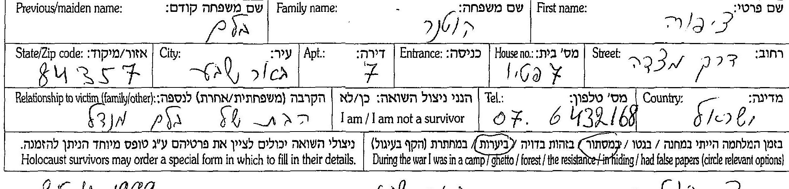
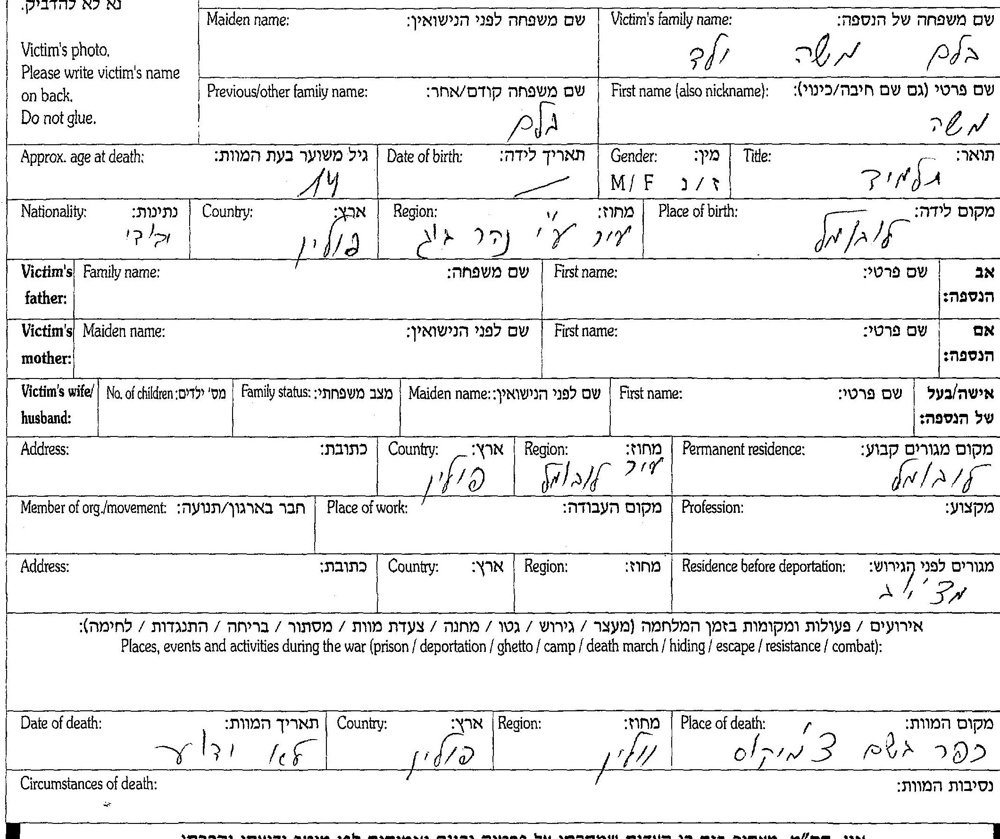
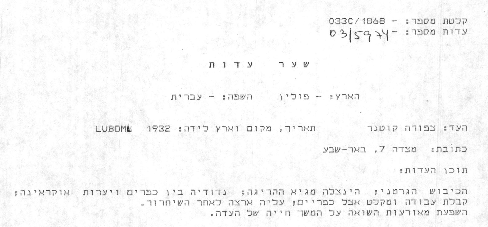
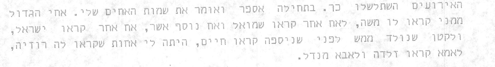
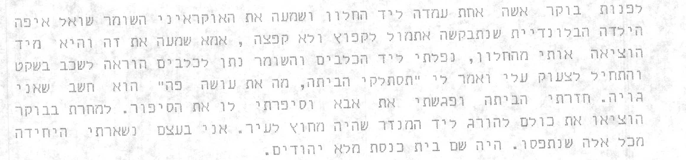
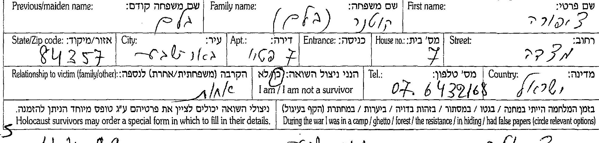
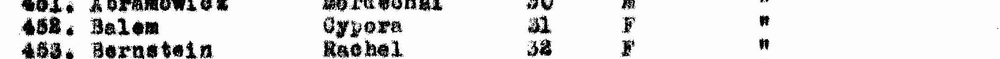
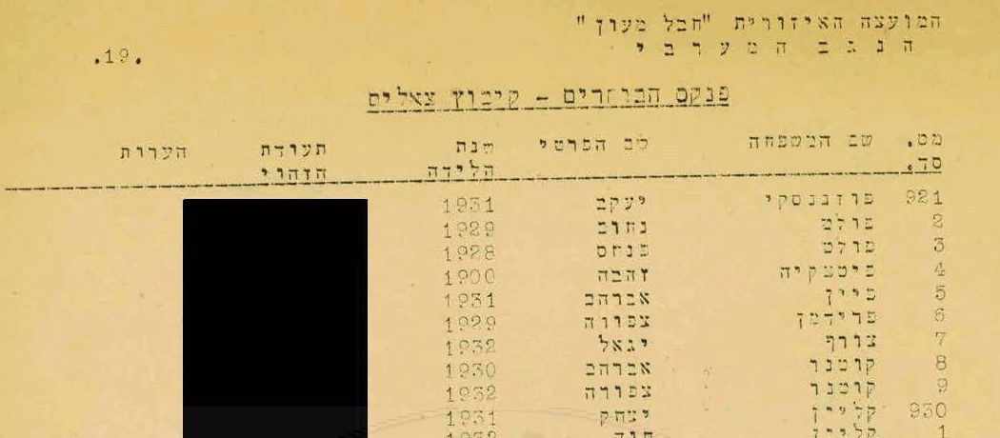

::: lede

**צפורה קוטנר לבית בלם** נולדה ב-**1932** — כך מסרה היא עצמה; ברשימות שאחרי המלחמה 1931 — ב**לובומל** שבווהלין, השנייה מבין שבעת ילדיהם של **מנדל בלם** ו**זלדה (סוניה) לבית פרימר**, חנוונים. כשהחלו לארגן את הגטאות עברה המשפחה מלובומל אל קרובים ב**מאצ'יוב**; שם, ככל הנראה ב-1942, נאספו אמה וחמשת אחיה הקטנים אל בית הכנסת ונרצחו למחרת — הקטן, חיים, היה בן שנה — וצפורה ("בערך בת 8 או 9", כדבריה) נמלטה עם שחר דרך החלון. עם אביה ועם אחיה הבכור משה, בן 14, חזרה לגטו לובומל, והשלושה ברחו ממנו ימים ספורים לפני חיסולו; בחורף נרצח האב, וכעבור כשבוע נרצח משה בידי אוקראינים, והיא שרדה לבדה — ביערות, ואחר כך כ"נכדה" במשפחת איכרים אוקראינית. כך סיפרה בעדותה ביד ושם ב-1990; בדפי העד שמילאה ב-1999 סימנה בעצמה "**ביערות**" ו"**במסתור**".

אחרי המלחמה היא ב**בית הילדים בסלווינו** שבהרי ברגמו באיטליה; ב-1947 היא — כמעט בוודאות — ברשימת **ילדים יתומים** שהועברו ממחנות המעצר בקפריסין, באותו עמוד ובאותה אונייה עם **אברם קוטנר**, לימים בעלה ([המחקר עליו](../index.html#research-avraham-kutner)); ב-1952 שניהם בפנקס הבוחרים של **קיבוץ צאלים**. נפטרה בינואר 2006, ונקברה עם אברהם בבית העלמין הישן של באר שבע, תחת מצבה "לזכר הוריהם ובני משפחתם שנספו בשואה".

כל מסמך שנקרא מופיע פעמיים — קישור אל הרשומה בארכיון וקישור אל עותק שמור; גם ממצא שלילי נרשם ([9.4](#s9-4)).

:::

**מאיפה להתחיל**

- [המשפחה בלובומל ובדוביינקה](#s3) — שלושה-עשר דפי עד שמילאה צפורה עצמה.
- [המלחמה — מה שהיא סימנה, ומה שכרטיס אחד אומר אחרת](#s4).
- [סלווינו, קפריסין, צאלים](#s5) — הדרך לארץ.
- [שנת הלידה](#s6) — 1931 או 1932.
- [הפעולות הפתוחות](#s8) — מה עוד חסר.

---

## 1. תמצית

צפורה בלם נולדה בלובומל (Luboml, בפולנית Luboml; ביידיש ובעברית לובומל), עיירה בווהלין סמוך לנהר הבוג, ב-1932 — כך בעדותה ביד ושם, בעץ המשפחה ובפנקס הבוחרים של 1952;[[13]][[7]][[5]] ברשימות שאחרי המלחמה — 1931, ובכרטיס של שירות האיתור הבין-לאומי בארולסן, שנערך על פי רשימה של ארגון הפליטים (IRO) באיטליה, 25.12.1931 ו-"Lublin".[[3]] התאריך 25.12, לפי בתה, אינו יום הולדתה ([פרק 6](#s6)). אביה **מנדל בלם**, יליד **דוביינקה** שעל הבוג, בן זכריה וחיה, "סוחר — חנווני"; אמה **זלדה (סוניה) לבית פרימר**, ילידת לובומל, בת יעקב וחיה פרימר; שניהם בעלי חנות מכולת. לזוג שבעה ילדים.[[1]]

ב-1999, בבאר שבע, מילאה צפורה — "צ. קוטנר", "שם משפחה קודם: בלם" — שלושה-עשר דפי עד: על אביה ("הבת של מנדל בלם"), על אמה, על ששת אחיה — **משה** (14), **רייזל** (7), **שמואל** (כ-5), **אשר** (4), **ישראל** (3½) ו**חיים** (שנה) — ועל ארבעת סביה.[[1]] על עצמה סימנה בכמה מהטפסים "ביערות" ו"במסתור" ([4.2](#s4-2)). את סיפורה מסרה כבר ב-1990, בעדות מוקלטת ביד ושם ([4.1](#s4-1)).[[13]]

אחרי המלחמה: ב-21.6.1946 בבית הילדים היהודי בסלווינו, ב-10.9.1947 בבוליאסקו שליד גנואה, וב-1.11.1948 "AWOL — יש להניח שעזבה לישראל" (כרטיס שירות האיתור);[[3]] ברשימה הראשונה של ילדי סלווינו, מסוף 1945, היא מס' 1: "Balam Zipora", אב "Mandai", אם "Salda", "Lubomul", 1931.[[6]] ב-1947 "Balem Cypora", ילידת 1931, ברשימת "המכסה השנייה של ילדים יתומים" שהועברו ממחנות קפריסין — אונייה "Ch. Arlozorof"; ובאותו עמוד "Kutner Abram".[[4]] ב-1952 — **צפורה קוטנר**, ילידת 1932, בפנקס הבוחרים של קיבוץ צאלים, בשורה שאחרי **אברהם קוטנר**.[[5]]

## 2. מה ידוע מהמשפחה

נקודת המוצא היא עץ המשפחה שבנתה המשפחה ב-MyHeritage — "[אתר אילן היוחסין של משפחת Achimeir](https://www.myheritage.co.il/family-trees/achimeir/OYYV6X5EIHXN3MKJW7NPOO2CA5VXXOY)" — זיכרון משפחתי שנרשם, לא רשומה:[[7]]

- צפורה קוטנר, 25 בדצמבר 1932, "Lubomel, Poland"; נפטרה 27 בינואר 2006; נקברה בבית הקברות הראשון (הישן) של באר שבע.
- הוריה: מנדל בלם וזלדה-סוניה בלם; סבה וסבתה מצד האב — זכריה בלם (1882–1942) וחיה (1887–1942); מצד האם — יעקב פרימר (1882–1942) וחיה (1888–1942); דודתה **פרידה פרימר** (1913–1943).
- אחיה, כולם "נספו בשואה" ב-1942: משה (1928), רייזל (1935), שמואל (1937), אשר (1938), ישראל (1939), חיים (1941).
- נשואה לאברהם קוטנר (1928–1986). ילדיהם, שניהם ילידי צאלים: **אילנה** (21.10.1957), נשואה מ-7.9.1981 ל**שמשון אחימאיר** (נ' 26.1.1954; על הוריו, יעקב ומרים בלומנטל — [המחקר על יעקב](../index.html#research-yaakov-blumenthal), [המחקר על מרים](../index.html#research-miriam-blumenthal)) — ילדיהם **טל** (1987), **איל** (1989) ו**שירי** (4.1.1998); טל נשואה ל**אוהד צדוק**, ובנותיהם **יסמין** (12.9.2019) ו**יערה** (20.9.2020) צדוק; ו**שאול** (16.3.1959), נשוי מ-21.9.1987 ל**דפנה מנדל** — ילדיהם **ניצן** (25.5.1990), **נטע** ו**יובל** קוטנר.

כמעט כל הפרטים האלה נמצאו בדפי העד שמילאה צפורה עצמה — כלומר העץ והדפים הם, ככל הנראה, אותו זיכרון בשני גלגולים, ולא שני מקורות בלתי תלויים.

ומפי בתה, **אילנה אחימאיר** (20.10.2026):[[15]] צפורה אמרה שנולדה ב-1932; התאריך 25.12.1932 הוא "סוג של המצאה", כמו התאריכים הבדויים שניתנו לילדים רבים שהתגלגלו למשפחות נוצריות, ובמסמכים אחרים נרשמה 1931 — המשפחה נשארת עם 1932, השנה שהיא עצמה מסרה כל חייה. סיפורה המלא מוקלט ביד ושם, ולמשפחה עותק מודפס ([4.1](#s4-1)). צפורה ואברהם נישאו ברבנות בבאר שבע — באו מקיבוץ צאלים, וחזרו באותו ערב. שם המשפחה באנגלית — **Kutner**. על אחיו או אחותו של מנדל ועל ילדיה של פרידה שלוקר — לא ידוע במשפחה; אילנה הציעה לברר עם "שארת הבשר היחידה של שלוקר", **גילה שלוקר יוסיבאש**. זו עדות משפחתית — **מאומת** כעדותה.

## 3. המשפחה בלובומל ובדוביינקה

### 3.1 דפי העד של צפורה, 1999

במאגר השמות של יד ושם שם המשפחה נכתב **Blam** — לא Blum; משום כך חיפוש "Blum" בלובומל מחזיר אפס. חיפוש לפי הממלאת ("Tzipora Blam Kutner") מחזיר שנים-עשר דפים, ודף שלושה-עשר — על סבתה חיה — נמצא בחיפוש לפי מקום.[[1]]

*דף העד של מנדל בלם, חלק הממלאת: «צפורה · קוטנר · שם משפחה קודם: בלם · עיר: באר שבע · הקרבה: הבת של מנדל בלם · ביערות · במסתור (מוקפים) · 25.4.1999 · צ. קוטנר». המקור: [דפי העד](#src-1).*

| רשומה | הנספה | גיל | מה כתוב (קריאה) | הקרבה |
|---|---|---|---|---|
| 975385 | מנדל בלם | 35 | נולד דוביינקה; בן זכריה וחיה; אשתו זלדה לבית פרימר; 7 ילדים; לובומל; "סוחר — חנווני", חנות מכולת; מקום המוות לובומל; תאריך המוות — ריק; נסיבות: "נורו בזמן הבריחה מן הגטו עקב היותם יהודים" | "הבת של מנדל בלם" |
| 6544552 | מנדל בלם (דף שני) | 35 | נולד דוביינקה ("עיר נהר בוג"); מכולת; לובומל, "וולין (לוצק)"; תאריך המוות — "לא ידוע"; מקום המוות: "האם + האחים — [ב]מצ'יוב"; נסיבות: "הגרמנים אספו את האם עם הילדים הקטנים והרגו אותם ע"י העיירה מצ'יוב" | "אני הבת של הנספה" |
| 976303 | זלדה (סוניה) בלם לבית פרימר | 30 | נולדה לובומל; בת יעקב וחיה פרימר; 7 ילדים; חנוונית, חנות מכולת; מגורים לפני הגירוש — לובומל; תאריך המוות — "1942 לא זוכרת" (השנה, בלי יום וחודש); מקום המוות — "מצ'יוב"; "עקב היותה יהודיה" | "הבת של זלדה" |
| 6406843 | משה בלם | 14 | תלמיד; נולד לובומל; מגורים לפני הגירוש — "מצ'יוב"; תאריך המוות — "לא יודעת"; מקום המוות — "כפר בשם צ'מיקוס" (קריאה לא ודאית) | אחות |
| 960928 | רייזל בלם | 7 | — | אחות |
| 883376 | שמואל בלם | כ-5 | — | אחות |
| 960255 | אשר בלם | 4 | — | אחות |
| 960922 | ישראל בלם | 3½ | — | אחות |
| 962173 | חיים בלם | 1 | — | אחות |
| 5627800 | זכריה בלם | 60 | חייט, עבד בבית; נולד, גר ונרצח בדוביינקה; "2 ילדים"; "עקב היותו יהודי" | נכדה |
| 5627799 | חיה בלם | 55 | נולדה וגרה בדוביינקה; אשת זכריה | נכדה |
| 976309 | יעקב פרימר (Frimer) | 65 | סוחר, לובומל | נכדה |
| 956871 | חיה (פרימר) | 65 | עקרת בית, לובומל | נכדה |

הדפים — **מאומת** (נקראו בסריקה). שהממלאת היא צפורה שלנו — **מאומת**: שמה, שם נעוריה, באר שבע, והקרבה שכתבה בידה לכל אחד מהנספים, תואמים את העץ ואת כל המסמכים שלהלן. הגילים — משוערים, כפי שהטופס מבקש ("גיל משוער בעת המוות"); הגילים של הילדים מתיישבים עם שנות הלידה שבעץ. הגיל שנרשם לזלדה, 30, אינו מתיישב עם בן בכור בן 14 — ככל הנראה הערכה נמוכה; גם 35 של מנדל — הערכה. **שנת המוות** כתובה רק בדף של זלדה (1942); בדפים של מנדל ושל משה — "לא ידוע" / "לא יודעת". ש-1942 היא שנת מותם של כולם — **כמעט ודאי**; ובספר יזכור לובומל: ההוצאות להורג הסופיות של יהודי העיירה החלו בהושענא רבה תש"ג — 2 באוקטובר 1942 (הספר כותב "1 באוקטובר", ערב החג; העדויות שבו אינן אחידות) — ורק כ-51 מיהודי לובומל שרדו את המלחמה — במסתור, אצל הפרטיזנים, בזהות בדויה או בצבא הסובייטי.[[12]] בדף של זכריה "2 ילדים" — אם אינו טעות מילוי (באותו דף נכתב "זכריה" גם בשדה האישה), לאביה של צפורה היו אח או אחות שאינם ידועים — **ככל הנראה** ([פרק 8](#s8)). בדף השני על מנדל (6544552) מולאו שדות "אב" ו"אם" בשמות הלא-נכונים (מנדל; זלדה) — טעות מילוי; בדף הראשון הם נכונים (זכריה; חיה).

*«בלם · מנדל · 35 · מקום לידה: דוביינקה · אב: זכריה בלם · אם: חיה · אשה: זלדה, לבית פרימר · 7 ילדים · נשוי · מקום מגורים קבוע: לובומל · מקום העבודה: חנות מכולת · מקצוע: סוחר — חנווני · מקום המוות: לובומל · נסיבות המוות: נורו בזמן הבריחה מן הגטו עקב היותם יהודים». המקור: [דפי העד](#src-1).*

*«בלם · זלדה (סוניה) · שם לפני הנישואין: פרימר · 30 · לובומל · אב: יעקב פרימר · אם: חיה פרימר · 7 ילדים · חנוונית, חנות מכולת · מגורים לפני הגירוש: לובומל · תאריך המוות: 1942». מקום המוות — "מצ'יוב" ([3.2](#s3-2)). המקור: [דפי העד](#src-1).*

### 3.2 המקום שבו נרצחו

שני תיאורים בכתב ידה של צפורה, שאינם אותו תיאור:

- בדף הראשון על אביה: "**נורו בזמן הבריחה מן הגטו**", ומקום המוות — לובומל.
- בדף השני על אביה: "הגרמנים **אספו את האם עם הילדים הקטנים והרגו אותם ע"י העיירה מצ'יוב**"; מקום המוות — "האם + האחים — [ב]מצ'יוב". אותה מילה — כמקום מותה של זלדה, וכמקום המגורים של משה לפני הגירוש; בדף של משה, מקום המוות "כפר בשם צ'מיקוס".

"העיירה מצ'יוב" היא **מאצ'יוב** (Maciejów), עיירה מזרחית ללובומל; לפי המילון הגאוגרפי הפולני שמובא בספר יזכור לובומל, תחנת הרכבת של לובומל שוכנת "o 20 w. od Maciejowa" — כ-20 ווירסטאות ממאצ'יוב.[[12]] הקריאה — **כמעט ודאי**: בעדותה מ-1990 המשפחה עוברת ל"עיר קטנה שקראו לה מצ'ייב (Maciejev)", ושם, בבית הכנסת, נאספו אמה ואחיה ([4.1](#s4-1)).[[13]] "צ'מיקוס" הוא ככל הנראה **Czmykos**, ביידיש **Shmikets**: כפר בגמינה ברז'צה (Bereżce) שבמחוז לובומל, ובו, לפי מפקד 1921 שמובא בספר, 11 יהודים; הוא שוכן על הדרך מלובומל לסטבקי.[[12]] גם הקריאה הזאת — **ככל הנראה**.

ויש קריאה שלישית אפשרית. במפת העיירה שבראש הספר — מפה מצוירת מזיכרון, שלא בקנה מידה — הדרך היוצאת מלובומל מסומנת "TO MACIEJOW", ולידה "THE 11/15 GRAVES · KILLING FIELDS · TO BRICK WORKS". מאמר בנספחי הספר מספר שיהודי העיירה הובלו, באוקטובר 1942, "down Matseyuska Street" — רחוב מאצ'יוב — עשרים דקות הליכה אל בית החרושת ללבנים שמחוץ לעיירה, ושם נורו אל הבורות; ועדות אחרת בספר ממקמת את הבורות "near the brick factory, on the way to the village of Boris".[[12]] אפשר ש"ע"י העיירה מצ'יוב" שכתבה צפורה מתאר את המקום הזה — בשולי לובומל, בקצה רחוב מאצ'יוב — ולא את מאצ'יוב עצמה; **טעון אימות**. התמליל של עדותה מ-1990 מכריע: האם והילדים נאספו בבית הכנסת של מאצ'יוב והוצאו להורג למחרת "ליד המנ[ז]ר שהיה מחוץ לעיר" ([4.1](#s4-1)). את הבורות ליד בית החרושת ללבנים היא מזכירה בעצמה — כמקום שבו נרצחו יהודי גטו לובומל ("ושם היהודים חפרו לעצמם את הבור שלהם") — לא כמקום מותה של משפחתה. האב ומשה ברחו איתה מגטו לובומל לפני חיסולו ונרצחו אחר כך, בנפרד, בכפרים שבהם חיפשו מחסה — משה, כדבריה, בידי אוקראינים: זה מתיישב עם "נורו בזמן הבריחה מן הגטו" שבדף העד הראשון על האב, ועם "כפר בשם צ'מיקוס" שבדף של משה — שם הכפר עצמו אינו בעדות.

*«בלם משה ילד · 14 · תלמיד · נולד לובומל ("עיר על נהר בוג") · מגורים לפני הגירוש: מצ'יוב · תאריך המוות: לא יודעת · מקום המוות: כפר בשם צ'מיקוס(?)». המקור: [דפי העד](#src-1).*

### 3.3 משפחת פרימר — דפים נוספים

שלושה דפי עד נוספים על **יעקב** ו**חיה פרימר** ועל **פרידה שלוקר לבית פרימר** מילא ב-14.4.1999 בן משפחה, שכתב על פרידה "בן" — כלומר בן דודה של צפורה.[[2]] בדף של פרידה: «SHLUKER · FRIDA · maiden PRIMER · 30 · LUBOMIL · father IACOV PRIMER · mother HAIA · 4 children · 1943 · LUBOMIL» — בת יעקב וחיה פרימר, ילידת לובומל, אם לארבעה, נספתה בלובומל ב-1943 — **מאומת** כעדות. שהיא אחותה של זלדה — **כמעט ודאי**: אותם הורים ואותה עיירה. "פרידה פרימר, 1913–1943" שבעץ היא היא.
בשני הדפים האחרים מאותו יום הוא רושם את **יעקב** (כבן 60) ואת **חיה** (כבת 57 או 54) **פרימר** — ילידי לובומל, נשואים זה לזה, נספו בלובומל ב-1942.[[2]] זה רישום **שני ובלתי תלוי** של סביה של צפורה, שגם היא רשמה אותם ב-1999 (בני 65); הגילים — הערכות. שהזוג הזה הוא הוריה של זלדה — **כמעט ודאי**.

## 4. המלחמה

### 4.1 העדות ביד ושם, 1990

ב-1990 מסרה צפורה — אז ברחוב מצדה 7 בבאר שבע — עדות בעל פה לאגף העדויות של יד ושם — קלטת 033C/1868, עדות 03/5974; המראיינת: שושנה אדלר; דף שער ו-13 עמודי תמליל מוקלד.[[13]] באתר הארכיון של יד ושם מוצגים, בדפדפן, סריקות התמליל וקטע של כחצי דקה מן ההקלטה; ההקלטה המלאה — בארכיון בלבד ([פרק 8](#s8)). התמליל נקרא במלואו ב-20.10.2026. זה סיפורה, בסדר שבו סיפרה; המובאות — מהתמליל, כלשונן.

*דף השער: «קלטת מספר 033C/1868 · עדות מספר 03/5974 · הארץ: פולין · השפה: עברית · העד: צפורה קוטנר · תאריך, מקום וארץ לידה: 1932 LUBOML · תוכן העדות: הכיבוש הגרמני; הינצלה מגיא ההריגה; נדודיה בין כפרים ויערות אוקראינה; קבלת עבודה ומקלט אצל כפריים; עליה ארצה לאחר השיחרור … · 1990 · מספר העמודים: 13 · המראיין: שושנה אדלר». המקור: [העדות ביד ושם](#src-13).*

**לפני המלחמה.** "מבית דתי מסורתי"; "הייתי בערך בת 8 או 9". האחים — "אחי הגדול ממני קראו לו משה", ואחריו שמואל, אשר וישראל, "והקטן שנולד ממש לפני שניספה קראו חיים"; אחות — "רוזיה" (רייזל שבדפי העד); "לאמא קראו זלדה ולאבא מנדל". לאב היו "אח והורים", "והוא ידע שהם ניספו"; הוא "היה קצין פולני, הוא שירת בצבא פולין ונלחם נגד הרוסים במלחמת העולם הראשונה ואפילו נפצע". "אמא ניהלה את המכולת ואבא היה סוחר".

*התמליל, עמ' 1: «אחי הגדול ממני קראו לו משה, לאח אחר קראו שמואל ואח נוסף אשר, אח אחר קראו ישראל, והקטן שנולד ממש לפני שניספה קראו חיים, היתה לי אחות שקראו לה רוזיה, לאמא קראו זלדה ולאבא מנדל». המקור: [העדות ביד ושם](#src-13).*

**1939–1941.** הגרמנים נכנסו לימים ספורים ועזבו; לובומל הייתה "עיר גבולית" על הבוג, תחת הסובייטים — תקופה קשה, "מפני שבזמננו אבי היה קצין פולני".

**1942 — מאצ'יוב.** כשהגרמנים חזרו ("אני חושבת שזה היה בשנת 42" — היא אומרת זאת על חזרת הגרמנים, שהייתה ביוני 1941) לקחו "אנשים מבוגרים" "למקומות עבודה" — "האנשים האלה חפרו את הבורות לעצמם או שחוסלו במקום". "כשהתחילו לארגן את הגטאות בערים", עברה המשפחה לקרובים במאצ'יוב, שבה לא היה גטו. יום אחד — "אובלווה": המשטרה וה-S.S., עם שני כלבי זאב. האב ומשה, "שאז היה בן 14", הסתתרו, ואיתם "סבא וסבתא שהיו זקנים", שנכנסו למחבוא ראשונים; האם והילדים נשארו בחוץ, נאספו והובאו לבית הכנסת. לפנות ערב טיפסה צפורה אל החלון ודיברה עם השומר; לפנות בוקר שאל השומר האוקראיני היכן "הילדה הבלונדינית" שלא קפצה —

*התמליל, עמ' 2: «אמא שמעה את זה והיא מיד הוציאה אותי מהחלון, נפלתי ליד הכלבים והשומר נתן לכלבים הוראה לשכב בשקט והתחיל לצעוק עלי ואמר לי "תסתלקי הביתה, מה את עושה פה" הוא חשב שאני גויה. חזרתי הביתה ופגשתי את אבא וסיפרתי לו את הסיפור. למחרת בבוקר הוציאו את כולם להורג ליד המנ[ז]ר שהיה מחוץ לעיר. אני בעצם נשארתי היחידה מכל אלה שנתפסו». המקור: [העדות ביד ושם](#src-13).*

**גטו לובומל.** האב החליט לחזור "לעיר שלנו"; גרו אצל דודה. "הגטו שלנו היה בין האחרונים שחוסלו"; ימים ספורים לפני החיסול ברחו בלילה האב, משה וצפורה לכפר, שם קיווה האב שמכריו יסתירו אותם. "אני זוכרת שאת היהודים היו לוקחים כל בוקר לעבודה בבית חרושת ללבנים, ושם היהודים חפרו לעצמם את הבור שלהם."

**היערות.** הסתתרו ביערות, בחורשות ובגרנות; לזמן מה — עם דודה שברחה מהגטו עם בנה, עד שהותקפו: הדודה נהרגה ו"הדוד" נפצע. בחורף נפלה צפורה מסולם בגורן ונפצעה בחזה; איכרה שאליה פנו איימה להלשין לגסטפו. "אבא כל לילה היה אומר 'ילדים אם נעבור את הלילה הזה סימן שנחיה'". לילה אחד ישן האב בגורן אחר, וצפורה ומשה בבית איכרה; לפנות בוקר נשמעו דפיקות, הילדים ברחו דרך החלון, ו"יותר מאוחר שמענו איך שהורגים את אבא שלי" — מי הרג אותו, אינה אומרת. כעבור כשבוע נפרדו האחים בבריחה; משה נכנס לבית לשאול עליה, "ואז הרגו אותו, היו אלה אוקראינים שהרגו אותו". את עצמות אביה ואחיה, "שקבורים באיזה יער", רצתה להביא לקבורה בארץ.

**המסתור.** אחרי כשבועיים לבד ביער מסרו אותה עגלונים למשפחה אוקראינית — אב, אם, שני ילדים בני 12 ו-5, וסבתא — שהציגה אותה כנכדה; "הסבתא היא שטיפלה בי"; "רק הודות לה נשארתי בחיים". באזור פעלו פרטיזנים ("קבוצת פרטיזנים גדולה שקראו לה המקומפק" — ככל הנראה של קובפאק), והחזית עמדה שם "לפחות חצי שנה". היא נשארה אצלם עד שנה אחרי השחרור והלכה לבית הספר. את שם הכפר ואת שם המשפחה אינה מוסרת; לשאלה אם עשתה דבר כדי שיוכרו כחסידי אומות העולם: "כתבתי להם והם לא ענו לי".

**אחרי השחרור.** שלושה גברים יהודים הוציאו אותה ממשפחת האיכרים; היא גרה אצל זוג יהודי צעיר בלובומל, שבה התרכזו "כ-50 איש כולל ילדים". חברה בת גילה ממאצ'יוב — "אסתרקה ורבר כעת שמה וסרשטרון" (בקטלוג יד ושם: אסתר וסרשטרום ורבר) — "העמידה אותי על הרגליים"; "היא עוד חיה והנה חברה לי ונמצאת בתל אביב". כשניתן הצו לעזוב את עיר הגבול — "בלובלין (Lublin) או בחלם (אני לא זוכרת)", ומשם ללודז'; בערב, ברחוב, מצאה אותה אסתרקה והביאה אותה לבית הילדים. משם, עם מדריך, "דרך צ'כיה לאוסטריה", ואחר כך "באיטליה בסלבינו", "כשנה או שנה וחצי", בחסות הבריגדה היהודית.

**העלייה.** ממטפונטו, "נקודת עליה בדרום איטליה", באוניית "חיים ארלוזורוב"; שבועיים בבת גלים שבחיפה, שביתות רעב ומים; "אחרי שבועיים לקחו אותנו לקפריסין"; שם "כשבעה חודשים", "קבוצה של 75 ילדים". משם — עליית הנוער, כיומיים-שלושה בעתלית, שנה בכפר רופין שבעמק בית שאן, "שירתתי בצבא 3 שנים", ואחר כך, "כקבוצת נח"ל", לצאלים — "ושם נשארתי 11 שנה כחברת משק"; "אנחנו היינו הראשונים שם".

**על בעלה**: "בעלי היה גם כן מאותה קבוצה, אבל בעלי היה במחנה ריכוז בפולין והוא מעיירה קטנה ליד לודז'"; "אחותו ניצלה"; הוא מת "בגיל צעיר בן 56"; "התאלמנתי לפני 4 שנים". את צאלים עזבו כשהקיבוץ עבר משבר — "בעלי ז"ל אמר שאינו רוצה להיות האחרון שסוגר את הדלת"; "כשעזבנו היתה לי בת בגיל שנה וחצי וילד בן 5 שבועות" — אילנה ושאול, ומכאן שעזבו ככל הנראה באביב 1959. מחברות הילדות שליוו אותה מבית הילדים — **אסתר דביר**, "שהיתה יחד איתי בבית הילדים".

הדירוג: התמליל — **מאומת** כעדותה (נקרא בסריקה, דף אחר דף); שהעדה היא צפורה שלנו — **מאומת**: שמה, 1932, לובומל, הוריה ואחיה בשמותיהם, סלווינו, קפריסין וצאלים. מה שבו — זיכרונה של ילדה, שסופר כחמישים שנה אחר כך; תאריכים כמעט אין בו.

**מה התמליל משנה בדף:**

- **מאצ'יוב** — מקום הרצח של האם והילדים — **כמעט ודאי**: עדותה ודף העד השני על אביה מתכנסים ([3.2](#s3-2)). התאריך — **ככל הנראה** 1942: אחרי הרצח חזרו לגטו לובומל, שחוסל באוקטובר 1942 ([3.1](#s3-1)); "שנת 42" שבדבריה נאמרה על חזרת הגרמנים, לא על הרצח.
- **הסבים** — תיאור הקטלוג ("הינצלות מרצח המוני כולל האם, האחים והסבים") **אינו מדויק**: לפי התמליל, "סבא וסבתא" הסתתרו עם האב ומשה ולא נתפסו. איזה זוג היה עמם במאצ'יוב — העדות אינה אומרת במפורש; אבל בתחילתה היא מספרת שהוריו של האב כבר נספו לפני שהגרמנים חזרו, ולכן היו אלה ככל הנראה סבי האם, יעקב וחיה פרימר — שדפי העד רושמים את מותם בלובומל, 1942, כלומר ככל הנראה חזרו גם הם לגטו לובומל — **ככל הנראה** ([3.1](#s3-1), [3.3](#s3-3)).
- **האב ומשה** — ברחו מגטו לובומל ימים ספורים לפני חיסולו ונרצחו אחר כך, בנפרד — משה בידי אוקראינים; מי הרג את האב, אינה אומרת — **מאומת** כעדותה; השנה — חורף 1942/43, **ככל הנראה**.
- **האב כקצין במלחמת העולם הראשונה** — כך בעדותה ("נגד הרוסים"; ייתכן שהכוונה למלחמת פולין–ברית המועצות, 1919–1920); בכל מקרה — יליד 1902 לכל המאוחר, ואינו מתיישב עם גילו בדפי העד (כ-35, כלומר יליד 1907 בערך) — **טעון אימות**.
- **אחיו והוריו של האב** — "והוא ידע שהם ניספו" — מתיישב עם "2 ילדים" שבדף העד של זכריה בלם: לזכריה ולחיה היה בן נוסף, שנספה ([3.1](#s3-1)); שמו — לא ידוע.
- **לובלין או חלם, לודז', צ'כיה ואוסטריה** — הדרך שאחרי השחרור; היא מסבירה את "אונר"א אוסטריה" שבכרטיס שירות האיתור ([4.3](#s4-3)).
- **"Ch. Arlozorof"** ברשימת קפריסין ([5.3](#s5-3)) — האונייה שבה הפליגה: **מאומת** כעדותה.
- **אסתר ורבר-וסרשטרום** ("אסתרקה ורבר … וסרשטרון" בתמליל) — החברה ממאצ'יוב — מסרה ליד ושם שתי עדויות משלה. עדות הווידאו שלה מ-1997 (2:35 שעות) תומללה כולה, בתמלול מכונה מקומי[[16]], ומתארת את אותה דרך: אחרי השחרור — בלובומל, אצל בת דודה של אביה; "לחלם הייתי מספר חודשים"; משם, עם "איזה ארבע בנות ושניים שלושה בנים", ברכבת פתוחה ללודז', ל"דירה של שני חדרים" שבה "הייתה קבוצת ילדים כבר מרוכזת"; ברכבות לסלווינו; האונייה "אולווא", ש"הפכה להיות … חיים ארלוזורוב", ועליה "קבוצת ילדי סלווינו", "על הסיפון"; בת גלים; "בקפריסין היינו חצי שנה", במחנה 66; "בארצה הגענו … בספטמבר ארבעים ושבע", "ביום כיפור" — בעתלית; ומשם, בעליית הנוער, לכפר רופין. זו בדיוק הדרך שתיארה צפורה, עד כפר רופין — **כמעט ודאי** שהיו באותה קבוצה. שמה של צפורה אינו עולה בעדות (חיפוש בכל התמליל: צפורה, ציפורה, ציפי, בלם, קוטנר) — אינו שלילה: תמלול מכונה, ואסתר אינה מונה את חבריה בשמם.

### 4.2 מה שצפורה סימנה

בתחתית טופס דף העד שורה: "בזמן המלחמה הייתי במחנה / בגטו / ביערות / במסתור / בזהות בדויה / במחתרת (הקף בעיגול)". בחמישה מהטפסים (מנדל, זלדה, זכריה, חיה בלם, יעקב פרימר) הקיפה צפורה **"ביערות"** ו**"במסתור"**; בדף של משה הקיפה "כן" בשאלה "הנני ניצול השואה".[[1]] העדות — **מאומת** כעדותה; פרטים — היכן, מתי, עם מי, כמה זמן — אינם בדפים.

*«צפורה · קוטנר (בלם) · שם קודם: בלם · באר שבע · הקרבה: אחות · הנני ניצול השואה: כן (מוקף)». המקור: [דפי העד](#src-1).*

### 4.3 מה שכרטיס שירות האיתור מוסיף

על כרטיס הכרטסת המרכזית של שירות האיתור ([5.2](#s5-2)), בגוש נפרד בתחתיתו, נרשמה תולדה קצרה של המלחמה: «To 1943: Lublin · 1945: Ravensbrück c.c. · 1946: UNRRA, Austria» — "עד 1943: לובלין; 1945: מחנה הריכוז רוונסבריק; 1946: אונר"א, אוסטריה".[[3]] שלוש השורות אינן מתיישבות כולן עם עדותה:

- "עד 1943: לובלין" — בעדותה: אחרי השחרור, "בלובלין (Lublin) או בחלם (אני לא זוכרת)", ומשם ללודז' ([4.1](#s4-1)): זו לובלין שאחרי המלחמה — אם השנה שבכרטיס משובשת. אפשרות אחרת — מחוז לובלין, שבו שכנה דוביינקה של משפחת אביה. שתי האפשרויות פתוחות — **טעון אימות**.
- "1946: אונר"א, אוסטריה" — מתיישב עם הדרך שבעדותה: מלודז' "דרך צ'כיה לאוסטריה" ולסלווינו, לפני יוני 1946.
- "1945: רוונסבריק" — אינו מתיישב לא עם דפי העד ולא עם עדותה, ואין לו הסבר.

ייתכן שהגוש הועתק ממסמך אחר או נרשם מפי אחר. **טעון אימות** — ואין להעדיף אותו על פני עדותה.

## 5. סלווינו, קפריסין, צאלים

### 5.1 סלווינו

**Sciesopoli** — בית ההבראה בסלווינו, בהרי ברגמו, ששימש מסוף 1945 בית ליתומים יהודים — מקיים אתר זיכרון ובו שתי רשימות:[[6]]

- **"רשימה קצרה של ילדי סלווינו"** (בעמוד הזה — הרשימה של שמונים הילדים הראשונים) — לפי האתר, תמלול רשימה השמורה ביד ושם, שנשלחה מהקהילה היהודית במילאנו לארגון OSE בז'נבה, ככל הנראה באוקטובר–נובמבר 1945: שמונים הילדים הראשונים בבית. מס' 1: «Balam · Zipora · Mandai · Salda · Lubomul · Polonia · 1931» — שם האב "מנדאי", שם האם "סלדה": **מנדל וזלדה**, בכתיב איטלקי.
- **"רשימת ילדי סלווינו (בעבודה)"** — מס' 36: «Balem (Balam) poi Kutner Zipora (1931 – Lubomjl, PL)» — "בלם (בלאם), לימים קוטנר"; ומס' 347: «Kutner Avraham (Abram) (1930 – PL)».

הדירוג: הרשימות — **ככל הנראה** (תמלול של אתר; הרשימה המקורית לא נקראה). שזו צפורה שלנו — **כמעט ודאי**: שמות שני ההורים, העיירה והשנה. באותו אתר, ברשימה אחרת שלפי האתר מבוססת על ספרו של אהרן מגד על בית סלווינו: אברהם קוטנר היה המזכיר הראשון של קיבוץ צאלים, ושם נשא את צפורה בלם, גם היא מילדי סלווינו — **ככל הנראה** ([המחקר עליו](../index.html#research-avraham-kutner)).

### 5.2 כרטיס שירות האיתור — איטליה

בארכיון ארולסן, בכרטסת המרכזית של שירות האיתור — כרטיס שהוכן ב-7 במאי 1950, על פי רשימה של IRO איטליה:[[3]]

*«BALEN · CIPORA · 25.12.31 · LUBLIN, Poland · Jewish, Polish · BALAM or BALEM ZIPORA · 21.6.46 Jewish Children's Home, SELVINO, BERGAMO, Italy · 10.9.47 BOGLIASCO, GENOA (Census) · 1.11.48 AWOL: Presumed left for Israel». בתרגום: בלן צפורה, 25.12.31, לובלין, פולין; יהודייה, פולנייה; בלאם או בלם צפורה; 21.6.46 בית הילדים היהודי, סלווינו, ברגמו, איטליה; 10.9.47 בוליאסקו, גנואה (מפקד); 1.11.48 נעדרת ללא רשות — יש להניח שעזבה לישראל. בשוליים: «9/E/575 — Aufstellung v. KK d. IRO Italien, ausgest. v. IRO Rom» — "רשימה … של IRO איטליה, הונפקה על ידי IRO רומא". המקור: [הכרטיס בארולסן](#src-3).*

- הכרטיס — **מאומת**. שזו צפורה — **כמעט ודאי**: שלושת כתיבי שם המשפחה, יום הלידה **25.12** כבעץ, סלווינו ושנת הלידה כברשימת סלווינו.
- "Lublin" כמקום לידה — שיבוש של לובומל, או מחוז לובלין שבו שכנה דוביינקה ([4.3](#s4-3)); **טעון אימות**.
- השורות "10.9.47 בוליאסקו" ו"1.11.48 — יש להניח שעזבה לישראל" אינן מתיישבות עם קפריסין 1947 ([5.3](#s5-3)): ככל הנראה רישום שהועתק מרשימות קודמות ולא עודכן. **טעון אימות**.

### 5.3 רשימת קפריסין, 1947

ב-IGRA, מתוך תיק הארכיון הציוני המרכזי 56/4315 (עמ' 3275), רשימה של עצורי מחנות קפריסין שהועברו לארץ — לפי תיאור המאגר, "המכסה השנייה של ילדים יתומים", 1947:[[4]]

*«452. Balem · Cypora · 31 · F · "» — העמודה השלישית היא שנת לידה, והסימן " חוזר על העמודה האחרונה: «Ch. Arlozorof». המקור: [רשימת קפריסין](#src-4).*

*שורות 445–468 באותו עמוד: «452. Balem · Cypora · 31 · F» ו-«467. Kutner · Abram · 30 · M». המקור: [רשימת קפריסין](#src-4).*

- השורה — **מאומת** כקריאה. שזו צפורה — **כמעט ודאי**: "Balem" הוא אחד משלושת הכתיבים שבכרטיס שירות האיתור; שנת הלידה 1931 כבכרטיס וברשימת סלווינו; היא רשומה עם ילדי סלווינו האחרים — ובהם אברם קוטנר; וב-IGRA אין "Balem" אחר במאגר קפריסין.
- "Ch. Arlozorof" — אוניית המעפילים "חיים ארלוזורוב" — **מאומת** כעדותה: הפליגה ממטפונטו באוניית "חיים ארלוזורוב", הייתה שבועיים בבת גלים, ומשם — "כשבעה חודשים" בקפריסין, בקבוצה של 75 ילדים ([4.1](#s4-1)) (פרטי האונייה — [במחקר על אברהם](../index.html#research-avraham-kutner)). מועד השחרור מקפריסין — לפי עדות חברתה מאותה קבוצה, אסתר ורבר-וסרשטרום: אחרי "חצי שנה" בקפריסין הגיעו ארצה "בספטמבר ארבעים ושבע", ובעתלית היו ב"יום כיפור" — 25.9.1947 — **כמעט ודאי** שזו "המכסה השנייה של ילדים יתומים" ([4.1](#s4-1)). בעמוד אין כותרת או תאריך: "המכסה השנייה של ילדים יתומים" ו-1947 — מתיאור המאגר ב-IGRA.
- **ובעיתון, 24.3.1947:** "לקרוב ולרחוק" פרסם את רשימת מעפילי "חיים ארלוזורוב" (לשעבר "אולואה") שגורשו לקפריסין — "1084 שמות", כל אחד עם גיל ועיר מוצא — ובה **"באלן צפורה, 16, לובומיל"**; ובעמוד הבא — "קוטנר אברהם, 16, אוזורקוב".[[17]] "באלן" — ככל הנראה פענוח אוטומטי של "באלם". הרשימה — **מאומת** כטקסט (התמונה לא נראתה); שזו צפורה — **כמעט ודאי**: שם, עיר ואונייה. הגיל, 16, מוגדל — היא הייתה בת 15 בערך.

### 5.4 צאלים, 1952

המועצה האזורית "חבל מעון", הנגב המערבי — "פנקס הבוחרים — קיבוץ צאלים", עמ' 19:[[5]]

*«928 · קוטנר · אברהם · 1930» ו-«929 · קוטנר · צפורה · 1932». עמודת מספרי הזהות מושחרת בסריקה. המקור: [פנקס הבוחרים](#src-5).*

- **מאומת** (ברשומה); שזו צפורה שלנו — **כמעט ודאי**. ב-1952 היא כבר **קוטנר** — כלומר נישאה לאברהם (או נרשמה כאשתו) לפני כן; לפי בתם, נישאו ברבנות בבאר שבע, ובאותו ערב חזרו לצאלים ([פרק 2](#s2)); לפי אתר סלווינו — "בצאלים" ([5.1](#s5-1)); לפי עדותה — אחרי שנה בכפר רופין ושלוש שנות צבא הגיעו לצאלים "כקבוצת נח"ל", "הראשונים שם", והיא נשארה בקיבוץ 11 שנה ([4.1](#s4-1)); את הנישואין עצמם אינה מתארת. המועד — לא נמצא. השנה (1952) — מתיאור המאגר ב-IGRA, לא מהעמוד.

### 5.5 הקבורה, באר שבע

בבית העלמין הישן של באר שבע — מצבה משותפת לצפורה ולאברהם, שצילם מתנדב של BillionGraves ותעתק.[[11]] אותו קבר — כ"ח בטבת תשס"ו, בת 73 — רשום גם במרשם הקבורה של JewishGen (JOWBR), בכתיב "Zipora".[[14]] בתעתיק: צפורה קוטנר, נפטרה **כ"ח בטבת תשס"ו** — 28.1.2006 בתעתיק הלועזי — **בת 73**; הוריה מנדל בלם וזלדה-סוניה; ולצדם הוריו של אברהם, ישראל וציביה; והקדשה: «לזכר הוריהם ובני משפחתם שנספו בשואה».

- התעתיק — **כמעט ודאי** (התצלום המלא פתוח בתשלום בלבד); שזו מצבתה — **כמעט ודאי**: השמות, ההורים, בעלה, באר שבע; את התצלום עצמו לא ראינו. ששתי הרשומות הן מצבה אחת משותפת — **כמעט ודאי**.
- כ"ח בטבת תשס"ו היה שבת, 28.1.2006, והחל עם כניסת השבת בערב 27.1 — מותה בליל שבת — ערב 27.1, כמו בעץ — נרשם בלוח העברי ככ"ח בטבת, והמתעתק המיר אותו ל-28.1 — **ככל הנראה**.
- הגיל, 73 בינואר 2006, מתאים ללידה ב-**1932** — השנה שהיא עצמה מסרה ([פרק 6](#s6)).

## 6. שנת הלידה — 1931 או 1932

| המקור | שנה | יום וחודש |
|---|---|---|
| רשימת סלווינו, 1945 — בתמלול האתר ([5.1](#s5-1)) | 1931 | — |
| כרטיס שירות האיתור, 1950 ([5.2](#s5-2)) | 1931 | 25.12 |
| רשימת קפריסין, 1947 ([5.3](#s5-3)) | 1931 | — |
| פנקס צאלים, 1952 ([5.4](#s5-4)) | 1932 | — |
| עץ המשפחה ([פרק 2](#s2)) | 1932 | 25.12 |
| עדותה ביד ושם, 1990 — דף השער של התמליל ([4.1](#s4-1)) | 1932 | — |
| מפי בתה ([פרק 2](#s2)) | 1932 — "מה שאמרה כל חייה" | 25.12 — "סוג של המצאה" |
| המצבה, באר שבע 2006 ([5.5](#s5-5)) | בת 73 ← **1932** | — |

שלושה מקורות מימי סלווינו וקפריסין — **1931**; היא עצמה — בעדותה מ-1990 ולאורך חייה, לפי בתה — **1932**, וכך גם הרישום הישראלי והמצבה ("בת 73" בינואר 2006). השנה שמסרה היא עצמה — **1932** — **מאומת** בדף השער של עדותה, בפנקס 1952 ובעדות בתה, וכך הדף כותב. השנה שבה נולדה בפועל — **טעון אימות**: ילדה שנולדה בעיירה שנחרבה ושרדה אצל איכרים — ייתכן שלא ידעה בעצמה. ויום הלידה, **25 בדצמבר**, שבכרטיס שירות האיתור ובעץ — לפי בתה תאריך שניתן לה, כמו התאריכים הבדויים של ילדים רבים שהתגלגלו למשפחות נוצריות, ולא יום הולדתה — **ככל הנראה**. ייתכן שהשנה שונתה בעלייה, כפי שקרה לבעלה ([המחקר עליו](../index.html#research-avraham-kutner)) — אבל לבעלה הגיל הוקטן, וכאן השנה הישראלית מאוחרת דווקא.

## 7. עץ המשפחה

העץ מוצג בתרשים ב[מקטע העץ](#tree). בטקסט — כל השמות מדפי העד שמילאה צפורה ([3.1](#s3-1)):

- **זכריה בלם** (כ-60, חייט) ו**חיה** (כ-55) — דוביינקה; נרצחו שם. "2 ילדים" — מנדל, ואח שנספה, ששמו אינו ידוע (עדותה: לאב היו "אח והורים", "והוא ידע שהם ניספו").
- **יעקב פרימר** (כ-65, סוחר) ו**חיה** (כ-65) — לובומל.
- **מנדל בלם** (כ-35), יליד דוביינקה, סוחר-חנווני בלובומל; לפי עדות צפורה — שירת בצבא הפולני במלחמת העולם הראשונה; ברח עם משה וצפורה מגטו לובומל ונרצח בחורף, בכפר שבו חיפשו מחסה. **זלדה (סוניה) לבית פרימר** (כ-30), ילידת לובומל — נרצחה עם חמשת ילדיה הקטנים במאצ'יוב. שבעה ילדים:
  - **צפורה** — 1932 (כך מסרה; 1931 ברשימות שאחרי המלחמה; 25.12 — תאריך שניתן לה), לובומל — 27/28.1.2006, באר שבע.
  - **משה** (כ-1928) — שרד עם אביו ועם צפורה את הרצח במאצ'יוב; נרצח אחרי אביו, בידי אוקראינים ([4.1](#s4-1)).
  - **רייזל ("רוזיה")** (כ-1935), **שמואל** (כ-1937), **אשר** (כ-1938), **ישראל** (כ-1939), **חיים** (כ-1941) — נרצחו עם אמם במאצ'יוב, ככל הנראה ב-1942 ([3.2](#s3-2)).
- **פרידה שלוקר לבית פרימר** (כ-1913–1943), אם לארבעה — אחותה של זלדה, כמעט ודאי ([3.3](#s3-3)).
- בעלה: **אברהם קוטנר** — 15.8.1928, אוזורקוב — 19.3.1986 — [מחקר נפרד](../index.html#research-avraham-kutner).

## 8. פעולות פתוחות

| # | פעולה | מה זה ישנה | מי |
|---|---|---|---|
| 1 | **ההקלטה המלאה של העדות** (יד ושם, קלטת 033C/1868) — התמליל **נקרא** ([4.1](#s4-1)); ברשת — רק כחצי דקה מן ההקלטה | קולה; מה שהתמליל קיצר | יד ושם — בקשה של המשפחה |
| 2 | **שנת הלידה בתעודת הזהות** | מה רשום בתעודה — 1931 או 1932 (לפי בתה, מסרה 1932; [פרק 6](#s6)) | משפחה |
| 2א | **המסמכים שמאחורי כרטיס שירות האיתור** — רשימת IRO איטליה 9/E/575, סלווינו, ושורות "רוונסבריק" ו"אונר"א אוסטריה" | מאיפה הגיעה לאיטליה; האם הגוש על רוונסבריק שלה ([4.3](#s4-3)) | ארולסן — **נשלחה בקשה, 20.10.2026** (מענה: עד 13 חודשים) |
| 3 | **הרשימה המקורית של סלווינו (OSE, 1945)** ותיק הילדה | הנוסח המקורי — ואולי תאריך כניסה, מקור הגעה ומלווה | יד ושם / OSE — **נשלחה בקשה, 20.10.2026** |
| 4 | **מאצ'יוב — מועד הרצח** ([3.2](#s3-2), [4.1](#s4-1)) | המקום — כמעט ודאי מאצ'יוב, בית הכנסת והמנזר שמחוץ לעיר; התאריך — ככל הנראה 1942, לפני חיסול גטו לובומל | מאגר המקומות של יד ושם; עדויות ניצולי מאצ'יוב (פעולה 10) |
| 10 | **עדויות אסתר ורבר-וסרשטרום** — החברה ממאצ'יוב (יד ושם 3556651, תיק 3028; 3564721, תיק 10200 — [עדות וידאו, 1997](https://www.youtube.com/watch?v=z_TipU8B5e0)) | תיאור שני, בלתי תלוי, של מאצ'יוב, של לובומל אחרי השחרור ושל הדרך ללודז' — ואולי של צפורה עצמה | עדות הווידאו — **תומללה ונקראה** ([4.1](#s4-1)); נשארה העדות הכתובה (3556651), שאינה סרוקה ברשת |
| 5 | **אחיו או אחותו של מנדל** ("2 ילדים" בדף של זכריה); **ילדיה של פרידה** | ענף נוסף במשפחה | יד ושם; אילנה — דרך גילה שלוקר יוסיבאש |
| 6 | **"חיים ארלוזורוב"** — מועד ההפלגה והשחרור מקפריסין | האונייה — מאומת כעדותה; העלייה מקפריסין — ספטמבר 1947, לפי עדות חברתה (כמעט ודאי) ([5.3](#s5-3)); התאריך המדויק — בתיק הארכיון הציוני | ספרות ההעפלה; הארכיון הציוני (S6) — **נשלחה בקשה, 20.10.2026** |
| 7 | **ספר יזכור לובומל** — נקרא במלואו בתרגום האנגלי[[12]]; אין בו את משפחות בלם ופרימר ([9.4](#s9-4), N-5) | גם רשימת הנספים במהדורה העברית-יידית של 1974 נקראה — אין בה את המשפחה; נשארו פרקי הסיפור שלה (עמ' 1–370), שבהם עשוי להופיע אזכור אגבי | קריאה ידנית; עדויות ניצולי לובומל |
| 8 | **תצלומים** — צפורה בסלווינו, בצאלים, בחתונה | | משפחה |
| 9 | **עדויות וידאו מלובומל וממאצ'יוב** — בארכיון קרן השואה של USC רשומות 37 עדויות שמתויגות "לובומל" ו-17 שמתויגות "מצ'יוב" (חיפוש לפי מקום, 20.10.2026); שלוש מתויגות בשני המקומות — 10406, 14928, 34801 | ניצולים מאותם מקומות — אולי עדים לרצח במאצ'יוב ולמסתור בכפרים; בחלק מעדויות מאצ'יוב אין תיוג "ניצול יהודי" — ייתכן שהם עדים מקומיים או מצילים. במפתח האנשים של כולן אין את המשפחה (N-11) | צפייה בעדויות (VHA, בהרשמה) — קודם שלוש המשותפות |

## 9. שיטה ומגבלות

### 9.1 בסיס הראיות

שלושה-עשר דפי עד שמילאה צפורה עצמה ב-1999 (עדות בכתב ידה — מקור ראשוני מאוחר, נקרא בסריקה); כרטיס הכרטסת המרכזית של שירות האיתור בארולסן (מקור ראשוני בן-זמנו, נקרא); רשימת עצורי קפריסין ופנקס הבוחרים של 1952 (סריקות IGRA שנקראו); רשימות ילדי סלווינו (תמלול של אתר — משני); עדותה המוקלטת ביד ושם מ-1990 (מקור ראשוני מאוחר — התמליל נקרא בסריקה); ומה שמסרה בתה (עדות משפחתית). עץ MyHeritage של המשפחה הוא נקודת המוצא בלבד.

### 9.2 סולם הוודאות

**מאומת** — נקרא ישירות מהמסמך; **כמעט ודאי** — מסמכים מתכנסים ללא סתירה; **ככל הנראה** — פרשנות סבירה או זיהוי נסיבתי; **טעון אימות** — לא פוענח או לא נבדק. המסמך מדורג בנפרד מן הזיהוי שנשען עליו: דף עד הוא **מאומת** כעדות, ומה שבו — זיכרונה של ילדה בת עשר, שנכתב חמישים ושבע שנים אחר כך.

### 9.3 מוסכמות הכתיב

בלם · Blam · Balem · Balam · Balen — אותו שם; **לא** Blum. צפורה · ציפורה · Cipora · Zipora · Cypora. פרימר · Primer · Frimer. לובומל · Luboml · Lubomel · Lubomjl · Lubomul. דוביינקה · Dubienka. קוטנר · Kutner · Kotner — ובאנגלית, כפי שהמשפחה כותבת, **Kutner**. מאצ'יוב · Maciejów · Maciejev · מצ'יוב.

### 9.4 ממצאים שליליים

| # | שאלה | מקור וכיסוי | תוצאה | דירוג |
|---|---|---|---|---|
| N-1 | "Blum" בלובומל ביד ושם | Blum / Blum* / בלום + Luboml / לובומל | אפס — האיות ביד ושם הוא Blam | לא שלילה — שגיאת כתיב |
| N-2 | צפורה בלם בג'וינט | JDC Names: Blam / Blum / Blumen / Blyum + Luboml — אפס; Balam / Balem / Balen / Blam ללא מקום — 103 רשומות, אף אחת אינה צפורה ילידת 1930–1932 | אין | **ככל הנראה** |
| N-3 | "צפורה בלם" ברשימות העולים | Pinpoint: Balam Cipora, Balem Cypora — אפס; "צפורה בלם" — 67 מסמכים, רעש OCR של כתב יד, לא נבדקו | לא הוכרע | — |
| N-4 | קבורה | IGRA קבורות, קוטנר — אפס; JewishGen JOWBR ישראל: "Kutner Tzipora" — אפס, אבל בקריאת כל 162 השורות של Kutner נמצאה בכתיב "Zipora" ([5.5](#s5-5)) | נמצאה | לא שלילה — שגיאת כתיב |
| N-5 | בלם / פרימר / שלוקר בספר יזכור לובומל | התרגום האנגלי המלא[[12]] (Luboml: The Memorial Book of a Vanished Shtetl, 452 עמודים בקובץ), חיפוש בשכבת הטקסט: Blam / Blum / Blim / Blyam, Primer / Frimer, Shluker, Kutner, Zelde, Selvino, Dubienka, Maciejów; וגם המהדורה העברית-יידית בארכיון האינטרנט | אפס למשפחה (קרובים בלבד: Blumen, Frimerman — שמות אחרים); נמצאו רק המקומות — Czmykos/Shmikets ומאצ'יוב ([3.2](#s3-2)) | **ככל הנראה** — העמודים ששכבת הטקסט שלהם משובשת (עברית, יידיש, פולנית, רוסית) ועמודי התצלומים והמסמכים — 82 עמודים — נקראו גם מתמונת העמוד: אין בהם את המשפחה; כמה כתבי יד זעירים (מגילות אסתר, כיתובים) קריאים רק בחלקם. ובמהדורה העברית-יידית של 1974 נקראה מתמונות הסריקה כל רשימת הנספים, "אלה שמות קדושי לובומל והסביבה" (עמ' 373–390; [ארכיון האינטרנט, עמ' 374](https://archive.org/details/nybc313869/page/n378/mode/1up)): אין בה בלם, פרימער או שלוקער — רק בלומען ופרימערמאן; העורכים עצמם כותבים שהרשימה חסרה. פרקי הסיפור של המהדורה העברית לא נקראו |
| N-6 | "BLUM Cipora", רשימת לינץ | ארולסן 81656097 — ילידת רומניה, בת 18, הגירה לקנדה 1948 | אדם אחר | **נשלל** |
| N-7 | "צפורה קוטנר", ירושלים | IGRA, פנקס הבוחרים לכנסת 1949 — ילידת 1908 | אדם אחר | **נשלל** |
| N-8 | צפורה ואברהם ברשימות העולים | Pinpoint: Balem / Balam / Blam Cypora, Kutner, Selvino, Arlozoroff; שני תיקי "מעפילים — Haim Arlosoroff 1947" נקראו רק בחלקם | אין התאמה | לא הוכרע — כיסוי חלקי, OCR של כתב יד |
| N-9 | אברהם וצפורה בצאלים, ינואר 1949 | ארכיון המדינה, רשימת בעלי זכות הבחירה לאספה המכוננת, כרך 7 ([000z1yq](https://catalog.archives.gov.il/details/000z1yq), גל-45497/6), קלפי 17 — "ברחובות — צאלים", עמ' 233–236 בקובץ, כ-120 שמות; וכרך 8 (000z1yr) — צאלים רק בתוכן העניינים | אין קוטנר, ואין בלם / בלאם / באלם — רק חברי הגרעין המייסד | **ככל הנראה** — בינואר 1949 הם עוד לא היו רשומים בצאלים; מתיישב עם תיאור עדותה של צפורה: צבא, ואחר כך צאלים |
| N-10 | עדות וידאו בארכיון קרן השואה של USC | VHA (vha.usc.edu, ללא התחברות), חיפוש שמות "Blam" — שתי עדויות, של משפחות אחרות; "Kutner" — 18, אף אחת אינה שלה; 20.10.2026 | אין | **ככל הנראה** |
| N-11 | בלם, פרימר ושלוקר במפתח האנשים של עדויות הווידאו מלובומל וממאצ'יוב | ארכיון קרן השואה של USC, בחשבון מחובר, 20.10.2026: מפתח האנשים של כל 51 העדויות המתויגות "לובומל" (37) ו"מצ'יוב" (17; שלוש משותפות); חיפוש Blam / Blum / Blyum, Primer / Frimer, Shluker / Szluker, Zelda, Kutner | אין. שתי התאמות שטחיות נשללו: 38469 — "Blum" שם הנישואין של ניצולה ילידת חורז'וב (לבית קסריאל); 46108 — "Zelda" אחות של הנחקר | **ככל הנראה** — מפתח האנשים רושם רק את מי שנזכר בשמו; העדויות עצמן לא נצפו |

### 9.5 חסמים

ארכיון קיבוץ צאלים — אין לו קטלוג מקוון; ברשת ארכיוני ישראל (הספרייה הלאומית, נבדק בדפדפן 20.10.2026) כ-200 פריטים על צאלים, רובם של יד טבנקין, ואין בהם אזכור של קוטנר; הפנייה — לקיבוץ עצמו. FamilySearch — אין אסימון גישה; לא נבדק. BillionGraves — נבדק בדפדפן ונמצא ([5.5](#s5-5)); JewishGen JOWBR — נקרא בדפדפן, בחשבון מחובר, ונמצא ([5.5](#s5-5)). תמליל העדות ביד ושם — מוצג באתר הארכיון רק בדפדפן (הכלי האוטומטי מקבל דף ריק); ההקלטה ברשת — כחצי דקה בלבד ([4.1](#s4-1)). ארכיון המדינה והספרייה הלאומית — לא נבדקו בסבב הזה. JPress — שאילתה אחת ("צפורה קוטנר"), אפס; כתיבים אחרים ומודעות אבל מ-2006 — לא נבדקו (עיתוני 2006 אינם ב-JPress ממילא).

### 9.6 מה הדף אינו עושה

לבקשת המשפחה, הדף כולל גם את בני המשפחה החיים — ילדיה, נכדיה ונינותיה של צפורה — ואת מה שמסרה בתה.  אינו מסתמך על עץ MyHeritage כראיה. אינו משלים את שנות המלחמה של המשפחה מתוך ספרות כללית על לובומל: ספר היזכור משמש להקשר בלבד — מקומות, תאריכים, מה קרה לקהילה — ומצוטט בשמו בכל מקום; מה שלא נמצא במסמך על המשפחה, נאמר שלא נמצא.

