

::: lede

**יעקב בלומנטל** נשא את **מרים ליבוביץ** ב-**27 באוקטובר 1948** ברבנות פתח תקווה, בעיצומה של מלחמת העצמאות. בתעודת הנישואין הוא "חייל" בן 30, מקום מגוריו "אי שם...", ושמות הוריו — **משה בן ציון** ו**חוה** בלומנטל — מסומנים "מת", "מתה".[[1]] בנם **מאיר** נולד בפתח תקווה ב-1952; כדורגלן של הפועל פתח תקווה וחייל בחיל האוויר, הוא צנח ומת באימון ב-21 בנובמבר 1974, בן 22, ו"השאיר אחריו הורים, שני אחים ואחות".[[6]][[7]] על שמו — "אחי-מאיר", אחיו של מאיר — נקראו אחיו **אחימאיר**; אם גם יעקב ומרים שינו את שמם — לא נמצא מסמך.[[11]]

מאין בא יעקב? לפי המשפחה — מהונגריה; וכמעט ודאי מ**נוגראדברצל** (Nógrádbercel): הוריו הם, כמעט ודאי, **משה בן ציון ("בנו") בלומנטל** ו**חוה (אידה) לבית דויטש** — בעלי אחוזה בנוגראדברצל, לפי העיתון הרשמי ההונגרי של 1926[[14]] — הורים לשנים-עשר, שנלקחו במאי 1944. דפי עד עליהם מילאו ארבעה מילדיהם, שחיו בפתח תקווה;[[2]][[3]] ועץ משפחה של קרוב, "מ. בלומנטל", רושם את יעקב כבנם.[[13]] מסמך שנוקב בשמו — אין, ובין שנים-עשר ילדיהם שבספר ארכיון מחוז נוגראד אין "Jakab" ([4.8](#s4-8)); אבל לפי בנו, שמו שם — **ינו** (Jenő); ובספר — ינו, 1922.[[24]] בנם — **כמעט ודאי**; ינו — **ככל הנראה** ([4.4](#s4-4)).

כל מסמך שנקרא מופיע פעמיים — קישור אל הרשומה בארכיון וקישור אל עותק שמור; גם ממצא שלילי נרשם ([9.4](#s9-4)).

:::

**מאיפה להתחיל**

- [תעודת הנישואין, 1948](#s3) — המסמך שעליו נשען הכול.
- [נוגראדברצל — משפחת בלומנטל](#s4) — דפי העד, ומה הם מוכיחים ומה לא.
- [מאיר, 1952–1974](#s5) — הבן שעל שמו נקראו אחיו.
- [השם אחימאיר](#s6) — מה ידוע ומה לא.
- [הפעולות הפתוחות](#s8) — מה עוד חסר, ואת מי לשאול.

---

## 1. תמצית

**המסמך הראשון:** תעודת נישואין מס' H 99915 של רבנות פתח תקווה, מחוז תל אביב, 27.10.1948 — כ"ד בתשרי תש"ט. החתן: "יעקב בלומנטל", 30, "חייל", העדה "ישראלית", מקום המגורים "אי שם...", אביו "משה בן ציון בלומנטל" — "מת", אמו "חוה" — "מתה". הכלה: "מרים ליבוביץ", 22, "פועלת", פתח תקווה, רחוב חובבי ציון 12, בת "משה הלוי ליבוביץ" ו"פרימט" — שניהם מתים. העדים: זישא שלנגר וצבי יהושע גורדון, פקיד.[[1]] — **מאומת**.

**הילדים:** כרטיס ההתאמה של MyHeritage לשמשון מונה את הוריו, "יעקב בלומנטל ומרים ליבוביץ'", ואת אחיו, "משה, נאוה ומאיר" — ככל הנראה מתוך רשומה ב-Geni.[[8]] מאיר — **מאיר בלומנטל, "בן מרים ויעקב"**, נולד ב-11.4.1952 בפתח תקווה ומת בשירות צבא הקבע ב-21.11.1974; "השאיר אחריו הורים, שני אחים ואחות".[[6]] — הדף **מאומת**; שזהו בנם של יעקב ומרים שלנו — **כמעט ודאי**: שמות ההורים, העיר, שנת הלידה בין 1948 ל-1954, ומספר האחים — כולם מתיישבים ([5.1](#s5-1)). מכאן גם: **יעקב ומרים היו בחיים בנובמבר 1974**; ומודעת אבל מאותם ימים פונה ישירות ל"יעקב בלומנטל" ([5.2](#s5-2)). וב-28.9.1975 "העניק **אביו של מאיר בלומנטל ז"ל**" את הגביע על שם בנו, במגרש — כלומר, יעקב היה בחיים גם בספטמבר 1975 ([5.1](#s5-1)).[[15]]

**המוצא:** לפי המשפחה — **הונגריה**, בלי עיר.[[11]] משה בן ציון ("בנו") בלומנטל ואשתו חוה (אידה) לבית דויטש — "Blumenthal Benő és neje Deutsch Ida, nógrádberceli lakosok" ("בנו בלומנטל ואשתו אידה דויטש, תושבי נוגראדברצל") בעיתון הרשמי ההונגרי, 1926[[14]] — נספו, לפי רוב הדפים, ב-1944. עליהם תשעה דפי עד — מבניהם יצחק (1956), יהודה (1956) ומיכאל (1995, באמצעות בתו), מבתם רבקה גומבו, ומנכדתם חוה שרה דויטש-כהן;[[2]][[3]] בארבעה מהדפים — "10" ילדים. יצחק ובני משפחה נוספים — בפתח תקווה.[[4]] **שיעקב הוא אחד מילדיהם — כמעט ודאי** ([4.4](#s4-4)): בנו, שמשון, מוסר ששמו בהונגריה היה ינו (Jenő), שיצחק, מיכאל, יהודה ורבקה גומבו — "האחים שלו", ושגבריאלה ופירי — אחיותיו;[[24]] ועוד — הזוג "משה בן ציון וחוה בלומנטל" נמצא במאגר השמות של יד ושם רק בנוגראדברצל (במגבלות החיפוש — [4.4](#s4-4)); המשפחה מוסרת שיעקב בא מהונגריה; אחיו לכאורה חיו בפתח תקווה, שם נישא (וגם הכלה גרה שם) — וב-1948 גר יעקב ב**עין גנים**, השכונה שבה גר ב-1949 אחד מהם, יצחק (ועמו בשכונה עוד בני בלומנטל);[[22]] הכלה — ממשפחה מבאלאשאג'רמאט, עיר המחוז ([4.7](#s4-7)); ועץ משפחה שמנהל קרוב מונה אותו כבנם — עץ שמקורותיו לא ידועים, ושייתכן שנבנה מאותה התאמת שמות לתעודת הנישואין.[[13]] מסמך שמונה את יעקב בין הילדים — אין; ובין שנים-עשר הילדים שמונה ספר ארכיון מחוז נוגראד אין "Jakab" — אבל יש ינו (Jenő), יליד 1922, ששרד ([4.8](#s4-8)).

**אחרי המלחמה:** ב-1946 — **ינו בלומנטל**, יליד ברצל, 1922 — לפי אחד משני כרטיסי העקור, בן "Benö" ו-"Deutsch Ida" — עקור יהודי בגרמניה, בכפר זנרן שבהסן, בטיפול צוות אונר"א; ו"היעד המבוקש" — "Palestine" ("ארץ ישראל"); ובאותו כרטיס נכתב תחילה שם פרטי אחר, ונמחק ([4.11](#s4-11)).[[25]] שזה יעקב — **ככל הנראה**, בגבול העליון.

**מה לא נמצא:** איפה היה יעקב ב-1944; איך הגיע מגרמניה ארצה, ומתי; מתי ואיפה נפטר — אחרי ספטמבר 1975. כל אלה — [פרק 8](#s8).

## 2. מה ידוע מהמשפחה

נקודת המוצא היא עץ המשפחה ב-MyHeritage ("Achimeir Family Tree") — לא רשומה, אלא זיכרון משפחתי שנרשם.[[8]] בעץ עצמו אין לשמשון הורים; בכרטיס התאמה ("Record Match") מ-26.10.2026 מסכם האתר: "הורים: **יעקב בלומנטל ומרים ליבוביץ'**", "אחים/אחיות: **משה, נאוה ומאיר**" — ומתאים את שמשון לפרופיל ב-Geni בשם "**שמשון אחי-מאיר**", שבו גם "מאיר בלומנטל"; שאר הפרטים מוצפנים בתצוגה החינמית. מקור השמות, ככל הנראה — הרשומה ב-Geni.

ומפי המשפחה (26.10.2026):[[11]] "השם משפחה שלהם הוא בלומנטל, אחימאיר זה על שם האח מאיר שנפטר בגיל צעיר"; ובהודעה נוספת: "**שני ההורים מהונגריה**, אני לא בטוח מאיזו עיר, נוכל לשאול את שמשון מחר". — **מאומת** כעדות המשפחה; העיר — עוד לא נמסרה.

צאצאיו: **שמשון אחימאיר** (נ' 26.1.1954), נשוי מ-7.9.1981 ל**אילנה לבית קוטנר** — בתם של אברהם וצפורה קוטנר ([המחקר על אברהם](../index.html#research-avraham-kutner), [המחקר על צפורה](../index.html#research-tzipora-kutner)). ילדיהם: **טל** (14.3.1987, שיקגו), נשואה מ-11.6.2017; **איל** (23.7.1989, שיקגו); ו**שירי** (4.1.1998).[[8]] בנותיה של טל, **יסמין** ו**יערה** — במחקרים על משפחת קוטנר. — מן העץ המשפחתי; **טעון אימות** מול רשומה.

ומעץ משפחה ב-MyHeritage שמנהל קרוב, "מ. בלומנטל מישראל" — עץ שכולל גם את "יוסף יונגר" ו"פסיה יונגר", "אבא של כלתה" ו"אמא של כלתה" של מרים, ולכן, ככל הנראה, נבנה בידי אחד מצאצאי יעקב ומרים — כפי שהגיע למשפחה כ"התאמה חכמה" (26.10.2026):[[13]] "**מרים מגדה בלומנטל (לבית ליבוביץ)**", ילידת 1925, הונגריה, נפטרה ב-2003; בעלה יעקב בלומנטל; ילדיה — מאיר ושלושה נוספים (פרטיים). חמיה — משה בן ציון בלומנטל; חמותה — חוה (לבית Deutsch); "סבתא של בעלה" — "Regina Rebekka Blumenthál" (אם האב), ו"סבא של בעלה" — "Juda Julius Deutsch" (אבי האם); וסבי-הסבים — "Izsak (יצחק) \"Ignacz\" Blumenthál" ו-"Hani / Johanna"; "מאיר הלוי סגל ווזנר (Wosner, Halevi)" ו"ציפורה פייגלא"; "Ignaz Naten Deutsch" ו-"Sara Rosalia Deutsch (לבית Brandt)". עץ משתמשים שמקורותיו לא ידועים — **כיוון, לא רשומה**; מתיישב עם דפי העד, אבל אינו עדות בלתי תלויה בהם.

## 3. תעודת הנישואין, 1948

### 3.1 התעודה

[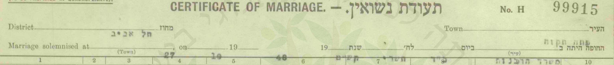](docs/igra/marriage_cert_H99915_petah_tikva_1948-10-27.jpg)

[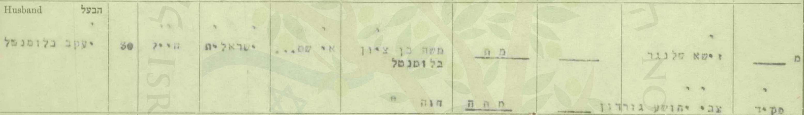](docs/igra/marriage_cert_H99915_petah_tikva_1948-10-27.jpg)

*תעודת נישואין H 99915, רבנות פתח תקווה, 27.10.1948. המקור: [ערך 1](#src-1).*

| שדה | קריאה | דירוג |
|---|---|---|
| מקום ותאריך | פתח תקווה, "משרד הרבנות"; 27.10.1948 — כ"ד תשרי תש"ט | מאומת |
| שם החתן | יעקב בלומנטל | מאומת |
| גיל | 30 — כלומר נולד ב-1917 או ב-1918 | מאומת כרישום |
| משלח יד | "חייל" | מאומת |
| מקום מגורים | "אי שם..." | מאומת |
| אביו | "משה בן ציון בלומנטל" — "מת" | מאומת |
| אמו | "חוה" — "מתה" | מאומת |
| העדים | זישא שלנגר; צבי יהושע גורדון, "פקיד" | מאומת |

### 3.2 מה התעודה אומרת על יעקב

שבאוקטובר 1948 היה **חייל**; שבמקום הכתובת נכתב "אי שם..." — בעוד שכתובת הכלה מפורטת; ושהוריו **כבר אינם בחיים**, כמו הוריה של הכלה. ההסבר ל"אי שם" — שירות צבאי שאין לנקוב במקומו — הוא פרשנות, לא ממצא; אבל ברשימת הנרשמים לנישואין ב"הצופה", 8.10.1948, כתובתו של יעקב — "עין גנים פ"ת", ו"אי שם" נכתב באותה רשימה בשורתו של חייל אחר ([4.3](#s4-3)).[[22]] מאיזו יחידה, ומתי גויס — לא ידוע; תיק השירות בארכיון צה"ל — [פרק 8](#s8).

על הכלה, מרים ליבוביץ — [המחקר עליה](../index.html#research-miriam-blumenthal).

## 4. נוגראדברצל — משפחת בלומנטל

### 4.1 משה בן ציון ("בנו") בלומנטל

ארבעה דפי עד ביד ושם על **משה בן ציון בלומנטל** מנוגראדברצל (Nógrádbercel), כפר במחוז נוגראד שבהונגריה:[[2]]

| דף | ממלא | קרבה | תאריך | לידה | הוריו | מקצוע | במלחמה ומותו |
|---|---|---|---|---|---|---|---|
| 1349233 | יצחק בלומנטל, פתח תקווה, שיכון עממי כפר אברהם 14 | בן | 4.6.1956 | 1892, נוגראדברצל | מאיר (Mór) ורבקה (Rebeka) | "מורה" (Tanító) | "אי שם בגרמניה" (Valahol Németország) |
| 310307 | יהודה בלומנטל, פתח תקווה | בן | 17.12.1956 | 1892, נוגראדברצל | מאיר וחוה | "איכר" | "גיארמת (גטו)"; אושוויץ, 1944 |
| 1804444 | מיכאל בלומנטל, שיכון בילינסון, פתח תקווה — באמצעות בתו | בן ("נכדה" — הממלאת) | 17.2.1995 | 1888, ברצל | מאיר ורבקה לבית ווזנר | "בעל אחוזה" | "הונגריה (ברצל) עד שלקחו ב-1944 מאי"; "אושוויץ, לא חזר" |
| 3609155 | חוה שרה דויטש-כהן, נתניה — "סבי, אב אמי" | נכדה | אב תשנ"ג (1993) | בן 51 | מור ורגינה לבית ווזנר | (בשדה — "עקרת בית") | אושוויץ, 1944 |

[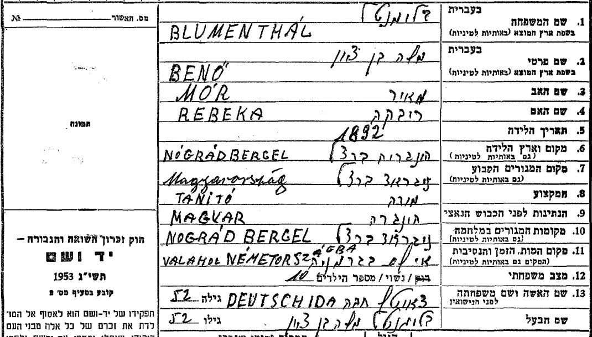](docs/yadvashem-pot/1349233_1.jpg)

*דף עד 1349233, מאת יצחק בלומנטל, בנו, פתח תקווה, 4.6.1956: «משה בן ציון / BENŐ · מאיר / MÓR · רבקה / REBEKA · 1892 · נוגראדברצל · מורה / TANÍTÓ · אי שם בגרמניה / VALAHOL NÉMETORSZÁGBA · נשוי / מספר הילדים: 10 · DEUTSCH IDA». המקור: [ערך 2](#src-2).*

הדפים חלוקים בשנת הלידה (1888 או 1892; "בן 51"), במקצוע (מורה, בעל אחוזה, איכר), בשם אמו (רבקה / רגינה / חוה) — ובמקום מותו: "אי שם בגרמניה" לפי יצחק (1956), אושוויץ לפי שלושת האחרים. הם מוצגים כאן כולם, בלי להכריע. מה שמשותף לכולם: **משה בן ציון בלומנטל, נוגראדברצל, נשוי לחוה (אידה) לבית דויטש, נספה בשואה** (1944 — בשלושה מן הדפים) — **מאומת** כעדות ילדיו ונכדתו. לפי שני דפים של יהודה, הוריו היו בזמן המלחמה ב"גיארמת (גטו)" — ככל הנראה באלאשאג'רמאט שבמחוז נוגראד.[[2]][[3]]

### 4.2 חוה (אידה) בלומנטל לבית דויטש

חמישה דפי עד, באשכול אחד ביד ושם:[[3]]

| דף | ממלא/ת | קרבה | לידה | הוריה | מותה |
|---|---|---|---|---|---|
| 1351282 | רבקה גומבו, פתח תקווה | בת | 1888, בורגנלנד, אוסטריה | יהודה ואסתר | אושוויץ |
| 1815364 | מיכאל בלומנטל, פתח תקווה (1995) | בן | 1885, פראואנקירכן, אוסטריה | יהודה דויטש ואסתר | "נלקחה ב-1944 למשרפות אושוויץ", מאי 1944 |
| 418389 | יהודה בלומנטל (1956) | בן | 1888, בורגנלנד, אוסטריה | יהודה ורגינה | "גיארמת (גטו)"; אושוויץ, 1944 |
| 421417 | יצחק בלומנטל (1956) | בן | 1890, Boldogasszony | יהודה (Gyula) ואסתר (Eszter) | אושוויץ |
| 3605706 | חוה שרה דויטש-כהן, נכדה | נכדה | בת 52; Boldogasszony (פראואנקירכן), בורגנלנד | גיולה ואנה | אושוויץ, 1944 |

[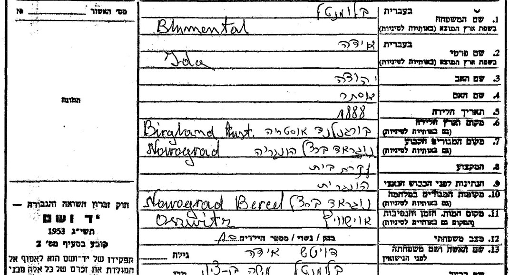](docs/yadvashem-pot/1351282_1.jpg)

*דף עד 1351282, מאת רבקה גומבו, בתה, פתח תקווה: «בלומנטל / Blumental · אידה / Ida · אב: יהודה · אם: אסתר · 1888 · בורגנלנד, אוסטריה · נוגראד ברצל, הונגריה · עקרת בית · אושוויץ · נשואה, 10 · דויטש אידה · בעלה: בלומנטל משה בן ציון». המקור: [ערך 3](#src-3).*

שנת הלידה — 1885, 1888, 1890, או "בת 52" במותה; שם אמה — אסתר (שלושה דפים), רגינה, אנה; שם אביה — יהודה, או גיולה (Gyula). מקום הולדתה — פראואנקירכן (Boldogasszony) שבבורגנלנד. בארבעה דפים (של יצחק על אביו, של רבקה, של יצחק עליה ושל הנכדה) — **עשרה ילדים**. — **מאומת** כעדות ילדיה ונכדתה.

### 4.3 הילדים שמילאו את הדפים — ופתח תקווה

מבין עשרת הילדים שבדפי העד (שנים-עשר נולדו, לפי ספר ארכיון מחוז נוגראד — [4.8](#s4-8)), ארבעה ידועים בשמם מתוך הדפים: **יצחק**, **מיכאל**, **יהודה** ו**רבקה** (גומבו); וחמישית — אמה של הנכדה חוה שרה דויטש-כהן ("סבי — אב אמי"), שאינה בשמה. העץ של "מ. בלומנטל" מונה עוד את **מאיר**, **ייטל (יהודית) לאה** ו**פירושקה-פירי (פייגה הינדל)**, ולצדה **יעקב כהן**; ובין הגיסות — **סימה לבית שרייבר**: לפי פנקס 1961, אשת יצחק הייתה סימה — ככל הנראה היא.[[13]][[4]] אחרי המלחמה — ב**פתח תקווה**:

- **יצחק בלומנטל**, יליד 1915, בן משה — בפנקס הבוחרים לכנסת, 1949, פתח תקווה, עין גנים 49;[[4]] ובפנקס 1961 — "כ[פר] אברהם, ש[יכון] עממי 14", אותה כתובת שבדף העד שמילא ב-1956, ולצדו **סימה**.[[4]] סימה — ילידת 1923 בפנקס 1961, אבל ב-1949, באותה כתובת בעין גנים 49, "סימה, בת אברהם, 1915" — אותה אישה, ככל הנראה, בשנות לידה שונות. ושנת 1915 של יצחק — בספר ארכיון מחוז נוגראד היא שנתו של **יוז'ף**, והספר מפנה את "יצחק" אל איגנץ (1919): מי מן הבנים הוא יצחק — **טעון אימות** ([4.8](#s4-8)).
- **יהודה** — חתם על דפיו "פ"ת", 1956.[[2]]
- **רבקה גומבו** — חתמה על דף העד של אמה "פ"ת"; התאריך — "24.7.5?", ככל הנראה 1957.[[3]]
- **מיכאל** — "שיכון בילינסון", פתח תקווה, 1995.[[2]] ואולי גם ב-1947: ב"לקרוב ולרחוק" — "בלומנטאל מיכאל" ברשימת עולי קפריסין שבמחנה עתלית (9.1.1947), ו"בלומנטאל איגנאץ־יאנו (מיכאל בלומנטאל) 4868" במדור לחיפוש קרובים בחיפה (6.2.1947): מיכאל בלומנטל מחפש את "איגנאץ־יאנו" בלומנטל — ושמות הקרובים "בסוגריים" הם שמות המבקשים.[[22]] "איגנאץ" — איגנץ (Ignác); "יאנו" — ינו (Jenő) או יאנוש (János): ברשימות האלה א' מסמנת גם a וגם e; ואולי אדם אחד בשני שמות. איגנץ (1919) — ואם "יאנו" הוא ינו, גם ינו (1922) — בני בנו ואידה בספר ארכיון נוגראד, והספר מזהה את מיכאל עם מיקלוש ([4.8](#s4-8)). שזה מיכאל שלהם, ושאת אחיו חיפש — **אפשר ש… (טעון אימות)**: שמות בלבד, בלי הורים, גיל או מקום.
- **יהודה — 1952:** ב"הצופה", 21.8.1952, ברשימת הנרשמים לנישואין במשרד הרבנות פתח תקווה: "יהודה בלומנטל בן משה בן ציון, רוק, פ"ת" — ועטרה קרינדל בת שלמה שלזינגר.[[22]] שזה יהודה של דפי העד — **כמעט ודאי**: גם בדף העד שמילא ב-1956 (310307) שם אביו "משה בן ציון"; אותו שם משפחה ואותה עיר. על יעקב — הרישום הזה אינו מוסיף דבר.
- **ויעקב עצמו — עין גנים, 1948:** ב"הצופה", 8.10.1948, תחת "נרשמו לנשואין אצל הרבנות הראשית בפתח תקווה": "יעקב בן משה בלומנטאל — עין גנים פ"ת" ו"מרים בת משה ליבוביץ — פתח־תקווה" (בפענוח: "עין _גגים").[[22]] שיעקב גר אז בעין גנים — **כמעט ודאי**; שגר אצל יצחק — **אפשר ש…**: עין גנים — שכונה, ובה גרו ב-1949 עוד בני בלומנטל (להלן).
- בעותק השני של פנקס 1949, באותו עמוד — "בלומנטאל הינדה, [בת] יהודה, 1920, עין גנים 49", ו"בלומנטאל תמר, [בת] חיים, 1923, עין גנים 2".[[4]] בעץ של "מ. בלומנטל" — שתי גיסות בשם הינדה ("הינדא לבית ברגמן", "הינדה אהובה לבית בלונדר");[[13]] הינדה מעין גנים 49 — ככל הנראה אשת אחד האחים; **טעון אימות**.
- דף העד שמילאה הנכדה חוה שרה דויטש-כהן רושם את שם משפחתה הקודם — "כהן"; ובעץ של "מ. בלומנטל" — "פירושקה-פירי (פייגה הינדל) כהן (Kohn)" ובעלה "יעקב Kohn-כהן":[[13]] ייתכן שפירושקה היא אמה של הנכדה — **טעון אימות**.

### 4.4 האם יעקב הוא בנם? — הדירוג

| נימוק | בעד | נגד / חסר |
|---|---|---|
| שמות ההורים | "משה בן ציון" ו"חוה" — זהים לתעודת הנישואין. במאגר השמות של יד ושם (26.10.2026; "בלומנטל" + "בן ציון", Blumental / Blumentahl + Ben Zion, Blumenthal + Bencion) — חמש רשומות, ארבע מהן הוא; החמישית, "Mosze Ben Cwi" מנאגיוואראד, נשוי לאחרת | המאגר מכיל רק נספי שואה: זוג באותם שמות שמת במקום אחר או לפני המלחמה — לא היה מופיע בו; לא נבדקו הכתיבים Benő, Benzion, בלומנטאל |
| ארץ המוצא | לפי המשפחה, יעקב ומרים — "מהונגריה";[[11]] נוגראדברצל — בהונגריה | העיר לא נמסרה |
| עדות הבן, 2026 | שמשון: שמו של יעקב בהונגריה — "jeno"; יצחק, מיכאל, יהודה ורבקה גומבו — "הם האחים שלו"; גבריאלה ופירי — "אחותו"[[24]] — שמות שבספר ארכיון נוגראד ([4.8](#s4-8)) | השאלה הציעה את השמות (איגנץ או ינו; גבריאלה, פירושקה, מרתה, ינו), ומרתה וינו — "לא מכיר"; העיר — "נצרף תעודת לידה", שטרם התקבלה |
| שם אביה של חוה | דפי העד: "יהודה", "יהודה (Gyula)"; העץ של "מ. בלומנטל": "Juda Julius Deutsch"[[13]] | — |
| שני ההורים מתים ב-1948 | מתיישב: נספו ב-1944 | — |
| המקום | ארבעה ילדים בפתח תקווה; יעקב נישא בפתח תקווה ובנו נולד בה | חלש: הכלה גרה בפתח תקווה, והחתונה הייתה, מן הסתם, בעירה |
| המגורים, 1948 | ברישום לנישואין, 8.10.1948 — "עין גנים פ"ת": השכונה שבה גר ב-1949 יצחק, בן משה (עין גנים 49)[[22]] | עין גנים — שכונה, לא כתובת; ובה עוד בני בלומנטל |
| משפחת הכלה | הוריה של מרים — כמעט ודאי מבאלאשאג'רמאט, עיר המחוז של נוגראדברצל; הם — בגטו שלה, לפי דף עד מ-1957; והורי החתן לכאורה — לפי דפי יהודה ([4.7](#s4-7)) | קשר גאוגרפי; אינו מזהה |
| שמות הנכדים | **מאיר** — לפי שמשון, "על שם מרצ'י, אח של מישהו";[[24]] אפשר ש… על שם מור, אחיו של יעקב (1921), שלא חזר מן הגירוש — Mór ומאיר — אולי צמד שמות — ואפשר ש… על שם מרטון, אחיה של מרים ("Marci" — כינוי של Márton); ואולי גם כשם סבו של יעקב, מור; **משה** — כשם משה בן ציון (וגם כשם אביה של מרים) | ספקולציה: שמות נפוצים |
| מספר הילדים | "10" בדפי העד — שנים-עשר שנולדו, פחות שניים שמתו בינקותם ([4.8](#s4-8)) | הספר מונה את כולם בשמם, ואין ביניהם "Jakab" — אבל יש ינו, ששמו של יעקב בהונגריה, לפי בנו ([4.11](#s4-11)) |
| עץ משפחה של קרוב | MyHeritage, "התאמה חכמה" מעץ "מ. בלומנטל מישראל": "מרים מגדה בלומנטל (לבית ליבוביץ)", 1925, הונגריה; בעלה יעקב בלומנטל; חמיה "משה בן ציון בלומנטל", חמותה "חוה (לבית Deutsch)"; גיסיה — מיכאל, יהודה, מאיר, רבקה גומבו, ייטל (יהודית) לאה, פירושקה (פייגה הינדל) כהן; ובין הגיסות — סימה לבית שרייבר[[13]] | עץ משתמשים, כנראה של צאצא של יעקב ומרים; מקורותיו לא ידועים — ייתכן שההורים צורפו בו לפי אותה התאמת שמות; אינו עדות בלתי תלויה |
| העיתונות ההונגרית | "Blumenthal Benő és neje Deutsch Ida, nógrádberceli lakosok" — 1926:[[14]] בני הזוג מדפי העד, באותו כפר, עשרים שנה קודם | אינה מזכירה ילדים |
| מסמך ארכיוני שמונה את יעקב בין הילדים | כרטיס עקור מ-1946: "Blumenthal Jenö", יליד ברצל, בן "Benö" ו-"Deutsch Ida" ([4.11](#s4-11)) | שהעקור הוא יעקב — ככל הנראה; ובשם "יעקב" — אין: אף דף עד אינו נוקב בו, ולא נמצאה רשומת לידה ([4.8](#s4-8)) |

**הדירוג: כמעט ודאי.** שמות ההורים זהים; האחים בפתח תקווה, ויעקב גר ב-1948 בעין גנים, השכונה שבה גר ב-1949 אחד מהם; הכלה — ממשפחה מעיר המחוז, באלאשאג'רמאט. ועכשיו — עדות בנו: שמו בהונגריה "ינו", ואחיו ואחיותיו — יצחק, מיכאל, יהודה, רבקה גומבו, גבריאלה ופירי;[[24]] ובספר ארכיון נוגראד — ינו (Jenő), יליד 1922, בנם של בנו ואידה, ששרד ([4.8](#s4-8)). לא "מאומת": אין עדיין מסמך שנוקב בשמו, והשאלות הציעו את השמות; ושהוא ינו דווקא — **ככל הנראה** ([4.8](#s4-8), [4.11](#s4-11)). ומה שעוד אינו מתיישב — הגיל: ינו של הספר נולד ב-1922, ויעקב "בן 30" בתעודת הנישואין, 1948 ([4.8](#s4-8)). מה שיכריע: תעודת הלידה שהמשפחה תצרף ([פרק 8](#s8)).

### 4.5 ברצל — בני בלומנטל נוספים

לפי רשימות מועמדי העלייה מהונגריה ב-1947 (הארכיון הציוני, S6/36831) ביקשו לעלות מברצל שישה בני בלומנטל: דוד (1907, איכר), סומה (1894, איכר), ינו (1914, טוחן), יוז'ף (1915, סוחר), מיקלוש (1920, איכר) ואיגנץ (1926) — אף אחד מהם אינו יעקב, ובאינדקס אין שמות הורים.[[5]] וב-JewishGen (26.10.2026, בחשבון מחובר) — 150 התאמות פונטיות ל"בלומנטל" + "ברצל"; אבל החיפוש הפונטי מערב שני כפרים: נוגראדברצל וטיסהברצל (Tiszabercel). רק מקצת השורות קשורות במפורש לנוגראד ("b. Berczel, Nograd"). ב-1868 נשא יעקב בלומנטל, "Groom resided in Berzel [Bercel?]" ("החתן גר בברזל [ברצל?]"), את לני **וושנר** (Wuszner) — שם קרוב לשם המשפחה של אמו של משה בן ציון ("ווזנר"); **טעון אימות**.[[12]] ועיתון בודפשטי פרסם ב-2.3.1947 את "רשימת שמותיהם של שלוש מאות יהודים מהונגריה שעוכבו בקפריסין" — ובה שישה בני בלומנטל "מברצל": שמואל, יצחק ("Jichak"), יוז'ף, גבריאלה, גיולה ומרדכי.[[14]] יעקב — אינו ברשימה. ועוד בני בלומנטל מברצל, ברשומות שאינן נוקבות בהורים:[[18]] כרטיס ג'וינט מווינה, 1956 — "BLUMENTHAL Mor", "Birth Date 20.5.03, Birth Place Bercel", פליט, "Country of destination USA" ("ארץ היעד: ארצות הברית") — יליד 1903, ולכן אינו בן של משה בן ציון; אבל שמו כשם אביו של משה בן ציון, מאיר (Mór) — אולי בן דוד (**טעון אימות**); "Blumenthal Ernő", יליד נוגראדברצל 1902, בן אמיליה וילהיים (Vilheim Emilia) — בתיק של התביעה העממית בבודפשט, 1946; "Deutsch Alajos", יליד נוגראדברצל 1855, בן רוזה בלומנטל — סוכן נדל"ן בבודפשט, 1902; ובמפתח MACSE לרישום האזרחי של ברצל — 56 לידות, 10 נישואין ו-7 פטירות בשם בלומנטל: המרשם שבו אמורות להיות רשומות לידות שנים-עשר הילדים — הרשומות עצמן פתוחות רק לחברי האגודה ([פרק 8](#s8)). כלומר: בברצל — כמה בני בלומנטל; השם לבדו אינו מזהה משפחה.

### 4.6 בנו בלומנטל בעיתונות ההונגרית, 1921–1931

בארכיון העיתונות ההונגרי (Arcanum) — **בנו (Benő) בלומנטל מנוגראדברצל** בשנות העשרים, כחקלאי ובעל אחוזה, ובצרותיו:[[14]]

- **1921:** "Blumenthal Benő nagyberceli birtokos úr" ("מר בנו בלומנטל, בעל אחוזה בנאג'ברצל"), במכתב שפרסם שבועון החקלאים ב-1925: החיטה המושבחת "נזרעה אחרונה, הבשילה ראשונה", ונתנה "9 קווינטל לחולד הונגרי, לעומת 7 קווינטל בזן הישן".
- **1922:** "Blumenthal Benő gazdasága, Nógrádbercel" ("משקו של בנו בלומנטל, נוגראדברצל") — מקטע חיפוש.
- **1925:** ברשימת בעלי האחוזות והחוכרים של 100 חולד ומעלה — "Blumenthal Benő" — מקטע חיפוש.
- **1926:** בעיתון הרשמי — שתי הוראות מכירה פומבית. הראשונה נגד "**Blumenthal Benő és neje Deutsch Ida, nógrádberceli lakosok**" ("בנו בלומנטל ואשתו אידה דויטש, תושבי נוגראדברצל"): על כרמים, על שתי "אחוזות אצולה" (nemesi birtok) ועל מגרש וגן; השנייה נגד "Blumenthal Benő" לבדו: על "בית, חצר וגן" בנוגראדברצל.
- **1930:** "חוכר קרקעות נידון לשלושה חודשי מאסר": בנו בלומנטל חכר ב-1924 "למחצה", עם ינו הופמן, "אחוזה גדולה במחוז נוגראד"; הופמן הגיש נגדו תלונה פלילית ("bűnvádi feljelentést tett") על "18 מיליון כתר" שלא נתן עליהם דין וחשבון, ובית הדין בבאלאשאג'רמאט גזר עליו, בעבירת מעילה, שלושה חודשי מאסר — ערכאת הערעור אישרה.
- **1931:** הוצאה לפועל של מוסד האשראי הקרקעי נגד "Blumenthal Benő berceli lakos", על "שדה ומרעה" הרשומים על שמו — מקטע חיפוש.

**מה זה מוכיח:** שבנו בלומנטל ואשתו **אידה דויטש** — בני הזוג מדפי העד — חיו בנוגראדברצל בשנות העשרים, כבעלי אחוזה וחוכרי קרקע — **מאומת** (העיתון הרשמי, 1926). הוא מתיישב עם "בעל אחוזה" שבדף העד של מיכאל ועם "איכר" שבדף של יהודה. שיעקב הוא בנם — לא נאמר כאן.

### 4.7 מאי–יוני 1944: הגטו בבאלאשאג'רמאט והגירוש

דפי העד שמילא יהודה בלומנטל רושמים את מקומם של ההורים בזמן המלחמה: "גיארמת (גטו)" — באלאשאג'רמאט, עיר המחוז ([4.1](#s4-1)).[[2]] על הגטו הזה מעידים שני פרוטוקולים שגבתה ב-1945–1946 הוועדה הלאומית לטיפול במגורשים (DEGOB) בבודפשט: של חבר המועצה היהודית בגטו, עורך דין יליד 1908 (פרוטוקול 3550), ושל שבע נשים מבאלאשאג'רמאט (פרוטוקול 3549).[[16]] לפיהם:

- **10 במאי 1944 — הגטו.** ליהודי העיר — "két és fél utca" ("שני רחובות וחצי"), וליהודי הכפרים — "jóformán egy háztömb" ("כמעט גוש בתים אחד"); "Május 10-én hozták be a falusi zsidóságot" ("ב-10 במאי הביאו את יהודי הכפרים").
- **סוף מאי — שירות העבודה.** "az összes egészséges 16-48 éves férfiakat elvitték munkaszolgálatra" ("את כל הגברים הבריאים בני 16 עד 48 לקחו לשירות עבודה"); בגטו נשארו ילדים, נשים, חולים וגברים מעל 48. משה בן ציון — אז בן 51, ולפי דף עד אחד (1888) בן 55 — היה בין הנשארים.
- **תחילת יוני — ניריֶשפוסטה (Nyírjespuszta).** לפי עדות הנשים — ב-4 ביוני ("Június 4-én kivittek bennünket Nyírjespusztára" — "ב-4 ביוני הוציאו אותנו לניריֶשפוסטה"). בלילה, "30 percen belül" ("תוך 30 דקות"), עם חבילה של 50 ק"ג — אל "két nagy dohánypajtában" ("בשתי סככות טבק גדולות"): 2,000–2,500 איש, כ-1,850 מגיארמת וכ-700–800 מן הסביבה.
- **10 ביוני — הרכבת.** "Egy transzporttal vittek el kb. 2800 embert, ebben benne voltak a balassagyarmatiak, a városi lakosság és a balassagyarmati járás zsidósága" ("ברכבת אחת לקחו כ-2,800 איש, ובהם אנשי באלאשאג'רמאט — תושבי העיר — ויהודי מחוז באלאשאג'רמאט"), כ-70 בקרון. בקאשה (קושיצה) קיבלו את הרכבת הגרמנים.
- **14 ביוני, עם שחר — בירקנאו.** "Június 14-én hajnalban érkeztünk meg Auschwitz-Birkenauba" ("ב-14 ביוני עם שחר הגענו לאושוויץ-בירקנאו"). הגברים הבריאים בני 16–60 הופרדו לעבודה; "a többieket ... azóta senki sem látta" ("את האחרים ... איש לא ראה מאז").

מוזיאון אושוויץ-בירקנאו, לפי רשימתו של מיקולאש גאשקו, מונה שתי רכבות מבאלאשאג'רמאט שעברו בקאשה: ב-12.6.1944, ובה 2,810 איש, וב-14.6.1944, ובה 1,867. רשימות שמות — אין: מגורשי הונגריה לא נרשמו במחנה, וכשלושה רבעים מהם נשלחו מן הרמפה ישר אל תאי הגזים.[[17]] הרכבת שתיארו העדים — כ-2,800 איש, יצאה ב-10 ביוני והגיעה ב-14 ביוני — היא ככל הנראה הראשונה, של 2,810. את השנייה מסביר, כנראה, אותו עד: "Losonc másik részét Illéspusztáról vitték ..., ahonnan az ipolysági gettó lakóit is vagonírozták" ("את שאר יהודי לושונץ לקחו מאילֶשפוסטה ..., משם הועמסו גם יושבי גטו איפוישאג").

**מה זה אומר על משה בן ציון וחוה:** אם היו בגטו באלאשאג'רמאט, כדברי בנם יהודה — הם יצאו ככל הנראה ברכבת של 10 ביוני 1944, והגיעו לבירקנאו ב-14 ביוני. **ככל הנראה** — הכרונולוגיה של הגטו שלהם, לא רשומה שלהם. משה בן ציון, בן 51 (או 55), היה בתוך טווח הגילים שהופרד לעבודה ("16-60"); זה מתיישב עם גרסתו של יצחק מ-1956, שאביו מת "אי שם בגרמניה", ולא באושוויץ — אפשרות בלבד, **טעון אימות**. במאגר הנספים של מוזיאון אושוויץ יש שורה אחת, "Blumenthal Jenö", יליד 17.7.1892 — בלי מקום לידה, מגורים, מספר או מקור.[[17]] Jenö אינו Benő — אבל השמות נבדלים באות אחת, והתאריך רחוק שלושה ימים בלבד מתאריך לידתו של בנו ברישום האזרחי, 20.7.1892 ([4.8](#s4-8)): אולי שיבוש של אותו אדם — **טעון אימות**. מאיזה מסמך נלקחה השורה — שאלה למוזיאון ([פרק 8](#s8)).

**ומשפחת הכלה:** הוריה של מרים — כמעט ודאי משה ופרומה (פני) ליבוביץ מבאלאשאג'רמאט, סנדלר ואשתו ([המחקר על מרים](../index.html#research-miriam-blumenthal)) — היו בגטו הזה: בדף העד שמילא עליה ב-1957 יצחק ליבוביץ — "בגטו בבאלאשאג'רמאט"; ובתם אסתר כתבה ב-1999 "גטו" — "NIRIEGE", ככל הנראה ניריֶש — ואושוויץ. הורי הכלה — באותו גטו: **כמעט ודאי**; הורי החתן — **כמעט ודאי**, כמו הזיהוי שלהם ([4.4](#s4-4)); ושיצאו באותה רכבת — **אפשר ש…**.

**ויעקב?** אם היה בהונגריה ב-1940–1944, בן 18–22, היה חייב בשירות עבודה, כמו כל הגברים היהודים בגילו; ובגטו עצמו נלקחו לשירות כל הגברים הבריאים בני 16–48. רשומה של יעקב משנות המלחמה — לא נמצאה, באף מאגר ([N-15](#s9-4)); אבל ב-1946 הוא עקור בגרמניה, כ"ינו בלומנטל" ([4.11](#s4-11)). ייתכן גם שלא היה בהונגריה כלל: "יעקב בלומנטל" אחד היה ב-1941 בקבוצת הנוער של שריד ([N-4](#s9-4)), ואחר שב ארצה ב-1938 ([N-14](#s9-4)) — אף אחד מהם אינו מזוהה איתו.

### 4.8 הרישום האזרחי וספר ארכיון נוגראד: הנישואין, ושנים-עשר הילדים

**הנישואין, 1912.** במאגר הנישואין האזרחיים של סלובקיה ב-JewishGen (ספר הנישואין של גלנטה, בארכיון הממלכתי בשאליה):[[20]] "BLUMENTHAL, Mózes / Benczion" — בן "BLUMENTHAL, Mór" ו"WOZNER, Regina", בן 19 — נשא את "DEUTSCH, Ida" — בת "DEUTSCH, Gyula" ו"BLUMENSCHEIN, Netti", בת 24 — ב-"23-Jan-1912" בגלנטה (Galánta): "Groom b. 20-Jul-1892, from Berczel (Nógrád m.). Bride b. 06-Nov-1887, from Boldogasszony [Frauenkirchen]" ("החתן נולד ב-20.7.1892, מברצל שבמחוז נוגראד; הכלה נולדה ב-6.11.1887, מבולדוגאסוני [פראואנקירכן]"); העדים — איזאק גנזל ומארק בלומנטל, שניהם מברצל.

[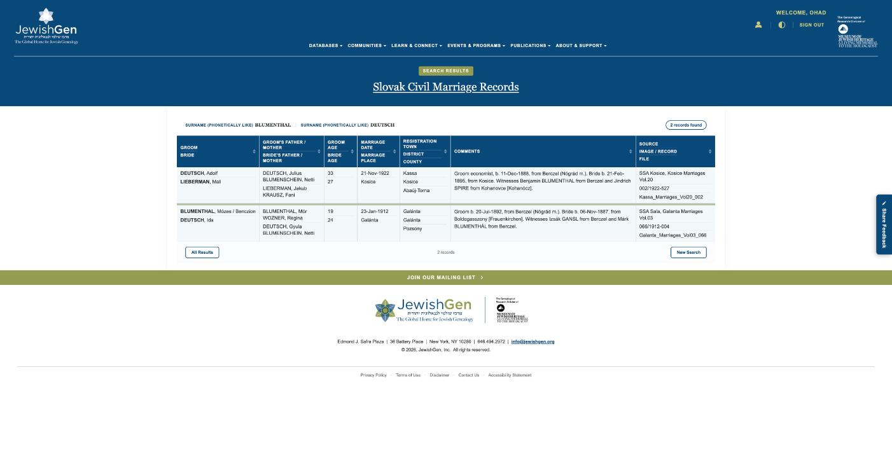](docs/census/img/jewishgen_SM_0012723_galanta_marriage_1912_blumenthal_deutsch.jpg)

*מאגר הנישואין האזרחיים של סלובקיה, JewishGen, SM_0012723. המקור: [ערך 20](#src-20).*

אלה משה בן ציון ("Mózes / Benczion") וחוה (אידה), בשמם ובשמות הוריהם — כמו בדפי העד ([4.1](#s4-1), [4.2](#s4-2)). באותם מאגרים: לידתה של אידה, 6.11.1887, בבולדוגאסוני, לגיולה (Julius) ולנטי לבית בלומנשיין; שני ילדים שמתו בינקותם בברצל — "BLUMENTHAL, Szerén", 12.5.1918, ו"BLUMENTHAL, Dezsö", 14.7.1928, "Benö // DEUTSCH Ida"; ומות הוריו של בנו בברצל ב-1920 — מור (6.6.1920, בן 67, בן יוז'ף ויוהנה לבית קליין) ורגינה לבית ווזנר (30.9.1920, בת מאיר ופאני לבית פליישמן). אלה שורות אינדקס; אבל ב-27.10.2026 נקראו הפנקסים עצמם — לידתה של אידה, מותם של סרנה ודז'ה ומותם של מור ורגינה — והשורות תואמות אותם. המסמכים — **מאומת**; שאלה הוריו וילדיו של בנו — **כמעט ודאי** ([4.10](#s4-10)). שורת הנישואין מגלנטה — עדיין אינדקס בלבד.

**שנים-עשר ילדים.** ספר המחקר של ארכיון מחוז נוגראד, Senkiföldjén (2006) — שנבנה על פנקסי הקהילה והרישום האזרחי, רישומי בית הספר ושאלוני 1945 — מונה את ילדי "Benő (Moshe Bentzion)" ואידה:[[21]]

| # | שם | שנה | לפי הספר |
|---|---|---|---|
| 1 | גבריאלה | 1912 | הבכורה; נישאה ב-1941 לינו קאופר; חזרה ב-1945 |
| 2 | יוז'ף | 1915 | חנות מכולת בברצל ובפלוטש; אשתו ובנם מתו; חזר מפולין בינואר 1945 |
| 3 | פירושקה | 1916 | שרדה; חזרה ב-1945; תופרת |
| 4 | סרנה | 1918 | מתה באותה שנה |
| 5 | **איגנץ** | **1919** | "További sorsát nem ismerjük ... (A háború után valószínűleg Izraelben telepedett le.)" ("גורלו לא ידוע ... [אחרי המלחמה, כנראה התיישב בישראל]") |
| 6 | מור | 1921 | לא חזר מן הגירוש |
| 7 | ינו (Jenő) | 1922 | שרד; חצה את הגבול ב-23.5.1945; סוחר |
| 8 | מרתה | 1923 | חזרה ב-1945; תופרת |
| 9 | גיולה | 1925 | חזר מן הגירוש |
| 10–11 | אילונה ומיקלוש, תאומים | 1926 | אילונה לא שרדה; מיקלוש חזר ב-1945 |
| 12 | דז'ה | 1928 | מת באותה שנה |

שנים-עשר נולדו, ועשרה היו בחיים ב-1944 — כמו "10" שבדפי העד. ובנו — "nem kevesebb, mint nyolc családtagjával együtt hurcolták el" ("גורש יחד עם לא פחות משמונה מבני משפחתו"). הספר מזהה את "מיכאל" שבדף העד (בספר: 1994; הדף עצמו — 17.2.1995) עם **מיקלוש**, ומפנה את "יצחק", שמילא דף ב-1956, אל **איגנץ** — הפניה בלבד, "vö. III. 1. 3. 5." ("השווה"), בלי נימוק. גיולה (1925) — אולי **יהודה**: Gyula ויהודה הם צמד שמות מקובל, וכך נרשם אבי אידה, "יהודה (Gyula)", בדף 421417 ([4.2](#s4-2)); אבל דפי העד של יהודה עצמו (310307, 418389) אינם נוקבים ב-Gyula — **טעון אימות**. ומור — כנראה **מאיר**, שבעץ המשפחה. הספר מקור משני, של ארכיונאים, ועל כן — **ככל הנראה**.

**יצחק — איגנץ, או יוז'ף?** בפנקסי הבוחרים, 1949 ו-1961, יצחק בלומנטל, בן משה, הוא יליד **1915** ([4.3](#s4-3))[[4]] — שנתו של **יוז'ף** בספר, לא של איגנץ. ושנות הלידה של הבנים סותרות גם במקורות אחרים: באינדקס מועמדי העלייה מ-1947 — "איגנץ" מברצל, יליד **1926**, ו"מיקלוש", יליד **1920** ([4.5](#s4-5));[[5]] בשתי רשימות ניצולים ב-JewishGen — "BLUMENTHAL, Miklós", ברצל, **1920** (באחת מהן — 27.11.1920);[[12]] ואילו בספר — איגנץ 1919, ומיקלוש 1926, אחיה התאום של אילונה. בברצל היו כמה משפחות בלומנטל ([4.5](#s4-5)), ולכן גם שורה בשם הנכון אינה בהכרח של בן של בנו ואידה. **"יצחק = איגנץ" — טעון אימות**; וכך גם שנת הלידה של איגנץ.

**ויעקב? אין "Jakab" ברשימה — אבל יש ינו.** בתעודת הנישואין, 27.10.1948, הוא בן 30 — יליד 1918 בערך; ולפי בנו, שמו בהונגריה היה ינו. האפשרויות — והמובילה היום היא ינו:
- **איגנץ** — לפי הספר יליד 1919, הבן היחיד שגורלו לא ידוע, "כנראה בישראל"; בן 29 באוקטובר 1948 — ההתאמה הטובה ביותר בגיל לתעודה; אבל בנו של יעקב, כשנשאל "איגנץ או ינו", בחר בינו. ובפברואר 1947 חיפש "מיכאל בלומנטל" — אולי אחיו מיקלוש — את "איגנאץ־יאנו בלומנטל" דרך המדור לחיפוש קרובים בחיפה ([4.3](#s4-3)); אפשר ש… (טעון אימות). אבל הספר מפנה אליו את "יצחק"; ואם הוא "Ignác, 1926" שבאינדקס העלייה — היה בן 22, ואינו יעקב. בעצורי קפריסין 1947 ([4.5](#s4-5)) רשומים גם יוז'ף וגם "Jichak" (יצחק) מברצל — אבל הרשימה כוללת את כל בני בלומנטל מברצל, מכל המשפחות, ולכן אינה מכריעה. אם יצחק הוא יוז'ף — איגנץ פנוי.
- **ינו, 1922** — לפי בנו של יעקב, זה שמו בהונגריה: "jeno".[[24]] ינו שרד, וחצה את הגבול ב-23.5.1945; וב-1946 — עקור בגרמניה, יליד 6.5.1922 ([4.11](#s4-11)); אבל ב-1948 היה בן 26, לא 30 — ואפשר ש… נתן גיל גבוה מגילו. ו"איגנאץ־יאנו" (Ignác-Jenő), שחיפש מיכאל ב-1947 — אפשר ש… הוא, בשם כפול ([4.3](#s4-3)).
- **יוז'ף, 1915** — בן 33 ב-1948; שנתו כשנת יצחק בפנקסים — ואולי הוא יצחק.
- **ילד שלא נרשם** — אפשרות חלשה, וכעת פחות סבירה: הספר מונה את סרנה (1918) כ"ילדתם הרביעית" ("negyedik gyermeke"), אחרי גבריאלה, יוז'ף ופירושקה; ו-"10" שבדפי העד שווה בדיוק לשנים-עשר פחות שניים שמתו בינקותם. הערת הספר על חסרים בפנקסים ("az anyakönyvek hiányai miatt" — "בגלל החסרים בפנקסים") נוגעת לילדי מור ורגינה, הדור הקודם — לא לילדי בנו ואידה. ובפנקס הפטירות: סרנה נולדה בינואר 1918 בערך — ולכן ילד שלא נרשם, בגילו של יעקב, אפשרי רק כתאום שלה או בסוף 1918 ([4.10](#s4-10)).
- **שיעקב אינו בנם** — כעת לא סביר: שמות הוריו בתעודה, משה בן ציון וחוה בלומנטל, הם שמם המלא של בנו ואידה, ו"Moshe Bentzion" — גם בספר.

**הדירוג: שיעקב הוא בנם של בנו ואידה — כמעט ודאי; ושהוא ינו — ככל הנראה, בגבול העליון**, לפי עדות בנו (שנשאל "איגנץ או ינו"), שמו של ינו ברשימת הספר, וכרטיסי העקור מ-1946 ([4.4](#s4-4), [4.11](#s4-11)). שנת הלידה — 1922 בספר, כ-1918 בתעודת הנישואין — לא הוכרעה; וגם לא אם "איגנאץ־יאנו" של 1947 הוא אדם אחד. מה שיכריע: תעודת הלידה שהמשפחה תצרף ([פרק 8](#s8)).

### 4.9 הדור שלפניהם: ברצל ופראואנקירכן

**הורי האם של אידה — וולף (וילהלם) וחני בלומנשיין.** אמה של אידה, לפי שורת הנישואין מ-1912 ושורת הלידה מ-1887 — נטי לבית בלומנשיין ([4.8](#s4-8)); בדפי העד — "אסתר", "רגינה" או "אנה" ([4.2](#s4-2)). ובמאגר הלידות של פראואנקירכן (Boldogasszony) — "BLUMSCHEIN, Netti", ילידת 7.3.1859, בת "Willhelm // Hani" (HB_0823944). ובמאגרי בורגנלנד ב-JewishGen:[[20]]
- **נישואי ההורים**, פראואנקירכן, 10.6.1852 (BM2_0000805): "Wolf BLUMENSCHEIN", 26 — בן "Moses Jakob BLUMENSCHEIN" ו-"Eva" — נשא את "Hanni WOLF", 25, בת "Josef WOLF"; "Groom and bride from Frauenkirchen" ("החתן והכלה מפראואנקירכן").
- **וולף, וילהלם, וילמוש — אדם אחד:** במרשם הלידות של פראואנקירכן, 1853–1864, האב של ילדי חני — "Wilhelm" ב-1853, ב-1855–1859 וב-1863, ו-"Wolf" ב-1860, ב-1861 וב-1864; ב-1882 נישאה פאני, אחותה של נטי (ילידת 24.5.1857, בת "Wilhelm // Hani"), ובשורת הנישואין — אביה "Wolf BLUMENSCHEIN" (BM2_0000999); ובשורת הפטירה של יוהנה, 2.7.1894, בת 74 — "widow, was married to Vilmos BLUMENSCHEIN, maiden name WOLF" ("אלמנה; הייתה נשואה לווילמוש בלומנשיין; שם נעוריה — וולף") (BD2_0002976). וולף עצמו מת ב-20.6.1881, בן 56 (BD2_0002425).
- **ילדיהם**, לפי המרשם: רגינה (1853), יוזף (1854), איגנץ (1855), פאני (1857), **נטי (7.3.1859)**, בת שמתה בלי שם (1860), איזק (1861), צצילייה (1863) ויוזף (1864).

[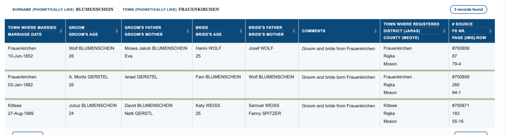](docs/census/img/jewishgen_BM2_0000805_frauenkirchen_1852_wolf_blumenschein_hanni_wolf_and_1882_fani_gerstel.png)

*מאגר הנישואין של בורגנלנד ב-JewishGen: BM2_0000805 (1852) ו-BM2_0000999 (1882). המקור: [ערך 20](#src-20).*

שוולף (וילהלם) וחני בלומנשיין הם הוריה של נטי, ומכאן סבה וסבתה של אידה — **כמעט ודאי**. שתי החוליות נקראו ב-27.10.2026 בפנקסים עצמם ([4.10](#s4-10)): לידתה של אידה, לנטי לבית בלומנשיין; ולידתה של נטי, ב-7.3.1859, לווילהלם ולחני; ולצדן — נישואי וולף וחני, 1852. ומה שנשען עדיין על הסקה: שווילהלם של 1859 הוא וולף של 1852 — לפי המרשם ושורת הפטירה של יוהנה; ושנטי של 1859 היא אמה של אידה — שם, עיירה ודור. ואי-התאמה אחת: יוהנה "בת 74" ב-1894 — ילידת 1820 בערך — אבל "25" בנישואיה, 1852 — ילידת 1827 בערך; בפנקסים האלה הגילים רופפים. והדור שלפני: "Eva BLUMSCHEIN", בת 83, נשואה, מתה ב-12.1.1870, ו-"Jakob BLUMSCHEIN", בן 90, אלמן, מת ב-1.10.1876 — אולי הוריו של וולף, משה יעקב וחוה; אין שורה שקושרת — **טעון אימות**.

**אבי האם — גיולה דויטש?** ב-1903 נבחר "Deutsch Gyula magánzó boldogasszonyi lakos" ("גיולה דויטש, מתפרנס מהונו, תושב בולדוגאסוני") להנהלת קופת החיסכון של העיירה, ובאותה הנהלה הוא רשום עד 1918; ב-1921 — "a lemondott Deutsch Gyula helyébe" ("במקום גיולה דויטש, שהתפטר").[[14]] אפשר ש… זה אביה של אידה — שם ועיירה בלבד, ומשפחת דויטש בפראואנקירכן גדולה; **טעון אימות**.

**ברצל: יוז'ף ומור.** שלוש ידיעות בעיתונות ההונגרית, מן הפענוח האוטומטי של Arcanum — הסריקות לא נראו:[[14]]
- **1870, יוז'ף:** בהודעה ב-"Budapesti Közlöny" (2.9.1870) — תביעה של "Berczelly Vilmos" נגד "Blumenthal József" על "700 frt és 150 frt haszonbér" ("700 ו-150 פורינט דמי חכירה"), ועיקול בברצל ב-11.11.1869 וב-15.3.1870 של 30 כבשים, 4 שוורים, סוסים ועגלה. יוז'ף בלומנטל, חוכר אדמה בברצל ב-1869–1870 — **ככל הנראה** אבי מור (שורת הפטירה, 1892: "Landowner" — "בעל אדמה"); שם ומקום בלבד.
- **1883, מור:** ברשימת סוחרי היין הבולטים של הונגריה ("Magyarország nevezetesebb borkereskedőinek név- és lakjegyzéke 1883-ban") — "Bérczel. (Nógrád megye.) Blumenthal Mór" ("ברצל, מחוז נוגראד: מור בלומנטל").
- **1892, מור:** במרשם החברות של בית המשפט בגיארמת (באלאשאג'רמאט), 1.6.1892: "Blumenthal Mór, vegyeskereskedő, Berczelen" ("מור בלומנטל, סוחר כל-בו, בברצל") — שבעה שבועות לפני שנולד בנו, בנו (20.7.1892).

מור בלומנטל, סוחר בברצל, ב-1883 וב-1892 — **ככל הנראה** (פענוח בלבד); ושהוא אביו של בנו — **כמעט ודאי** ([4.10](#s4-10)); ושסוחר העיתונות הוא אותו מור — **ככל הנראה**: גם בשורת הפטירה של אמו, יוהנה בלומנטל לבית קליין, ב-1903 — "Reported by son Mór BLUMENTHAL, merchant in Berczel" ("מסר: בנה, מור בלומנטל, סוחר בברצל") ([הטבלה](docs/census/jewishgen_nogradbercel_blumenthal_wosner_deaths_1828_2026-10-27.md)).

**ומה לא נמצא:** נישואי מור ורגינה; לידתו של מור; הוריו של יוז'ף; ומשפחתה של רגינה לבית ווזנר — מאיר ופאני לבית פליישמן — אף שורה מנוגראד ([N-19](#s9-4)).

### 4.10 הפנקסים עצמם: ברצל ובולדוגאסוני ב-FamilySearch

ב-27.10.2026 נקראו ב-FamilySearch, בדפדפן ובחשבון מחובר, הסריקות של שני פנקסים:[[23]] פנקס הפטירות האזרחי של ברצל, 1917–1932 (קבוצת תמונות 004838569, פריט 3), ופנקסי הקהילה היהודית של בולדוגאסוני — פראואנקירכן — 1835–1895, העתקים שנשמרו בארכיון הלאומי ההונגרי (קבוצת תמונות 004541945; פריט 1 הוא סרט 700859 של מאגרי JewishGen). כל שורת אינדקס שבדקנו — נמצאה בפנקס, ושדותיה תואמים.

| המסמך | מה כתוב בו | הסריקה |
|---|---|---|
| פטירות ברצל, 1920, רשומה 47 | נפטר 6.6.1920, 10 בערב: "Blumenthál Mór, földbirtokos, Berczel" ("מור בלומנטל, בעל אחוזה, ברצל"); "izr." ("יהודי"); בן 67; אשתו — "Wosner Regina"; הוריו — "néh. Blumenthál József", "néh. Klein Johanna" ("המנוח יוז'ף בלומנטל", "המנוחה יוהנה קליין"); סיבת המוות — "idült veselob" ("דלקת כליות כרונית"); מסר — "Gansl Mór" | [השורה](docs/familysearch/fs_bercel_deaths_1920_no47_blumenthal_mor_row.jpg) · [העמוד](docs/familysearch/fs_bercel_deaths_1920_no47_blumenthal_mor_page.jpg) · [הגיליון](docs/familysearch/fs_bercel_deaths_1920_dgs4838569_item3_img55_spread.jpg) |
| פטירות ברצל, 1920, רשומה 89 | נפטרה 30.9.1920, 7 בערב: "özv. Blumenthal Mórné Wosner Regina, Berczel" ("אלמנת מור בלומנטל, רגינה ווזנר, ברצל"); בת 64; בעלה — "néh. Blumenthal Mór"; הוריה — "néh. Wosner Mayer", "néh. Fleischman Fáni" ("המנוח מאיר ווזנר", "המנוחה פאני פליישמן"); "májrák" ("סרטן הכבד"); מסר — "Gansl Mór" | [השורה](docs/familysearch/fs_bercel_deaths_1920_no89_wosner_regina_row.jpg) · [הגיליון](docs/familysearch/fs_bercel_deaths_1920_dgs4838569_item3_img62_spread.jpg) |
| פטירות ברצל, 1918, רשומה 21 | נפטרה 12.5.1918: "Blumenthal Szeréna, Berczel", בת 4 חודשים; הוריה — "Blumenthal Benő", "Deutsch Ida"; "idült bélhurut" ("דלקת מעיים כרונית") | [השורה](docs/familysearch/fs_bercel_deaths_1918_no21_blumenthal_szerena_row.jpg) · [הגיליון](docs/familysearch/fs_bercel_deaths_1918_dgs4838569_item3_img22_spread.jpg) |
| פטירות ברצל, 1928, רשומה 41 | נפטר 14.7.1928: "Blumenthál Dezső, Berczel", בן 4 חודשים; הוריו — "Blumenthál Benő", "Deutsch Ida"; מסר — "Klein Jakab" | [השורה](docs/familysearch/fs_bercel_deaths_1928_no41_blumenthal_dezso_row.jpg) · [הגיליון](docs/familysearch/fs_bercel_deaths_1928_dgs4838569_item3_img172_spread.jpg) |
| לידות בולדוגאסוני, 1887, רשומה 26 | "Deutsch Ida", נולדה ב-6 בנובמבר 1887, בת, "törvényes" ("חוקית" — מנישואין); אביה — "Deutsch Julius, kereskedő, Boldogasszony" ("יוליוס דויטש, סוחר, בולדוגאסוני"); אמה — "Netti szül. Blumenschein, Boldogasszony" ("נטי לבית בלומנשיין, בולדוגאסוני") | [השורה](docs/familysearch/fs_boldogasszony_births_1887_no26_deutsch_ida_row.jpg) · [הגיליון](docs/familysearch/fs_boldogasszony_births_1887_dgs4541945_item2_img69_spread.jpg) |
| לידות פראואנקירכן, 1859, רשומה 9 | "Netti Blümschein" (?), נולדה 7 במרץ 1859, בת, מנישואין; אביה — "Wilhelm Blümschein" (?); אמה — "Hani"; שם המשפחה — קריאה לא ודאית, ככל הנראה "Blumschein", כמו במאגר; מגורי ההורים — פראואנקירכן | [השורה](docs/familysearch/fs_frauenkirchen_births_1859_no9_blumenschein_netti_row.jpg) · [ראש הגיליון](docs/familysearch/fs_frauenkirchen_births_1859_dgs4541945_item1_img120_header.jpg) |
| נישואי פראואנקירכן, 1852, רשומה 4 | "Verzeichniss sämtlicher in der Isr. Gemeinde zu Frauenkirchen vorgefallenen Trauungen vom 1. Jänner bis Ende Dec. 852" ("רשימת כל הנישואין שנערכו בקהילה היהודית בפראואנקירכן, מ-1 בינואר עד סוף דצמבר 1852"); 10 ביוני: החתן — "Wolf Blumenschein", "von hier" ("מכאן"), בן 26, רווק; הוריו — "Moyses Jakob" ו-"Eva", ושם המשפחה בשדה ההורים — "Blumschein" (?); הכלה — "Hani Wolf", מכאן, בת 25, רווקה; אביה — "Joseph Wolf"; מקצוע החתן, מקום החופה ושם הרב — כתב קורנט, קריאה חלקית | [החתן והכלה](docs/familysearch/fs_frauenkirchen_marriages_1852_no4_blumenschein_wolf_wolf_hani_left.jpg) · [התאריך](docs/familysearch/fs_frauenkirchen_marriages_1852_no4_date_right.jpg) |

*הסריקות נקראו ב-FamilySearch; שמורים צילומי המסך של הגיליונות ושל השורות. המקור: [ערך 23](#src-23).*

[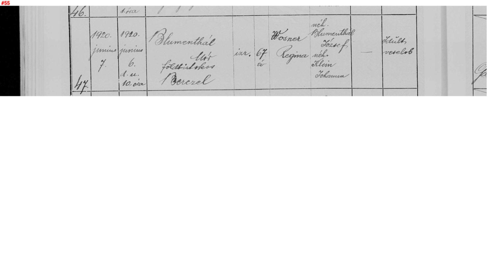](docs/familysearch/fs_bercel_deaths_1920_dgs4838569_item3_img55_spread.jpg)

*פנקס הפטירות האזרחי של ברצל, 1920, רשומה 47. המקור: [ערך 23](#src-23).*

[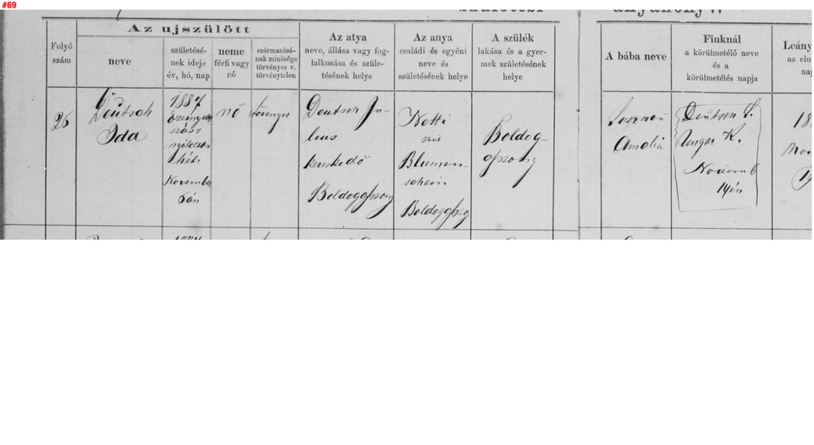](docs/familysearch/fs_boldogasszony_births_1887_dgs4541945_item2_img69_spread.jpg)

*פנקס הלידות של הקהילה היהודית בבולדוגאסוני, 1887, רשומה 26. המקור: [ערך 23](#src-23).*

**מה זה מוכיח:**
- **המסמכים — מאומת:** מור בלומנטל, בעל אחוזה בברצל, מת ב-6.6.1920 בן 67, בן יוז'ף ויוהנה לבית קליין; אשתו רגינה, בת מאיר ווזנר ופאני לבית פליישמן, מתה ב-30.9.1920 בת 64; לבנו ולאידה דויטש מתו בברצל בת, סרנה (1918), ובן, דז'ה (1928); אידה דויטש נולדה בבולדוגאסוני ב-6.11.1887 ליוליוס (גיולה) דויטש, סוחר, ולנטי לבית בלומנשיין; נטי בלומנשיין נולדה בפראואנקירכן ב-7.3.1859 לווילהלם ולחני; וב-10.6.1852 נישאו שם וולף בלומנשיין, בן משה יעקב וחוה, וחני וולף, בת יוסף.
- **שמור ורגינה הם הוריו של בנו — כמעט ודאי:** שורת הנישואין מ-1912 (אינדקס: "בן Mór ו-Regina Wozner") דף העד 3609155 של הנכדה, חוה שרה דויטש-כהן — במפורש "מור ורגינה לבית ווזנר"; ודף העד של מיכאל ("מאיר ורבקה לבית ווזנר" — מור הוא מאיר, ורגינה — רבקה, צמדי שמות מקובלים; [4.1](#s4-1)); ושני הפנקסים — אותו כפר, אותם שמות.
- **שאידה של בולדוגאסוני היא אשתו של בנו — כמעט ודאי:** שורת הנישואין (אינדקס) — תאריך הלידה, העיירה ושמות ההורים כמו בפנקס; ובדף העד 421417 — אביה "יהודה (Gyula)" ([4.2](#s4-2)).
- **אבי אידה — סוחר:** "Deutsch Julius, kereskedő" — ולא "magánzó" ("מתפרנס מהונו") של 1903; ייתכן ששניהם אדם אחד, שפרש ממסחרו — עדיין **אפשר ש…**.
- **"Gansl Mór"**, שמסר את שתי הפטירות ב-1920 — אולי ממשפחת גנזל מברצל, כמו "Isaak Gánzel", העד בנישואי 1912 ([4.8](#s4-8)); קרבה — לא ידועה.
- **ומה לא:** פנקס הלידות של ברצל ב-FamilySearch — רק 1915–1916, ולא נקרא; לידות 1917–1922, ובהן אולי יעקב, אינן בסריקות המקוונות. רישום פטירה מאוחר של בנו ואידה — לא נמצא במפתח של FamilySearch, ולא בעמודי הפטירות של ברצל ב-1945–1946; עמודי 1947 ואילך — דהויים, ולא נקראו ([N-20](#s9-4)).
- **וסרנה:** מתה ב-12.5.1918 "בת 4 חודשים" — נולדה, אפוא, בינואר 1918 בערך. יעקב, "בן 30" באוקטובר 1948, נולד בין אוקטובר 1917 לאוקטובר 1918 בערך; ילד של אידה בטווח הזה אפשרי רק כתאום של סרנה או בסוף 1918 — הסקה בלבד, וגיל בתעודה אינו מדויק ([4.8](#s4-8)).

### 4.11 1946: ינו בלומנטל, עקור בגרמניה — בדרך לארץ ישראל

בארכיון ארולסן שני כרטיסים מ-1946, ורשימה שנערכה אחר כך, שנמצאו ב-27.10.2026 בחיפוש "Blumenthal Jenő":[[25]]

| המסמך | מה כתוב בו | הסריקה |
|---|---|---|
| כרטיס רישום של עקור, "A.E.F. D.P. Registration Record" ("כרטיס רישום עקור של כוחות בעלות הברית"), עותק — 11.1.1946 | "Blumentahl Jenö"; זכר, רווק; אזרחות — "Hungarian" ("הונגרית"); נולד "6.5.22", ב"Bercel", "Hungary"; דת — "jude" ("יהודי"); שם האב — "Beny (?) Blumenthal", כנראה בנו; שם הנעורים של האם — "Schwarz Fele" (?) — לא "Deutsch Ida"; היעד המבוקש — "Palestine"; מקום המגורים הקבוע האחרון, או ב-1.1.1938 — "Bercel, Hungary"; מקצועו — "Molkereigehilfe" ("עוזר במחלבה"); שפות — הונגרית, גרמנית, יידיש; בהערות — "Zennern"; חותמת — "UNRRA Team 117, Centre Fritzlar" ("צוות אונר"א 117, מרכז פריצלר") | [הכרטיס](docs/arolsen/cni_blumenthal_jeno_1922/arolsen_125807711_01_front.jpg) |
| כרטיס רישום של עקור, עותק — 14.3.1946 | "Blumenthal Jenö" — ומתחת לשם, מחוק, שם פרטי אחר: "Jakab" או "Jakob" (?); נולד "6.5.1921", ב"Bercel — Hungary"; דת — "mosz." ("בן דת משה"); שם האב — "Benö"; שם הנעורים של האם — "Deutsch Ida"; מקום המגורים האחרון — "Bercel — Hungary"; מקצועו — קריאה חלקית; שפות — "ung., germ." ("הונגרית, גרמנית"); חתימה — "Blumenthal Jenö"; חותמת — "D.P. Camps Hohne" ("מחנות העקורים, הוהנה") | [הכרטיס](docs/arolsen/cni_blumenthal_jeno_1922/arolsen_125807710_01_front.jpg) |
| רשימת הזרים ששהו בכפר זנרן (Zennern), נפת פריצלר-הומברג שבהסן, "Ungarn (Juden)" ("הונגריה — יהודים"); נערכה ב-27.5.1948 (השנה — מתחת לחותמת; קריאה לא ודאית) | "Blumenthal — Jenö — 6.5.1922, Bercel (Berech)" (Berech — כתיב נוסף של ברצל); זכר; מקום המוצא — "unbekannt" ("לא ידוע"); שהה בכפר מ-14.1 עד 14.6.1946 | [העמוד](docs/arolsen/fritzlar_homberg_zennern_1946_blumenthal_jeno_1922/arolsen_70382196_01.jpg) |

[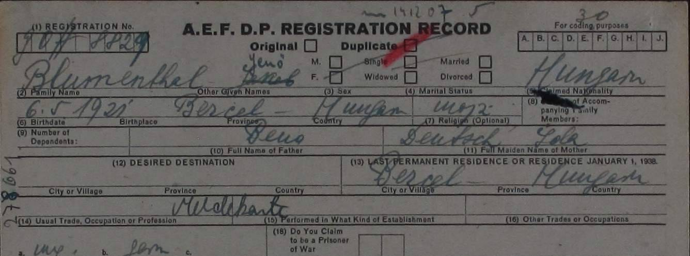](docs/arolsen/cni_blumenthal_jeno_1922/arolsen_125807710_01_front.jpg)

*כרטיס רישום של עקור, 14.3.1946. המקור: [ערך 25](#src-25).*

[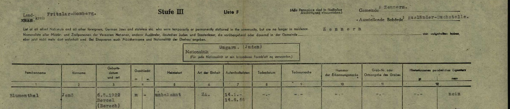](docs/arolsen/fritzlar_homberg_zennern_1946_blumenthal_jeno_1922/arolsen_70382196_01.jpg)

*רשימת הזרים ששהו בזנרן, הסן — ראש העמוד ושורתו של ינו. המקור: [ערך 25](#src-25).*

**מה זה מוכיח:**
- **המסמכים — מאומת:** ינו בלומנטל, יליד ברצל, 6.5.1922 (ובכרטיס אחד — 6.5.1921), יהודי, רווק, עוזר במחלבה, נרשם ב-1946 כעקור בגרמניה; שהה בכפר זנרן שבהסן, באזור הכיבוש האמריקני, מ-14.1 עד 14.6.1946, בטיפול צוות אונר"א 117 (פריצלר); ו"היעד המבוקש" — ארץ ישראל. הכרטיס של מרץ 1946 נושא חותמת של מחנות העקורים בהוהנה — באזור הבריטי; אולי נרשם גם שם, והסתירה לא הוכרעה.
- **ההורים — סתירה בין הכרטיסים:** בכרטיס של מרץ — האב "Benö" והאם "Deutsch Ida", כמו בספר ארכיון נוגראד ([4.8](#s4-8)); בכרטיס של ינואר — האב "Beny" (?) והאם "Schwarz Fele" (?). שינו של 1946 הוא בנם של בנו ואידה — **כמעט ודאי**: שם, כפר ושנת לידה כמו בספר, ושמות ההורים בכרטיס אחד מן השניים; "Schwarz Fele" — אולי טעות של הרושם; לא הוסבר.
- **שהוא יעקב — ככל הנראה, בגבול העליון:** לפי בנו, שמו של יעקב בהונגריה היה ינו ([4.4](#s4-4)) — אבל השאלה הציעה "איגנץ או ינו"; בכרטיס של מרץ נכתב תחילה שם פרטי אחר, ונמחק — **אפשר ש…** "Jakab" או "Jakob" (הקריאה קשה); ויעדו — ארץ ישראל, שבה נישא ב-1948. מה שיכריע: תעודת הלידה שהמשפחה תצרף, או תיק העולה.
- **שנת הלידה:** 6.5.1922 — **ככל הנראה** (כרטיס ינואר, רשימת זנרן וספר הארכיון); "1921" בכרטיס של מרץ, ו"בן 30" בתעודת הנישואין, 1948 — ככל הנראה שגויים.
- **ומה לא:** איפה היה ב-1944 — בגטו, במחנות או בשירות העבודה — לא נמצא; וגם לא איך הגיע מגרמניה ארצה, ומתי — בין יוני 1946 לאוקטובר 1948 ([פרק 8](#s8)). ו"ינו בלומנטל" אחרים, ילידי 1922, נשללו: אסיר בוכנוולד 35590 / 37590, יליד בודפשט, תושב גיור, בן רודולף ואילונה לבית קופפשטיין, שמת ב-9.2.1945 — וככל הנראה הוא גם "Jeno Blumenthal" מגיור שברשימות הנרצחים — ו"Jeno Blumenthal" מבודפשט שברשימות הנרצחים ([N-21](#s9-4)).

## 5. פתח תקווה — המשפחה

### 5.1 מאיר בלומנטל, 1952–1974

[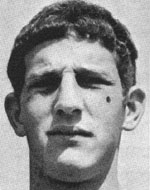](https://www.izkor.gov.il/%D7%9E%D7%90%D7%99%D7%A8%20%D7%91%D7%9C%D7%95%D7%9E%D7%A0%D7%98%D7%9C/en_03274e4633b3f8082d741b4b72ac7028)

*מאיר בלומנטל — מתוך דף ההנצחה באתר יזכור של משרד הביטחון. המקור: [ערך 6](#src-6).*

לפי דף ההנצחה באתר יזכור:[[6]] מאיר בלומנטל, חיל האוויר, "בן יעקב ומרים", נולד ב-ט"ז בניסן תשי"ב (**11.4.1952**) בפתח תקווה; למד בבית הספר היסודי "השומר" בבני ברק, בבית הספר המקצועי "מקס פיין" בתל אביב וב"עמל" בפתח תקווה; שיחק בקבוצת הנערים של הפועל פתח תקווה, בנבחרת גוש דן — ונבחר לקפטן בנסיעתה לחוץ לארץ — ובקבוצת הנוער בליגה הלאומית. גויס בנובמבר 1970 לחיל האוויר, נהג רכב כבד, ונשאר בצבא הקבע בדרגת **סמל**; השתתף במלחמת יום הכיפורים בסיני וברמת הגולן. נפטר בשירותו ב-ז' בכסלו תשל"ה, **21.11.1974**, ונקבר בבית העלמין הצבאי בקריית שאול (גוש 1, חלקה 9, שורה 5, קבר 19); "השאיר אחריו הורים, שני אחים ואחות"; "אחרי מותו הועלה לדרגת סמ"ר" — **סמל ראשון**. אחותו כתבה: "הספורט היווה את כל חייו... הוא התחיל את חייו במגרש הספורט, עסק בו רוב חייו ואף סיים בו את חייו".

"מעריב" למחרת:[[7]] "כדורגלן הפועל פתח תקוה ונבחרת הנוער בעבר, מאיר בלומנטל, צנח אתמול על פני הדשא בעת אימון קבוצתו — ומת. היה בן 22 וחצי. השאיר הורים, שני אחים ואחות... הועבר לבית החולים 'בילינסון' — שם נקבע מותו"; "בלומי — כפי שכונה — היה בחור צנוע וביישן"; ו"דבר": "לקה בהתקף לב". לפי "מעריב", שיחק בנבחרת הנוער כשזכתה בגביע אסיה בבנגקוק.

#### מאיר בעיתונות הספורט, 1971–1980

בעיתונות העברית (JPress) — עוד כשלושים ידיעות על מאיר, מימי הנוער ועד הגביע על שמו:[[15]]

- **1971:** "הצעירים ששולבו בשורותיהם, כמו מאיר בלומנטל ובוז'יקובסקי, הפגינו ניצוצות של כשרון" — האזכור המוקדם ביותר בקבוצה הבוגרת ("מעריב", 5.10.1971).
- **1972 — גביע אסיה לנוער, בנגקוק:** בטקס הפתיחה — "את הדגל נשא מאיר בלומנטל" ("מעריב", 16.4.1972); ובגמר, שבו ניצחה ישראל את דרום קוריאה 0:1, אמר המאמן: "הכנסתי למשחק את בלומנטל והוא שיחק כאילו השתתף בכל משחקי הטורניר" ("דבר", 7.5.1972).
- **1972–1974 — בצבא ובליגה:** בקבוצת פיקוד המרכז בגביע הרמטכ"ל, ואף כבש בו שער; בהפועל פתח תקווה — מגן, ופנדלים: בגביע המדינה (ינואר 1973) וב"דרבי" שנגמר 0:5 (דצמבר 1973); ובאפריל 1974 — נעדר מהאימון "(בשירות)".
- **22.11.1974:** "על המשמר": "בן ה-22, חייל בצבא קבע, הגיע לאימון והחל ריצה יחד עם חבריו... צנח לפתע, ובטרם חשו אליו נפטר. נראה כי לקה בשבץ-לב". "דבר", 24.11.1974: "קהל אלפים ליווה ביום ששי את הכדורגלן מאיר בלומנטל למנוחת עולמים. מסע ההלוויה יצא מפ"ת לבית העלמין בקרית שאול"; הספיד מזכיר הפועל פתח תקווה, אורי קרני. ושר החינוך, אהרן ידלין, שלח למשפחה מברק תנחומים.
- **26.11.1974:** "ביקרה משלחת של שחקני הפועל פ"ת אצל משפחתו של מאיר בלומנטל ז"ל".
- **הגביע על שמו:** בדצמבר 1974 — משחק הפועל פתח תקווה נגד אוגסבורג "על גביע לזכרו של שחקן הפועל פ"ת מאיר בלומנטל ז"ל"; ב-28.9.1975 — "בתום המשחק העניק **אביו של מאיר בלומנטל ז"ל** ל'קפטן' מכבי תל-אביב, צבי רוזן, גביע"; ב-1976 — גביע הילדים "לזכרו של מאיר בלומנטל"; וב-23.3.1980 — "העניקו **בני משפחתו** של מאיר בלומנטל ז"ל את הגביע הענק".

את הידיעות האלה מזהים שמו המלא, הקבוצה, נבחרת הנוער ונסיבות מותו — **מאומת** (כטקסט; תמונות העמודים חסומות). "אביו של מאיר" ב-1975 אינו נקרא בשמו — אבל, לפי דף ההנצחה, אביו של מאיר הוא יעקב.

**הזיהוי:** שמות ההורים (יעקב ומרים), העיר (פתח תקווה), שנת הלידה (1952 — בין הנישואין ב-1948 ללידת שמשון ב-1954), ומספר האחים (שני אחים ואחות — שמשון, משה ונאוה) — כולם מתיישבים עם כרטיס ההתאמה ועם עדות המשפחה. — **כמעט ודאי**. המצבה עצמה לא נראתה.

### 5.2 מודעות האבל, 1974–1977

ב"מעריב", 24.11.1974, בטור מודעות התנחומים — שלוש מודעות על מאיר:[[7]]

- "**יעקב בלומנטל** ... היקרים, אתכם באסונכם הכבד בהלקח מכם ... יקירכם, מאיר" — בחתימת "משפחות בייזר-גרובר". מודעה הפונה אל יעקב בשמו: באותם ימים — **בלומנטל**, ובחיים.
- "למשפחת בלומנטל ... במות עליכם בנכם היקר, האהוב על כולנו, מאיר בלומנטל ז"ל — **דיירי הבית, רחוב יהוד 2, פתח תקוה**".
- "לסג"מ בלומנטל ... אחיך ... משתתפים בצערך — מפקד החיל ופקודיו". השם הפרטי של סגן-המשנה, בפענוח המכונה של העיתון — "שומעון": אולי **שמשון**, אולי שמעון. תמונת העמוד חסומה (Cloudflare) — **טעון אימות**.

ושלוש מודעות אזכרה, חתומות "**המשפחה**":[[7]]

- **7.11.1975:** "במלאת שנה לפטירתו של בננו ואחינו היקר מאיר בלומנטל ז"ל ... אזכרה ... בחלקה הצבאית בבית העלמין בקרית שאול. אוטובוס יצא מביתנו ברח' **רוטשילד 160א'**, פתח תקוה".
- **26.11.1976** ו-**15.11.1977:** אזכרות ל"מאיר בלומנטל ז"ל", בקריית שאול.

### 5.3 שמשון

**שמשון**, נ' 26.1.1954 — מן העץ המשפחתי.[[8]] אם "סג"מ בלומנטל" מנובמבר 1974 הוא שמשון, היה אז קצין בן 20; חילו — "מפקד החיל" — אינו נקוב. — **טעון אימות**.

## 6. השם אחימאיר

**אחי-מאיר** — "אחיו של מאיר". לפי המשפחה: "השם משפחה שלהם הוא בלומנטל, אחימאיר זה על שם האח מאיר".[[11]] כלומר — השם הוא של האחים; שמשון רשום בעץ המשפחתי בשם אחימאיר, ובפרופיל ב-Geni — "שמשון אחי-מאיר".[[8]] **אם גם יעקב ומרים שינו את שמם — לא נמצא מסמך**: מודעות האזכרה 1975–1977 חתומות "המשפחה", ושמו של מאיר בהן הוא, מטבע הדברים, שמו בחייו — כך שהן אינן מלמדות דבר על מועד השינוי. **מתי הוחלף השם — לא ידוע**. ההודעה ב"ילקוט הפרסומים" — לא נמצאה ([N-6](#s9-4)).

שם זהה נשאו עשרות שנים קודם לכן **אבא אחימאיר** (גייסינוביץ') ומשפחתו, ובהם בנו, העיתונאי **יעקב אחימאיר**, יליד 1938; הם **אינם** המשפחה הזאת ([N-5](#s9-4)).

## 7. עץ המשפחה

שלושה דורות לפני שמשון, כפי שהם עולים מהמסמכים. קו ההורות בין משה בן ציון וחוה ליעקב — **ככל הנראה**; ארבעת הילדים בשמם — מדפי העד; הנכדים — מכרטיס ההתאמה ומאתר יזכור. ראו את [העץ](#tree).

## 8. פעולות פתוחות

| # | פעולה | למה | איפה |
|---|---|---|---|
| 1 | **תעודת הלידה של יעקב**, שהמשפחה תצרף; ו**לשאול את שמשון, משה ונאוה** (נענו בחלקן, 27.10.2026[[24]]): מי הוא "מרצ'י"? מתי עלה? מתי נפטרו יעקב ומרים — אחרי ספטמבר 1975 — ואיפה נקברו? מי שינה את השם, ומתי? | העיר ושנת הלידה — ההכרעה בזיהוי ([4.4](#s4-4)); תאריכי הפטירה; השם | המשפחה |
| 1א | **ינו בלומנטל, 1946**: תיק העקור שלו בארכיון ארולסן (תיקי ה-T/D ותיקי UNRRA), ורשימות העולים מגרמניה, 1946–1948 — אנייה, מחנה קפריסין או עלייה ב' | איך ומתי הגיע ארצה, ואם בשם ינו או יעקב ([4.11](#s4-11)) | ארכיון ארולסן — בקשה רשמית; ארכיון המדינה; IGRA |
| 2 | תיק השירות של יעקב בלומנטל בצה"ל, 1948 | יחידה, תאריך גיוס, ארץ לידה | ארכיון צה"ל ומערכת הביטחון |
| 3 | תיק עולה / תעודת זהות של יעקב בלומנטל | תאריך ומקום לידה, תאריך עלייה | ארכיון המדינה (משרד הפנים) |
| 4 | **פנקס הלידות של ברצל, 1915–1922** (Hungary Civil Registration, מחוז סיראק) | האם נולד לבנו ואידה בן בשם יעקב (Jakab), ומתי; ומי מבניהם הוא יעקב — איגנץ (1919)? ינו (1922)? ([4.8](#s4-8)) | FamilySearch — רק 1915–1916 בסריקות, ולא נקראו (נבדק 27.10.2026, [4.10](#s4-10)); 1917–1922 — ארכיון מחוז נוגראד; MACSE (חשבון חינמי) — במפתח 56 לידות בלומנטל בברצל |
| 4א | **שאלוני החוזרים והרכוש הנטוש של ברצל, 1945–1946** (ארכיון נוגראד, NML V. 202. 2) | מי מן הילדים חזר, ואיפה היה כל אחד — ואולי יעקב | ארכיון מחוז נוגראד |
| 5 | פטירה וקבורה תחת **בלומנטל**, אחרי 1974 | הפטירה — לא נמצאה בשום שם | בתי העלמין בפתח תקווה (סגולה, ירקון); BillionGraves |
| 6a | מנהל העץ "מ. בלומנטל" ב-MyHeritage | מאין לקח את הורי יעקב — זיכרון משפחתי או התאמת שמות | פנייה דרך MyHeritage, או דרך המשפחה |
| 6 | משפחות **בייזר-גרובר** (המודעה מ-1974), ו"Yacob Grouber" (6642) הרשום בנוטרים ב-1944 לצד "Yacov Blumenthal" (6694) | קרובים? חברים? — ואולי קשר בין יעקב שלנו לנוטר 6694 | ארכיון ההגנה; המשפחה |
| 7 | המצבה בקריית שאול (גוש 1, חלקה 9, שורה 5, קבר 19) | השם על המצבה ושמות ההורים | צילום במקום / BillionGraves |
| 8 | צאצאי יצחק, מיכאל, יהודה ורבקה גומבו | בני דודים של שמשון — האם יעקב מוכר להם כאח | המשפחה |
| 9 | "בלומנטל יעקב" בקבוצת הנוער של שריד, 1941 | האם הוא יעקב שלנו ([N-4](#s9-4)) | יד יערי (הקיבוץ הארצי) |
| 10 | עמוד "מעריב" 24.11.1974, עמ' 10 | השם "שומעון" — שמשון? | הספרייה הלאומית — בדפדפן |
| 11 | שירות העבודה (munkaszolgálat), 1940–1944 | האם יעקב היה בהונגריה בשנות המלחמה, ובאיזו פלוגה ([4.7](#s4-7)) | ארכיון ההיסטוריה הצבאית בבודפשט (HL); יד ושם; לשאול את שמשון |
| 12 | מוזיאון אושוויץ — מקור הרשומה 34610, "Blumenthal Jenö", 17.7.1892 | האם זה משה בן ציון — 17.7 מול 20.7.1892, ו-Jenö מול Benő: אולי שיבוש — ומאיזה מסמך ([4.7](#s4-7)) | ארכיון המוזיאון, בדוא"ל |
| 13 | ארכיון מחוז נוגראד: סניף באלאשאג'רמאט (מפתח EHRI hu-006079), ותיקי נציב הרכוש הנטוש בבאלאשאג'רמאט, 1945–1948 (hu-002761) | תיק בית המשפט מ-1930; תיק הרכוש של בנו בלומנטל — ומי מבני המשפחה תבע אותו אחרי המלחמה[[18]] | בקשה בכתב לארכיון |
| 14 | תיק העולה של **יצחק בלומנטל** (1915, פתח תקווה) | מי מן הבנים שבספר הוא — יוז'ף (1915) או איגנץ — ומכאן, אם איגנץ "פנוי" להיות יעקב ([4.8](#s4-8)) | ארכיון המדינה; צאצאיו |
| 15 | תיק הרבנות בפתח תקווה — הרישום לנישואין של יעקב ומרים, אוקטובר 1948 | ארץ ותאריך לידה, ואולי שמות ההורים בצורתם ההונגרית | ארכיון המדינה; הרבנות פתח תקווה |
| 16 | תיק 4868 של המדור לחיפוש קרובים בחיפה, 1947 — "בלומנטאל איגנאץ־יאנו", שחיפש "מיכאל בלומנטל" | מי חיפש את מי, ומאיפה — ואולי "איגנאץ־יאנו" הוא יעקב, ינו ([4.3](#s4-3), [4.8](#s4-8)) | הארכיון הציוני המרכזי (תיקי מחלקת העלייה) |
| 17 | **סרט FamilySearch 701094**, תמונה 342 — פטירת יוהנה בלומנשיין, 1894; ופטירות אווה (1870) ויעקב (1876) בפנקסי פראואנקירכן. *(נישואי 1852 ולידת נטי — נקראו ב-27.10.2026, [4.10](#s4-10))* | שיוהנה אלמנת וילמוש היא חני — ושמות הורי וולף, משה יעקב וחוה ([4.9](#s4-9)) | FamilySearch |
| 18 | נישואי מור ורגינה לבית ווזנר (שנות ה-70) | הוריה של רגינה, ומקומה — אולי דונאסרדאהיי (Dunaszerdahely), שבה נישאו בני בלומנטל מברצל ב-1868 וב-1881, ושם מרוכזות משפחות ווזנר ([4.9](#s4-9)) | ארכיון מחוז נוגראד (פנקסי הקהילה של ברצל ובאלאשאג'רמאט); MACSE — פטירת "Wosner", באלאשאג'רמאט |
| 19 | הסריקות ב-Arcanum: Budapesti Közlöny, 2.9.1870; Közgazdasági Értesítő, 18.10.1883; Központi Értesítő, 16.6.1892 ו-1.3.1903 | לאשר את הפענוח האוטומטי ([4.9](#s4-9)) | Arcanum — כשהחשבון פנוי |

## 9. שיטה ומגבלות

### 9.1 בסיס הראיות

מסמך ראשוני אחד על יעקב עצמו — תעודת הנישואין;[[1]] הרישום לנישואין ב"הצופה", 1948;[[22]] ומודעת אבל אחת, מ-1974, הפונה אליו בשמו.[[7]] על הוריו ומשפחתם — תשעה דפי עד, עדויות מאוחרות של ילדיהם ונכדתם;[[2]][[3]] שורות אינדקס מן הרישום האזרחי, וספר ארכיון מחוז נוגראד;[[20]][[21]] על הבן מאיר — דף ההנצחה הממלכתי ועיתונות בת-זמנה.[[6]][[7]] לא נמצאו: רשומת עלייה, תעודת לידה, תיק צבאי, רשומת פטירה או קבורה של יעקב.

### 9.2 סולם הוודאות

**מאומת** — המסמך אומר זאת במפורש; **כמעט ודאי** — כמה מסמכים מתיישבים ואין סתירה; **ככל הנראה** — ההתאמה טובה אבל חסר מסמך מקשר; **טעון אימות** — רמז בלבד; **נשלל** — נבדק ואינו הוא. מסמך מדורג לחוד, וזיהוי האדם שבו — לחוד.

### 9.3 מוסכמות הכתיב

בלומנטל · Blumenthal · Blumental · Blumentahl · Bliumental · בלומנטאל. בלומנשיין · Blumenschein · Blumschein. וולף · וילהלם · וילמוש · Wolf · Wilhelm · Vilmos. חני · יוהנה · Hanni · Hani · Hany · Johanna. יוז'ף · József. מור · Mór. גיולה · Gyula. אחימאיר · אחי-מאיר · Achimeir · Ahimeir. נוגראדברצל · Nógrádbercel · Nograd Bercel · ברצל. משה בן ציון · Benő · Mosh Ben Zion. חוה · אידה · Ida · Chawa. ווזנר · Wozner · Vozner · Wosner · Wuszner. גיארמת · Balassagyarmat · Gyarmat. עין גנים · Ein Ganim. איגנץ · Ignác · איגנאץ; ינו · Jenő; "יאנו" (בפענוח, 1947) — ינו (Jenő) או יאנוש (János); מיקלוש · Miklós.

### 9.4 ממצאים שליליים

| # | שאלה | מקור וכיסוי | תוצאה | דירוג |
|---|---|---|---|---|
| N-1 | דף עד שמילא יעקב על הוריו | יד ושם, ממלא Blumenthal / Blumental / בלומנטל + Yaakov / Yakov / Jakob / יעקב, וממלא אחימאיר / Achimeir / Ahimeir — 26.10.2026 | אין; תשעת הדפים על משה בן ציון וחוה — מיצחק, מיכאל, יהודה, רבקה ונכדה | **ככל הנראה** — לא מילא |
| N-2 | יעקב בלומנטל בעלייה מהונגריה | IGRA, Blumenthal + Hungary — 38 שורות, כולן נקראו | אין יעקב / Jakab; שישה מברצל, אף אחד אינו יעקב | **ככל הנראה** — האינדקס חלקי |
| N-3 | יעקב בלומנטל בנוטרים, 1936–1944 | IGRA, 19 שורות; לפחות חמישה אנשים לפי מספר אישי (A1998, R400, 4390, 7858, 6694) | בדפים אין שנת לידה, מקום או אב — רק תאריכי גיוס; לא ניתן לזהות. ב-1944 רשום לצד 6694 "Yacob Grouber" (6642) — וב-1974 מנחמות "משפחות בייזר-גרובר" את יעקב | **טעון אימות** |
| N-4 | שריד, 1941 | מפקד הקיבוץ הארצי, שריד, שורה 11 — "בלומנטל יעקב" בקבוצת נוער | שנת הלידה בעמודה מסומנת בגרשיים; לא ברור | **טעון אימות** |
| N-5 | "יעקב אחימאיר" בארכיונים ובעיתונות | IGRA, ארכיון המדינה, JPress, Geni | כולם של משפחת אבא אחימאיר (ובהם בנו העיתונאי, יליד 1938) | **נשלל** |
| N-6 | ההודעה על שינוי השם | IGRA, "Name Changes after 1948" — 39 שורות "Blumenthal", ו"אחימאיר" / "אחי מאיר" | אין; המאגר מסתיים בערך ב-1977–1979 | אינו שלילה — מחוץ לכיסוי |
| N-7 | יעקב ומרים בפנקסי הבוחרים | IGRA, 1949 — פתח תקווה ואחרים; 1961 — שש שורות "בלומנטל" בכל המאגר (פתח תקווה, כפר המכבי) | יעקב אינו בפנקס 1949 של פתח תקווה; 1961 — לא נמצאו; מאגר 1961 מכסה רק חלק מהיישובים | אינו שלילה |
| N-8 | פטירה וקבורה של יעקב ומרים | JPress, מודעות: "יעקב בלומנטל" מדצמבר 1974 — אפס; "מרים בלומנטל" — אחת, של אחרת (אלמנת מאיר בלומנטל, ירושלים, 1977); "מרים אחימאיר", "יעקב אחימאיר" + פטירה — אפס; JOWBR: Achimeir / Ahimeir — אפס | לא נמצאו | אינו שלילה — JOWBR ובתי העלמין בפתח תקווה לא נבדקו בשם בלומנטל |
| N-9 | הפרופיל ב-Geni | חיפוש פומבי: "אחי-מאיר" — 0; "Achimeir" — 6, כולם משפחת אבא אחימאיר; "Meir Blumenthal" — 5, אף אחד אינו מאיר שלנו | הפרופילים, ככל הנראה, פרטיים | — |
| N-10 | יעקב בלומנטל, 1949, בדפנה ובקריית טבעון; 1936 תל אביב; 1942 נהלל | IGRA | ילידי 1908, 1914, ואחרים | **נשלל** — הגיל |
| N-11 | יעקב בלומנטל בהונגריה, ב-JewishGen | "בלומנטל" + "ברצל", כל המאגרים — 150 התאמות ב-18 מאגרים; נקראו מאגרי הלידות, הנישואין, הפטירות ושלושה מאגרי ניצולים (26.10.2026) | אין יעקב יליד 1917/18; ילדי משה בן ציון וחוה — רק שניים שמתו בינקותם, סרנה (1918) ודז'ה (1928), כפי שנמצא ב-27.10 ([4.8](#s4-8)) — במהדורות 1–4 נכתב בטעות שאין בהם אף אחד; החיפוש הפונטי מערב גם את טיסהברצל | אינו שלילה — כיסוי הלידות בעיקר במאה ה-19 |
| N-12 | יעקב בלומנטל בעיתונות ההונגרית | Arcanum: "Blumenthal Jakab" 1930–1949 — 5; "Blumenthal" + "Nógrádbercel" 1935–1949 — 3; "Blumenthal" + "Bercel" 1900–1947 — 52 (נקראו המקטעים) | אין יעקב מברצל | אינו שלילה — ייתכן שנרשם בשם אחר (Jenő, Jakab, Jakob) |
| N-13 | מודעת אבל משפחתית על מאיר, ושינוי השם, בעיתונות | JPress: "בלומנטל" במודעות 21–25.11.1974; "שמשון אחימאיר", "שמשון בלומנטל", "אחימאיר" + "שינוי שם", "מרים ליבוביץ" + "בלומנטל", "יעקב בלומנטל" 1948 ו-1974–2005, "רבקה גומבו" — 27.10.2026 | אין מודעה של המשפחה עצמה; אין הודעה על שינוי השם; "שמשון בלומנטל" מהוד השרון (1973) ו"יעקב בלומנטל" מיהוד (1980) — אחרים | אינו שלילה — כיסוי JPress אחרי 1990 דליל |
| N-14 | "בלומנטל יעקב" ברשימות העולים, 1938 | Pinpoint, רשימות העולים של לשכת העלייה בחיפה, 1938; וכל המאגר: "Blumenthal Jakab/Jacob/Jakob/Yaakov", "בלומנטאל יעקב" — 0[[19]] | שורה אחת: "בלומנטל יעקב", בן 24, בפרק "חוזרים" (תושב הארץ השב מחו"ל), האונייה "טרנסלבניה", 21.11.1938 | **ככל הנראה אחר** — יליד 1914 בערך; יעקב שלנו — בן 30 ב-1948 |
| N-15 | יעקב בשנות המלחמה | ארולסן — "Blumenthal Jakab", פונטי, 53 שורות; מוזיאון אושוויץ — 33 "Blumenthal" וכתיביו; למחרוזות המדויקות "Blumenthal Jakab / Jenő / Jakob / Moses" — 0 (ובסריקת "Blumenthal" — "Blumenthal Jenö", 17.7.1892: [N-16](#s9-4)); ובחיפוש חוזר בארולסן, 27.10.2026 — כרטיסי העקור של "Blumenthal Jenö", 1946 ([4.11](#s4-11)); ג'וינט — Jakab / Jacob / Jakob / Yaakov / Jenő / Jankel, מדויק — 0; DEGOB — "Nógrádbercel" 0, "Bercel" ו"Blumenthal" — 2 שגויים; Pinpoint — 0; 27.10.2026 | אין רשומה מנוגראד או מברצל | אינו שלילה — רשימות שירות העבודה ההונגריות אינן מאגר מקוון |
| N-16 | משה בן ציון וחוה ברשומות המחנות | ארולסן, מוזיאון אושוויץ, ג'וינט — Benő / Bencion / Ida / Deutsch Ida; 27.10.2026 | שורה אחת לא מזוהה: "Blumenthal Jenö", 17.7.1892 — שלושה ימים מתאריך לידתו של בנו ברישום האזרחי (20.7.1892), והשם נבדל באות אחת: אולי שיבוש — טעון אימות ([4.7](#s4-7)) | אינו שלילה — מגורשי הונגריה לא נרשמו באושוויץ |
| N-17 | מפקדים ומרשמים — ברצל ובולדוגאסוני | JewishGen: מפקד 1828 — בברצל ארבעה בלומנטל, "Moises", "Philippus", "Sany" ו"Gaspar"; מפקד 1848 — מוסון כן, נוגראד אינו במאגר; 1857 ו-1869 — נוגראד ומוסון אינם; פטירות ברצל 1890–1948 — יש; לידות ונישואין בברצל אחרי 1895 — אינם; Hungaricana — גיליונות מפקד 1921 רק לקרפטורוס; 27.10.2026 | אין רשומה של יעקב; נמצאו נישואי ההורים, לידת אידה, פטירות הסבים ושני ילדים ([4.8](#s4-8)) | אינו שלילה — לידות ברצל 1915–1922 אינן במאגר |
| N-18 | יעקב ואחיו בעיתונות, 1944–1952 | JPress: 267 חיפושים — גם בכינויי האב ("בן משה בלומנטאל", "בן משה בן ציון"), בשמות האחים, וב-84 מדורי "לקרוב ולרחוק", ובהם רשימות קפריסין ועתלית, 28.6.1945 – 17.9.1947; 27.10.2026 ([היומן](docs/jpress/jpress_NEGATIVES_sweep_miriam-and-yaakov_1944-1952_2026-10-27.md)) | נמצאו: הרישום לנישואין (1948), יהודה (1952) ומיכאל (1947) ([4.3](#s4-3)); לא נמצאו: יעקב ברשימות האניות, קפריסין ועתלית; פריט שנוקב בנוגראדברצל | **ככל הנראה** — כיסוי חלקי: "יעקב בלומנטל" נפוץ, והפענוח קוטע ומשבש שמות; את הרישום מ-1948 לא מצא החיפוש "יעקב בלומנטל" ([N-13](#s9-4)), כי בין השם לשם המשפחה מודפס "בן משה" |
| N-19 | הדור שלפני — מור ורגינה, יוז'ף, משפחת ווזנר, דויטש ובלומנשיין | JewishGen: נישואין בהונגריה — כל 98 שורות בלומנטל; Wosner ו-Wozner בלידות (289), בנישואין ובפטירות — מסוננים לנוגראד; לידות סצ'ני (1852–1867) ובאלאשאג'רמאט; פטירות בורגנלנד II — דויטש ובלומנשיין, פראואנקירכן; מפקד 1848, בולדוגאסוני; JGFF — תשעה צמדי שם ועיירה; יד ושם — Wosner / Wozner עם ברצל ובאלאשאג'רמאט, Blumenschein עם פראואנקירכן; Arcanum — מודעות פטירה של מור ורגינה; 27.10.2026 ([יומן החיפוש](docs/census/yaakov_ancestors_sweep_2026-10-27.md)) | נמצאו: הורי נטי ושלוש הידיעות ([4.9](#s4-9)). לא נמצאו: נישואי מור ורגינה (שני חתנים בלומנטל מברצל בלבד — יעקב, 1868, ומוזס, 1881, שניהם בדונאסרדאהיי); שורת ווזנר מנוגראד; רגינה ילידת 1852–1860; לידות ילדי יוז'ף או מור; פטירת נתן דויטש; משק בית בלומנשיין במפקד 1848; מודעת פטירה של מור או רגינה. ונשללו: "Mojer" בלומנטל, 15.11.1853 — בן שמעון ויולי וייס, יליד בושה; ו-"Zsanka", אלמנה, 80, 1894 — אינה יכולה להיות אם יוז'ף, שמת ב-1892 בן 62 | אינו שלילה — פנקסי ברצל שלפני 1895 אינם במאגרים |
| N-20 | לידות ברצל, 1917–1922, ורישום פטירה מאוחר של בנו ואידה | FamilySearch, "Explore Images" ("עיון בתמונות"), ברצל (Nógrád): לידות — רק 1915–1916 בסריקות, ולא נקראו; פטירות 1917–1932 — נקראו העמודים של מאי 1918, מאי–אוקטובר 1920 ויולי 1928; מפתח הרישום האזרחי — "Blumenth*", פטירות 1944–1945; פטירות ברצל 1945–1946 — נקראו בשמות; 1947 ואילך — דהויים, ולא נקראו; 27.10.2026 ([4.10](#s4-10)) | לידות 1917–1922 — אינן בסריקות; רישום פטירה של בנו או של אידה — לא במפתח, ולא בעמודים שנקראו | אינו שלילה — הרישום המאוחר אולי במקום אחר, ועמודי 1947–1953 לא נקראו |
| N-21 | "ינו בלומנטל" אחרים, ילידי 1922 | ארולסן, "Blumenthal Jenö" ו-"Blumenthal Eugen" — 22 שורות; יד ושם, "Jeno Blumenthal" — 12; ג'וינט — "Blumenthal Jeno" ו-"Jenő", לא מדויק — 30, כולן אחרות; 27.10.2026 | נשללו: אסיר בוכנוולד 35590 / 37590 (שני המספרים על כריכת התיק), יליד בודפשט 25.5.1922, תושב גיור, בן רודולף ואילונה לבית קופפשטיין, מת ב-9.2.1945 ([התיק](docs/arolsen/EXCLUDED_buchenwald_37590_blumenthal_jeno_1922_gyor/arolsen_5559980_01_front.jpg)); "Jeno Blumenthal", 1922, מגיור — ברשימות הנרצחים ובדף עד, ככל הנראה אותו אדם — ו"Jeno Blumenthal", 1922, מבודפשט, ברשימות הנרצחים; "Jenő Blumenthal", 1892, סוחר בבודפשט, ששרד; ו"Jeno Blumenthal" מבודפשט, בן הלן, בכרטסת DEGOB | שלילה — אף אחד מהם אינו יליד ברצל |

### 9.5 חסמים

הספרייה הלאומית (JPress) — תמונות העמודים נעולות באתר (זכויות יוצרים: סימן מנעול במקום הסריקה), והאתר עצמו מאחורי אתגר Cloudflare; לא נעקף. הטקסט נקרא מן הפענוח האוטומטי בלבד. Hungaricana — פורטל הארכיונים (archives) מכיל רק סדרות של ארכיון העיר בודפשט; תיקי מחוז נוגראד אינם בו — פער כיסוי, לא שלילה. ספר ארכיון מחוז נוגראד נקרא בפורטל הספרייה (library) ([4.8](#s4-8)). MACSE ו-RadixIndex — הרשומות עצמן פתוחות רק לחברים. Arcanum — תמונות העמודים חסומות ברשת ההפצה (403), וב-27.10.2026 גם בהודעה "החשבון בשימוש במכשיר אחר"; לא נעקף, ולא נותק אף משתמש — נשמר הפענוח האוטומטי, וכך גם לידיעות ב-[4.9](#s4-9). JewishGen — נקרא בדפדפן, בחשבון מחובר, 26–27.10.2026 ([4.5](#s4-5)); דפי הפירוט בממשק האוטומטי מחזירים אפס. מאגרי הלידות ההונגריים שם מכסים בעיקר את המאה ה-19 — לידת יעקב (1917/18) אינה בהם. FamilySearch — אין אסימון לממשק האוטומטי; ב-27.10.2026 נקראו הסריקות בדפדפן, בחשבון מחובר ([4.10](#s4-10)); סרט 701094 — לא נבדק. ארכיון צה"ל — אין מאגר מקוון שמי.

### 9.6 מה הדף אינו עושה

אינו קובע שיעקב נולד בנוגראדברצל — רק שזה הכיוון הסביר ביותר, ומה חסר כדי להוכיח. אינו קובע שיעקב שינה את שמו לאחימאיר. אינו מסתמך על עץ MyHeritage כראיה — רק כנקודת מוצא. לבקשת המשפחה, הדף כולל גם את בני המשפחה החיים.

